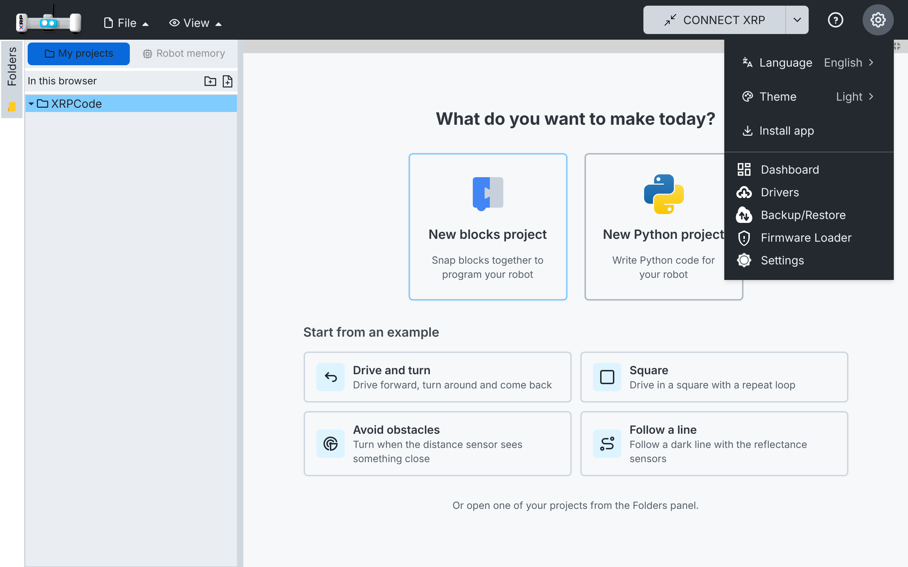
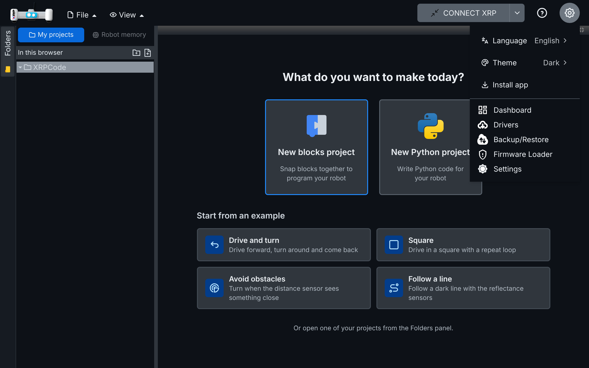

# 001 — Offline and installable app

The app works without internet and installs like an app. Three parts: the offline build, a lighter first load, and the installable (PWA) app.

## Part 1 — Offline build

### Problem

XRPWeb is used in classrooms where internet access is unreliable or blocked. Several features reach
the network even when they are not used:

- The Google Identity script and the Google client ID request load on startup.
- Connection telemetry is sent to a WPI server every time an XRP connects.
- The AI chat depends on a backend service.
- Blockly loads its sounds and cursors from `blockly-demo.appspot.com`.
- Help links point to online documentation with no indication that they need internet.

### Solution

A build flag, `VITE_OFFLINE=true`, produces a build that makes no external requests. Online code
paths stay in place and are skipped when the flag is on.

- `npm run dev:offline` and `npm run build:offline` load `.env.offline`.
- With the flag:
  - The Google Identity provider and client ID request are skipped, and so is the Google Auth
    handshake.
  - The AI chat menu is hidden, even with `?aibuddy=1`.
  - Connection telemetry is not sent.
  - Driver installation is allowed (it was blocked while signed in to Google).
  - Offline-only translation overrides mark Help links as "(online)" (`offline.json`).
  - My projects is used (see [File management](004-file-management.md)); its wording overrides live in
    `local-projects.json`.
- In every build (not only offline), Blockly media is served from the app
  (`node_modules/blockly/media`) instead of `blockly-demo.appspot.com`.

### Files

- New: `src/utils/offline.ts` (`isOfflineBuild`), `.env.offline`,
  `src/utils/i18n/locales/{en,es}/offline.json`.
- Hooks: `src/main.tsx`, `src/utils/aiBuddyAccess.ts`, `src/managers/connectionmgr.ts`,
  `src/services/google-auth.ts`, `src/components/navbar.tsx` (drivers),
  `src/utils/i18n/index.ts` (override merge), `src/components/blockly.tsx` (`media`),
  `vite.config.ts` (copy Blockly media, dev middleware in any serve mode), `package.json` (scripts).

### How to test

1. Open an offline build in Chrome or Edge.
2. In DevTools → Network, reload: there are no requests to other sites.
3. Open a blocks file and drag a block: Blockly's sounds and cursors load from the app itself.
4. The Help menu shows "(online)" next to external links; the AI chat is not in the menu.

Automated: `src/utils/tests/offline-locales.spec.ts` checks that offline overrides only replace
existing keys and that English and Spanish have the same keys.

### Upstream

- **Blockly media served locally:** useful for every user (works without internet and does not
  depend on a demo server). Small, self-contained change.
- **Offline flag:** useful for anyone hosting their own build (schools, kiosks, a desktop app). It
  turns off telemetry, so it is a decision for the XRPWeb team.

## Part 2 — Lighter first load

### Problem

The Python editor (Monaco, Pyright and the VS Code services) was imported by `xrplayout.tsx`, so
every first visit downloaded about 13 MB of JavaScript for it, even for children who only use
blocks. On tablets and school networks that is most of the wait before the app can be used.

### Solution

- **Python editor on demand.** `src/components/python/lazy-monaco-editor.tsx` (new) loads
  `MonacoEditor` with `React.lazy` the first time a Python tab or the "View Python" dialog opens,
  and shows "Opening the Python editor…" meanwhile. `xrplayout.tsx` and `view-pythondlg.tsx` only
  change their import.
- **Content reaches an editor that mounts late.** While its code downloads, the Python editor is
  not listening for the file's load event. `src/utils/loaded-content.ts` (new) keeps the loaded
  content in the editor session (Drive or My projects, and now also the robot), and the editor
  reads it when it mounts. This replaces the inline code added to `loadGoogleEditor` by spec 004.
- **Python editor downloaded in the background.** Loading it on demand made the first Python
  file wait a few seconds. `src/utils/idle-prefetch.ts` (new) runs a download once the page has
  loaded and the browser is idle (`requestIdleCallback`, or a short timer in Safari), and skips
  it on slow or metered connections (`navigator.connection.saveData` or 2G).
  `src/components/python/prefetch-python-editor.ts` (new) uses it for the Python editor's chunk,
  and `App.tsx` starts it on mount. The first load stays as light, and the editor is usually ready
  by the time a child opens Python.
- **Build fixes** (from the closed alejomartinez8/xrp-studio#12), in `vite.config.ts`:
  - `manualChunks` matches exact package names under `node_modules`, which removes the circular
    chunk warnings (`vscode` and `react` used to match unrelated paths).
  - Vite's dynamic-import helper gets its own small chunk. Otherwise Rollup puts it in the Monaco
    chunk, and the app entry downloads all of Monaco just to use it.
  - The bundle visualizer runs only with `ANALYZE=true`, and compressed sizes are not reported, so
    builds are quicker.

### Measurements

Production offline build, first visit, JavaScript downloaded:

| | Before | After |
| --- | --- | --- |
| JavaScript on first load | 16.5 MB (Monaco 13.3 MB) | 3.1 MB |
| Monaco | Always | In the background after the page loads (not with Data Saver) |

### Files

- New: `src/components/python/lazy-monaco-editor.tsx`,
  `src/components/python/prefetch-python-editor.ts`, `src/utils/idle-prefetch.ts`,
  `src/utils/loaded-content.ts`, tests in `src/utils/tests/{loaded-content,idle-prefetch}.spec.ts`.
- Changed: `src/App.tsx` (starts the background download), `src/components/xrplayout.tsx` and `src/components/dialogs/view-pythondlg.tsx`
  (import), `src/components/navbar.tsx` (`storeLoadedContent` in `loadGoogleEditor` and
  `loadXRPEditor`), `vite.config.ts`, `src/utils/i18n/locales/{en,es}/{en,es}.json`
  (`pythonEditorLoading`).

### How to test

1. Open the app with DevTools > Network (JS) on a new visit: `@monaco-*.js` is not part of the
   first load; it starts downloading only after the page has loaded (the load event).
2. With Data Saver on (Chrome on Android), or `Object.defineProperty(navigator, 'connection',
   { value: { saveData: true } })` before load, `@monaco-*.js` is not downloaded until a Python
   file opens.
3. Create a Python project from the welcome screen: the editor opens right away (or after a short
   "Opening the Python editor…" on a slow network), typing works. Reload: the file reopens with
   its content.
4. Blocks project > View Python: the code shows in the dialog.

### Upstream

Possible: the lazy import, the content fix and the build fixes apply to XRPWeb unchanged.

## Part 3 — Installable app that works offline

### Problem

Schools often lose internet in the middle of a class. The offline build (spec 001) needs someone
to serve it on the local network over `http://`, where Web Serial and Web Bluetooth do not work
(they need a secure context). The hosted app (https://xrp-studio.vercel.app) is HTTPS but did not
open without internet.

### Solution

#### Cache the whole app

- `pwa-plugin.ts` (new, repo root) configures `vite-plugin-pwa` (Workbox `generateSW`), added to
  `vite.config.ts` with one line.
- The service worker precaches the whole build in the background on the first visit (about 34 MB:
  the app, Monaco and Pyright, Blockly media, firmware, drivers and the MicroPython libraries).
  Source maps and SCSS are left out. The largest file is under the 20 MB limit.
- Page navigations fall back to `index.html`, except `/api/` (Google sign-in server).
- Old caches are removed after an update.
- The first visit is not controlled by the service worker. After the precache finishes, any later
  visit opens without internet.

#### Updates when the app opens

- A new version is downloaded in the background (the app looks for one when it opens and every
  hour) and waits. It never changes the page being used and shows no notice, so a child does not
  lose work and nothing moves on screen.
- When the app is opened or the page is reloaded, a stored version that is waiting takes over and
  the page loads it. The open files that save themselves are written first (autosave, spec 004).
  The page reloads once more at that moment, and never in a loop.
- `src/utils/pwa.ts` registers the worker from `main.tsx` (`startPwa()`) and keeps the install
  state (`canInstall`) read with `usePwaState()`.
- Fix: on some phone browsers a plain reload kept showing the old version, because a waiting
  version only takes over when every open page is closed. Applying it at open solves that. If the
  version has not taken over after 3 seconds, the worker and its stored copy are removed and the
  page reloads from the network, so the new version always loads (the offline copy is stored
  again afterwards).

#### Install the app

- Manifest: name "XRP Studio", standalone, theme colour `#24292f`, icons in `public/icons/`
  (192, 512, maskable 512 and the Apple touch icon). `index.html` links the Apple icon and the
  theme colour.
- **Install app** appears in the ⚙ menu (`src/components/navbar/quick-settings.tsx`) only while
  the browser offers it (`beforeinstallprompt`), and goes away once installed.

### Files

- New: `pwa-plugin.ts`, `src/utils/pwa.ts`,
  `public/icons/*.png`, tests in `src/utils/tests/pwa.spec.ts` with the stub
  `src/utils/tests/stubs/pwa-register.ts`.
- Changed: `vite.config.ts`, `vitest.config.ts` (stub alias), `tsconfig.node.json`,
  `src/vite-env.d.ts`, `src/main.tsx`, `src/App.tsx`, `src/components/navbar/quick-settings.tsx`,
  `index.html`, `src/utils/i18n/locales/{en,es}/{en,es}.json` (`pwa`), `package.json` and
  `package-lock.json` (dev dependency `vite-plugin-pwa`).

### How to test

1. Open a production build in Chrome. DevTools > Application > Service workers: activated; Cache storage holds about 230 entries.
2. DevTools > Network > Offline, reload: the app opens. Open an example (blocks) and a new Python
   project: both work.
3. Install: the ⚙ menu shows **Install app** (Chrome on a computer or Android); installing opens
   the app in its own window and the row goes away.
4. Update: publish a new build and use the app for a while: nothing changes and no notice
   appears. Reload the page (or open the app again): the new version loads.
5. On a build served over HTTPS, repeat 2 and 3 on an Android tablet.

### Upstream

Possible: the plugin config and the update-on-open logic are independent of the fork's UI; the install row would
go in XRPWeb's settings dialog instead.
