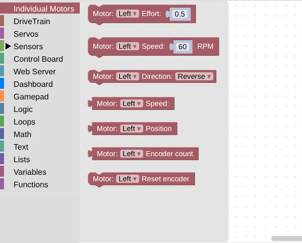
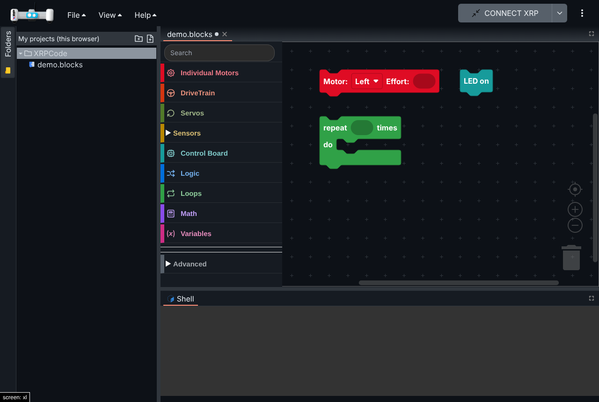
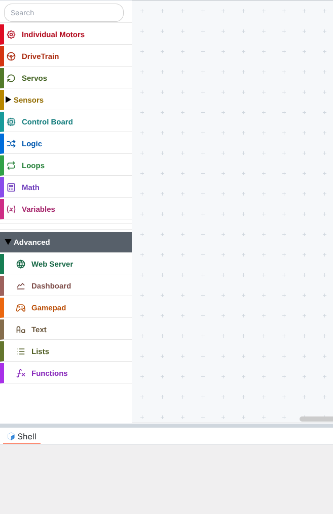
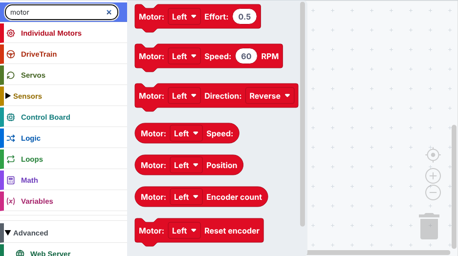
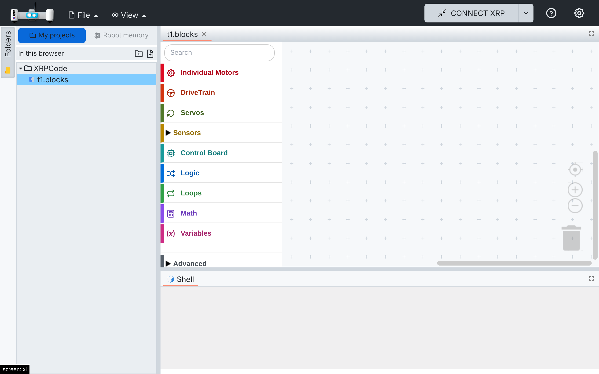
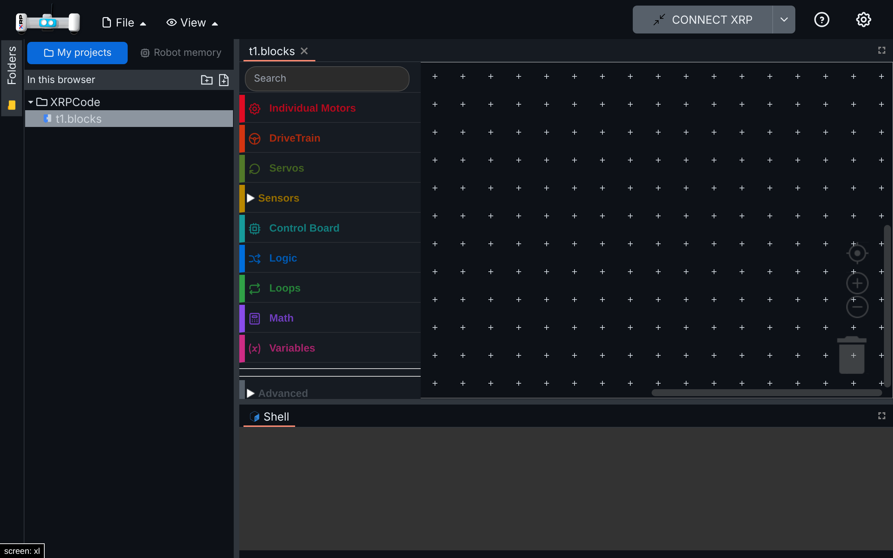

# 002 — Language and theme

Spanish first, and a friendly look in light and dark. Four parts: Spanish translation fixes, the friendly theme and block editor, theme switch fixes, and plain Spanish for the blocks.

## Part 1 — Spanish translation fixes

### Problem

- With the browser set to a regional Spanish locale (`es-ES`, `es-419`), the UI was in Spanish but
  all blocks were in English, even though `es/blockly.json` had the translations.
  `applyBlocklyLocale` received `i18n.language` (e.g. `es-ES`) and only accepted exactly `en` or
  `es`, so it fell back to English. The language picker in Settings showed no selection for the same
  reason.
- Several Spanish strings were wrong: the backup and restore descriptions described the opposite
  direction, "Processing" messages dropped the file name, and some strings had the wrong number or
  meaning or unbalanced `¡ !` punctuation. One key (`copyfiles.gdrive`) was misnamed.

### Solution

- i18next normalizes detected languages to their base code (`supportedLngs` +
  `convertDetectedLanguage`), and `applyBlocklyLocale` accepts regional codes.
- Spanish fixes: backup/restore direction, `{{ filename }}` placeholders, wording and number fixes,
  balanced punctuation, consistent "usted", "Girar Gr:" → "Girar grados:", "Gr:" → "Grados:".

### Files

`src/utils/i18n/index.ts`, `src/utils/blockly-locales.ts`,
`src/utils/i18n/locales/es/es.json`, `src/utils/i18n/locales/es/blockly.json`.

### How to test

1. Set the browser language to Spanish (Spain or Latin America) and open the app.
2. Settings shows Spanish selected; blocks read "Motor: Izquierdo Esfuerzo" instead of
   "Motor: Left Effort".

Automated: `src/utils/tests/i18n-locales.spec.ts` (English/Spanish key parity, regional locales,
fallback for unsupported languages).

### Upstream

Sent as [Open-STEM/XRPWeb#337](https://github.com/Open-STEM/XRPWeb/pull/337), closing
[Open-STEM/XRPWeb#335](https://github.com/Open-STEM/XRPWeb/issues/335). No changes to generated
Python.

## Part 2 — Friendly theme and block editor

### Problem

The block editor is hard to read for young students: small square blocks, muted colours that look
alike, a plain text toolbox with every category at the same level, and no way to search for a block.
The rest of the app looks like an IDE for adults.

### Solution

#### Block editor

- **Rounded blocks:** zelos renderer. Blocks are larger and easier to tap on tablets.
- **One colour per category:** each toolbox category gets a colour from a theme, and every block takes
  the colour of the category it lives in. Built-in Blockly styles (logic, loops, math, text, lists,
  variables, functions) use the same colours.
- **Toolbox:** an icon per category (react-icons, bundled, works offline), labels in the category
  colour (darker on the light theme, lighter on the dark theme), taller rows with separators.
- **Search:** a search field at the top of the toolbox (`@blockly/toolbox-search` 3.1.9, compatible
  with Blockly 12; replaced by an adapted copy in spec 004).
- **Advanced group:** Web Server, Dashboard, Gamepad, 3rd Party, Text, Lists and Functions move into a
  collapsed "Advanced" category. Grouping happens when the toolbox is built, so the plugin manager
  still finds Gamepad when it inserts the 3rd Party category.
- **Canvas:** theme background and a sparser cross grid.
- **Zoom:** the canvas can be zoomed in (up to 2x) and out with a pinch on touch screens and with
  the + / - controls. On phones (below 768 px) it starts at 75% so more blocks fit.
- **Phones:** the toolbox is small (short rows, 11 px labels that wrap to two lines, small icons
  and search box, a bit over a quarter of the screen width in English and Spanish alike) and the
  block list next to it has a fixed, readable size instead of following the canvas zoom (it used to
  become tiny once the canvas was zoomed out to fit a program). The longest blocks fit without
  being cut. The list floats over the canvas and closes when a block is picked, as in Blockly.

#### App theme (GitHub colours by default)

- The app's components use named Tailwind palettes (`curious-blue`, `matisse`, `shark`, ...). The
  theme replaces their values with GitHub's Primer colours, so components restyle without edits:
  dark header, neutral grays, blue accents, green Run, red Stop, 6px corners.
- System font stack and layout tabs with an underline on the active tab.

#### Themes

A theme lives in `src/theme/<name>/`:

- `tailwind.ts` — app palette, applied with `withGitHubTheme()` in `tailwind.config.ts`.
- `app.css` — font and layout tabs.
- `blocks.ts` — one colour per toolbox category and the editor surfaces (light and dark), typed by
  `src/theme/types.ts`.

`src/theme/index.ts` selects the active theme (GitHub by default). A theme selector can be added
later; `src/components/blockly/block-theme.ts` applies any block theme to Blockly.

### Files

- New: `src/theme/` (types, index, `github/`), `src/components/blockly/block-theme.ts`,
  `src/components/blockly/toolbox-ui.ts` and `.css`.
- Hooks: `src/components/blockly.tsx` (renderer, theme options, toolbox builder, grid, zoom),
  `tailwind.config.ts`, `src/main.tsx` (theme CSS), `src/utils/i18n/locales/{en,es}/blockly.json`
  ("Search", "Advanced").
- Dependency: `@blockly/toolbox-search` 3.1.9.

### How to test

1. Open a blocks file: rounded blocks, each category in its own colour, icons in the toolbox.
2. Type "motor" in the search field: the motor blocks appear.
3. Expand "Advanced": Web Server, Dashboard, Gamepad, Text, Lists and Functions are inside.
4. Switch to the dark theme in Settings: labels and icons stay readable.
5. Save and reload a project created before the change: it opens unchanged, and the generated
   Python is the same.
6. On a phone, or a window narrower than 768 px: the canvas starts at 75%. Pinch with two fingers
   (or use the + / - buttons): the blocks zoom in and out; the toolbox and the block list do not
   change size. Open "Motores Individuales" in Spanish: every block shows whole.

Automated: `src/components/tests/block-theme.spec.ts` (category and subcategory colours, block
colouring, built-in styles) and `src/components/tests/toolbox-ui.spec.ts` (Advanced grouping,
search entry).

### Screenshots

**Before**

**After (light)**

**After (dark)**

| Advanced expanded | Search |
| --- | --- |
|  |  |

### Upstream

- **Block editor** (renderer, toolbox icons, search, Advanced group, block theme): could be proposed
  as an option in Settings rather than a forced change.
- **App theme:** fork-specific design choice.

## Part 3 — Theme switch fixes

### Problem

Two bugs when switching between light and dark:

1. **Glitch on every switch.** The layout (flexlayout) loads its theme as a stylesheet file. The
   old file was removed before the new one had downloaded, so the whole layout lost its styles for
   a moment (most visible in production, where the file comes over the network).
2. **Layout and shell stuck on the old theme after closing a tab.** Closing an editor tab called
   `eventOff(EVENT_THEME)`, which drops *every* theme listener, including the layout's and the
   shell's. After that, switching themes left the tab bars and the shell on the old theme.

### Solution

1. New `src/utils/swap-stylesheet.ts`: adds the new stylesheet next to the old one and removes the
   old one only after the new one has loaded (or failed). A swap still loading is cancelled when
   another one starts, so fast toggling ends on the last choice. `xrplayout.tsx` uses it in
   `changeTheme`.
2. `EditorMgr.RemoveEditor` no longer removes theme listeners. A closed editor's listener finds no
   session and does nothing.

### Files

- New: `src/utils/swap-stylesheet.ts`, `src/utils/tests/swap-stylesheet.spec.ts`.
- Hooks: `src/components/xrplayout.tsx` (`changeTheme`), `src/managers/editormgr.ts`
  (`RemoveEditor`).

### How to test

1. On a slow network (the layout stylesheets take almost a second to load): switching theme keeps
   the layout styled during the load (before: unstyled layout).
2. Open a `.blocks` file, close its tab, reopen it, switch to Dark: tab bars, shell and blocks turn
   dark (before: tab bars and shell stayed light). Switch back to Light: all light.

Captured during the switch, with the stylesheet download delayed:

| Light | Dark |
| --- | --- |
|  |  |

### Upstream

Both bugs are in XRPWeb's code. The two code commits are on the `theme-switch-flash` branch, based
on `upstream/main`, ready to propose.

## Part 4 — Plain Spanish for the blocks

### Problem

The Spanish block texts were literal translations of robotics terms that kids do not understand:
"Esperar pulsación del botón", "Recto cm: 20 Esfuerzo: 0.5", "Tren de Tracción", "Arcade",
"Guiñada", "Reflectancia", "Codificador izquierdo" (which actually gives centimetres). XRPWeb also
builds each block from separate labels in a fixed order (label, number, label, number), so a
language cannot say "Avanzar 20 cm": the unit has to come before the number. The help texts
(tooltips) repeated the same terms.

### Solution

- **Sentence templates:** blocks that mix words and inputs can take a template per language, such
  as "Avanzar %1 cm con fuerza %2", and each language places the inputs where its grammar needs
  them. The block is first built as in XRPWeb; only its text is then rebuilt from the template.
  Inputs and dropdowns keep their names, so saved projects and the Python they produce do not
  change. English templates repeat the current English texts (the labels now sit a little closer).
- **Plain Spanish:** every Spanish block text and help text rewritten in words that say what the
  block does. Action blocks read as orders; round blocks, which give a value to put inside another
  block, read as the name of that value, without a verb (like Scratch), so they read naturally in
  a sentence: "si distancia al obstáculo < 10".

| Before | After |
| --- | --- |
| Recto cm: 20 Esfuerzo: 0.5 | Avanzar 20 cm con fuerza 0.5 |
| Girar grados: 90 Esfuerzo: 0.5 | Girar 90 grados con fuerza 0.5 |
| Arcade Recto: 0.8 Girar: 0.2 | Avanzar con fuerza 0.8 y girar con fuerza 0.2 |
| Establecer esfuerzo Izquierdo: Derecho: | Fuerza de las ruedas: izquierda 0.5 derecha 0.5 |
| Establecer velocidad Izquierdo: cm/s Derecho: cm/s | Velocidad de las ruedas: izquierda 60 cm/s derecha 60 cm/s |
| Reiniciar codificadores | Reiniciar encoders |
| Codificador izquierdo | Encoder izquierdo (cm) |
| Motor: Izquierdo Esfuerzo: | Mover motor izquierdo con fuerza 0.5 |
| Motor: Izquierdo Velocidad: 60 RPM | Mover motor izquierdo a 60 vueltas por minuto |
| Motor: Izquierdo Dirección: Reversa | Motor izquierdo en sentido invertido |
| Motor: Izquierdo Velocidad: / Posición / Conteo del codificador | Vueltas por minuto / Vueltas / Pulsos del encoder del motor izquierdo |
| Motor: Izquierdo Reiniciar codificador | Reiniciar encoder del motor izquierdo |
| Servo: 1 Grados: 90 | Mover servo 1 a 90 grados |
| Esperar: 1 | Esperar 1 segundos |
| Distancia del sonar (cm) | Distancia al obstáculo (cm) |
| Reflectancia izquierda (%) | Sensor de línea izquierdo (%) |
| Guiñada / Balanceo / Cabeceo | Giro / Inclinación a los lados / Inclinación adelante y atrás |
| Acc_x (mg) | Aceleración X (mg) |
| LED encendido / LED apagado | Encender LED / Apagar LED |
| Botón de usuario | ¿Está el botón presionado? |
| Esperar pulsación del botón | Esperar a que se presione el botón |
| Panel iniciar todo / … / obtener valor | Depurar: enviar sensores / … / valor |

Categories: Tren de Tracción → Movimiento, Motores Individuales → Motores individuales,
Reflectancia → Sensores de línea, Placa de Control → Tarjeta de Control, Panel → Depurar (also the
Depurar screen in the View menu, so the blocks and the screen they feed share a name).

"Fuerza" replaces "Esfuerzo": a number from -1 to 1, like pressing a pedal (0.5 is half). The help
texts explain the difference with "Velocidad", which the robot keeps on its own, like cruise
control. Where English uses a term kids will meet again in class, in XRP's Python and when they
move to English, Spanish keeps the same word so the two languages read alike: "encoder" stays,
like LED and servo ("Encoder izquierdo (cm)" for "Left encoder", "Reiniciar encoders" for "Reset
encoders"), and the help text explains it. Blocks that give a distance add the unit, cm (XRPLib
turns the wheel's turns into centimetres). The units themselves (forces from -1 to 1, cm, revolutions per minute) are unchanged;
simpler measures for kids are a separate change.

### Files

- New: `src/components/blockly/block-messages.ts` (sentence templates),
  `src/components/blockly/tests/block-messages.spec.ts`.
- Changed: `src/components/blockly/toolbox-ui.ts` (registers the templates at startup),
  `src/utils/i18n/locales/{en,es}/blockly.json` (templates; Spanish texts, help texts and
  categories), `src/utils/i18n/locales/es/es.json` (View menu: Depurar).
- The visual tests' block editor and DriveTrain images (spec 007, part 1) show the slightly tighter
  English labels.

### How to test

1. Switch the app to Español and open a blocks project.
2. Open Movimiento: "Avanzar 20 cm con fuerza 0.5", "Girar 90 grados con fuerza 0.5", "Avanzar
   con fuerza 0.8 y girar con fuerza 0.2". Hover a block: the help text explains it in plain words.
3. Open Motores individuales: "Mover motor izquierdo con fuerza 0.5", round blocks such as
   "Vueltas del motor izquierdo". Change the motor in a dropdown: the sentence keeps its order.
4. Open Tarjeta de Control: "Esperar a que se presione el botón", "¿Está el botón presionado?".
5. Open a blocks project saved before the change: the same blocks appear, with the new texts, and
   switching to English shows the English texts.

### Upstream

Possible: XRPWeb has the same Spanish file (Part 1 was sent as
[Open-STEM/XRPWeb#337](https://github.com/Open-STEM/XRPWeb/pull/337)), and the sentence templates
would help all its languages. Depurar for Dashboard is a naming choice to agree with them.
