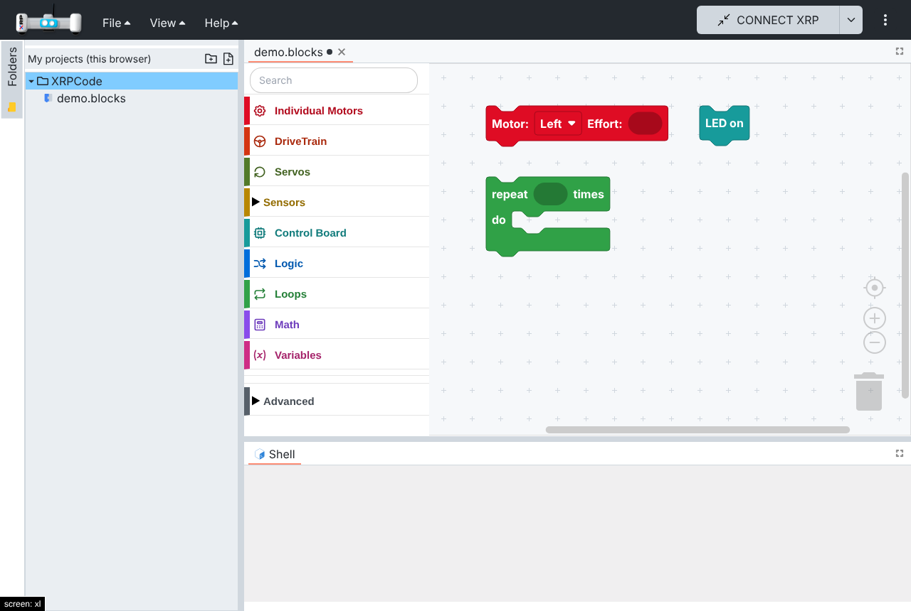
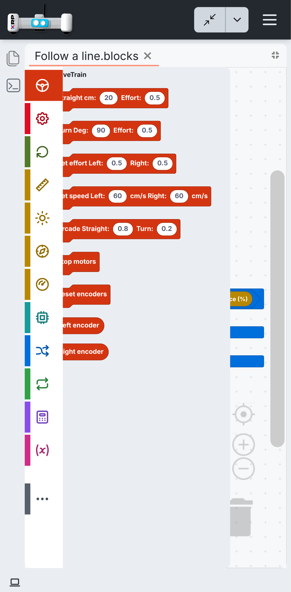
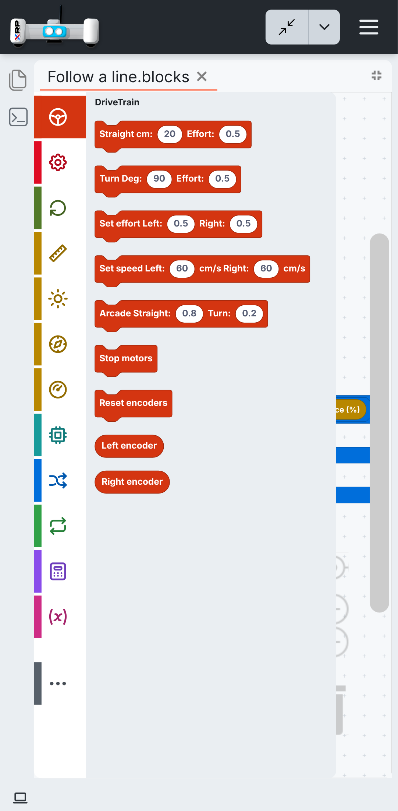
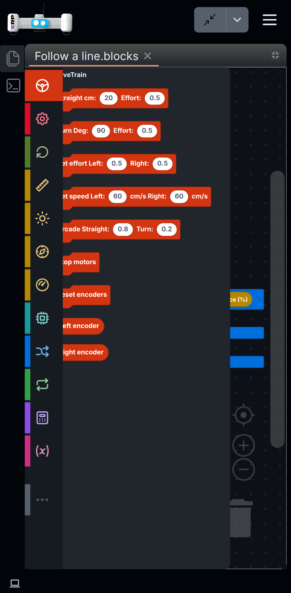
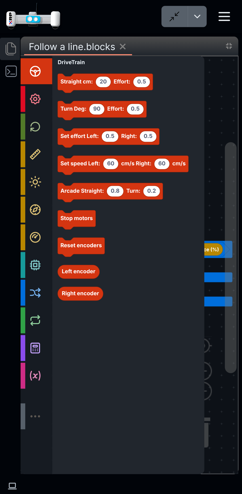

# 002 — Language and theme

Language support (English by default, several languages) and a friendly look in light and dark. The first language added besides English was Spanish. Six parts: Spanish translation fixes, the friendly theme and block editor, theme switch fixes, plain Spanish for the blocks, the toolbox on tablets and phones, and how the initial language is chosen.

## Part 1 — Spanish translation fixes

### Problem

- With the browser set to a regional Spanish locale (`es-ES`, `es-419`), the UI was in Spanish but
  all blocks were in English, even though `es/blockly.json` had the translations.
  `applyBlocklyLocale` received `i18n.language` (e.g. `es-ES`) and only accepted exactly `en` or
  `es`, so it fell back to English. The language picker in Settings showed no selection for the same
  reason.
- Several Spanish strings were wrong: the backup and restore descriptions described the opposite
  direction, "Processing" messages dropped the file name, and some strings had the wrong number or
  meaning or unbalanced `¡ !` punctuation. One key (`copyfiles.gdrive`) was misnamed.

### Solution

- i18next normalizes detected languages to their base code (`supportedLngs` +
  `convertDetectedLanguage`), and `applyBlocklyLocale` accepts regional codes.
- Spanish fixes: backup/restore direction, `{{ filename }}` placeholders, wording and number fixes,
  balanced punctuation, consistent "usted", "Girar Gr:" → "Girar grados:", "Gr:" → "Grados:".

### Files

`src/utils/i18n/index.ts`, `src/utils/blockly-locales.ts`,
`src/utils/i18n/locales/es/es.json`, `src/utils/i18n/locales/es/blockly.json`.

### How to test

1. Set the browser language to Spanish (Spain or Latin America) and open the app.
2. Settings shows Spanish selected; blocks read "Motor: Izquierdo Esfuerzo" instead of
   "Motor: Left Effort".

Automated: `src/utils/i18n/i18n-locales.spec.ts` (English/Spanish key parity, regional locales,
fallback for unsupported languages).

### Upstream

Sent as [Open-STEM/XRPWeb#337](https://github.com/Open-STEM/XRPWeb/pull/337), closing
[Open-STEM/XRPWeb#335](https://github.com/Open-STEM/XRPWeb/issues/335). No changes to generated
Python.

## Part 2 — Friendly theme and block editor

### Problem

The block editor is hard to read for young students: small square blocks, muted colours that look
alike, a plain text toolbox with every category at the same level, and no way to search for a block.
The rest of the app looks like an IDE for adults.

### Solution

#### Block editor

- **Rounded blocks:** zelos renderer. Blocks are larger and easier to tap on tablets.
- **One colour per category:** each toolbox category gets a colour from a theme, and every block takes
  the colour of the category it lives in. Built-in Blockly styles (logic, loops, math, text, lists,
  variables, functions) use the same colours.
- **Toolbox:** an icon per category (react-icons, bundled, works offline), labels in the category
  colour (darker on the light theme, lighter on the dark theme), taller rows with separators.
- **Search:** a search field at the top of the toolbox (`@blockly/toolbox-search` 3.1.9, compatible
  with Blockly 12; replaced by an adapted copy in spec 004).
- **Advanced group:** Web Server, Dashboard, Gamepad, 3rd Party, Text, Lists and Functions move into a
  collapsed "Advanced" category. Grouping happens when the toolbox is built, so the plugin manager
  still finds Gamepad when it inserts the 3rd Party category.
- **Canvas:** theme background and a sparser cross grid.
- **Zoom:** the canvas can be zoomed in (up to 2x) and out with a pinch on touch screens and with
  the + / - controls. On phones (below 768 px) it starts at 75% so more blocks fit.
- **Phones:** the toolbox is small (short rows, 11 px labels that wrap to two lines, small icons
  and search box, a bit over a quarter of the screen width in English and Spanish alike) and the
  block list next to it has a fixed, readable size instead of following the canvas zoom (it used to
  become tiny once the canvas was zoomed out to fit a program). The longest blocks fit without
  being cut. The list floats over the canvas and closes when a block is picked, as in Blockly.

#### App theme (GitHub colours; replaced by the VS Code theme in part 7)

- The app's components use named Tailwind palettes (`curious-blue`, `matisse`, `shark`, ...). The
  theme replaces their values with GitHub's Primer colours, so components restyle without edits:
  dark header, neutral grays, blue accents, green Run, red Stop, 6px corners.
- System font stack and layout tabs with an underline on the active tab.

#### Themes

A theme lives in `src/theme/<name>/`:

- `tailwind.css` — app palette as a Tailwind `@theme` block (CSS variables), imported by
  `src/index.css` (was `tailwind.ts` with `withGitHubTheme()` before Tailwind 4, spec 006 part 9).
- `app.css` — font and layout tabs.
- `blocks.ts` — one colour per toolbox category and the editor surfaces (light and dark), typed by
  `src/theme/types.ts`.

`src/theme/index.ts` selects the active theme (GitHub by default). A theme selector can be added
later; `src/components/blockly/block-theme.ts` applies any block theme to Blockly.

### Files

- New: `src/theme/` (types, index, `vscode/`), `src/components/blockly/block-theme.ts`,
  `src/components/blockly/toolbox-ui.ts` and `.css`.
- Hooks: `src/components/blockly.tsx` (renderer, theme options, toolbox builder, grid, zoom),
  `tailwind.config.ts`, `src/main.tsx` (theme CSS), `src/utils/i18n/locales/{en,es}/blockly.json`
  ("Search", "Advanced").
- Dependency: `@blockly/toolbox-search` 3.1.9.

### How to test

1. Open a blocks file: rounded blocks, each category in its own colour, icons in the toolbox.
2. Type "motor" in the search field: the motor blocks appear.
3. Expand "Advanced": Web Server, Dashboard, Gamepad, Text, Lists and Functions are inside.
4. Switch to the dark theme in Settings: labels and icons stay readable.
5. Save and reload a project created before the change: it opens unchanged, and the generated
   Python is the same.
6. On a phone, or a window narrower than 768 px: the canvas starts at 75%. Pinch with two fingers
   (or use the + / - buttons): the blocks zoom in and out; the toolbox and the block list do not
   change size. Open "Motores Individuales" in Spanish: every block shows whole.

Automated: `src/components/blockly/block-theme.spec.ts` (category and subcategory colours, block
colouring, built-in styles) and `src/components/blockly/toolbox-ui.spec.ts` (Advanced grouping,
search entry).

### Screenshots

**Before**

**After (light)**

**After (dark)**

| Advanced expanded | Search |
| --- | --- |
|  |  |

### Upstream

- **Block editor** (renderer, toolbox icons, search, Advanced group, block theme): could be proposed
  as an option in Settings rather than a forced change.
- **App theme:** fork-specific design choice.

## Part 3 — Theme switch fixes

### Problem

Two bugs when switching between light and dark:

1. **Glitch on every switch.** The layout (flexlayout) loads its theme as a stylesheet file. The
   old file was removed before the new one had downloaded, so the whole layout lost its styles for
   a moment (most visible in production, where the file comes over the network).
2. **Layout and shell stuck on the old theme after closing a tab.** Closing an editor tab called
   `eventOff(EVENT_THEME)`, which drops *every* theme listener, including the layout's and the
   shell's. After that, switching themes left the tab bars and the shell on the old theme.

### Solution

1. New `src/utils/swap-stylesheet.ts`: adds the new stylesheet next to the old one and removes the
   old one only after the new one has loaded (or failed). A swap still loading is cancelled when
   another one starts, so fast toggling ends on the last choice. `xrplayout.tsx` uses it in
   `changeTheme`.
2. `EditorMgr.RemoveEditor` no longer removes theme listeners. A closed editor's listener finds no
   session and does nothing.

### Files

- New: `src/utils/swap-stylesheet.ts`, `src/utils/swap-stylesheet.spec.ts`.
- Hooks: `src/components/xrplayout.tsx` (`changeTheme`), `src/managers/editormgr.ts`
  (`RemoveEditor`).

### How to test

1. On a slow network (the layout stylesheets take almost a second to load): switching theme keeps
   the layout styled during the load (before: unstyled layout).
2. Open a `.blocks` file, close its tab, reopen it, switch to Dark: tab bars, shell and blocks turn
   dark (before: tab bars and shell stayed light). Switch back to Light: all light.

Captured during the switch, with the stylesheet download delayed:

| Light | Dark |
| --- | --- |
|  |  |

### Upstream

Both bugs are in XRPWeb's code. The two code commits are on the `theme-switch-flash` branch, based
on `upstream/main`, ready to propose.

## Part 4 — Plain Spanish for the blocks

### Problem

The Spanish block texts were literal translations of robotics terms that kids do not understand:
"Esperar pulsación del botón", "Recto cm: 20 Esfuerzo: 0.5", "Tren de Tracción", "Arcade",
"Guiñada", "Reflectancia", "Codificador izquierdo" (which actually gives centimetres). XRPWeb also
builds each block from separate labels in a fixed order (label, number, label, number), so a
language cannot say "Avanzar 20 cm": the unit has to come before the number. The help texts
(tooltips) repeated the same terms.

### Solution

- **Sentence templates:** blocks that mix words and inputs can take a template per language, such
  as "Avanzar %1 cm con fuerza %2", and each language places the inputs where its grammar needs
  them. The block is first built as in XRPWeb; only its text is then rebuilt from the template.
  Inputs and dropdowns keep their names, so saved projects and the Python they produce do not
  change. English templates repeat the current English texts (the labels now sit a little closer).
- **Plain Spanish:** every Spanish block text and help text rewritten in words that say what the
  block does. Action blocks read as orders; round blocks, which give a value to put inside another
  block, read as the name of that value, without a verb (like Scratch), so they read naturally in
  a sentence: "si distancia al obstáculo < 10".

| Before | After |
| --- | --- |
| Recto cm: 20 Esfuerzo: 0.5 | Avanzar 20 cm con fuerza 0.5 |
| Girar grados: 90 Esfuerzo: 0.5 | Girar 90 grados con fuerza 0.5 |
| Arcade Recto: 0.8 Girar: 0.2 | Avanzar con fuerza 0.8 y girar con fuerza 0.2 |
| Establecer esfuerzo Izquierdo: Derecho: | Fuerza de las ruedas: izquierda 0.5 derecha 0.5 |
| Establecer velocidad Izquierdo: cm/s Derecho: cm/s | Velocidad de las ruedas: izquierda 60 cm/s derecha 60 cm/s |
| Reiniciar codificadores | Reiniciar encoders |
| Codificador izquierdo | Encoder izquierdo (cm) |
| Motor: Izquierdo Esfuerzo: | Mover motor izquierdo con fuerza 0.5 |
| Motor: Izquierdo Velocidad: 60 RPM | Mover motor izquierdo a 60 vueltas por minuto |
| Motor: Izquierdo Dirección: Reversa | Motor izquierdo en sentido invertido |
| Motor: Izquierdo Velocidad: / Posición / Conteo del codificador | Vueltas por minuto / Vueltas / Pulsos del encoder del motor izquierdo |
| Motor: Izquierdo Reiniciar codificador | Reiniciar encoder del motor izquierdo |
| Servo: 1 Grados: 90 | Mover servo 1 a 90 grados |
| Esperar: 1 | Esperar 1 segundos |
| Distancia del sonar (cm) | Distancia al obstáculo (cm) |
| Reflectancia izquierda (%) | Sensor de línea izquierdo (%) |
| Guiñada / Balanceo / Cabeceo | Giro / Inclinación a los lados / Inclinación adelante y atrás |
| Acc_x (mg) | Aceleración X (mg) |
| LED encendido / LED apagado | Encender LED / Apagar LED |
| Botón de usuario | ¿Está el botón presionado? |
| Esperar pulsación del botón | Esperar a que se presione el botón |
| Panel iniciar todo / … / obtener valor | Depurar: enviar sensores / … / valor |

Categories: Tren de Tracción → Movimiento, Motores Individuales → Motores individuales,
Reflectancia → Sensores de línea, Placa de Control → Tarjeta de Control, Panel → Depurar (also the
Depurar screen in the View menu, so the blocks and the screen they feed share a name).

"Fuerza" replaces "Esfuerzo": a number from -1 to 1, like pressing a pedal (0.5 is half). The help
texts explain the difference with "Velocidad", which the robot keeps on its own, like cruise
control. Where English uses a term kids will meet again in class, in XRP's Python and when they
move to English, Spanish keeps the same word so the two languages read alike: "encoder" stays,
like LED and servo ("Encoder izquierdo (cm)" for "Left encoder", "Reiniciar encoders" for "Reset
encoders"), and the help text explains it. Blocks that give a distance add the unit, cm (XRPLib
turns the wheel's turns into centimetres). The units themselves (forces from -1 to 1, cm, revolutions per minute) are unchanged;
simpler measures for kids are a separate change.

### Files

- New: `src/components/blockly/block-messages.ts` (sentence templates),
  `src/components/blockly/block-messages.spec.ts`.
- Changed: `src/components/blockly/toolbox-ui.ts` (registers the templates at startup),
  `src/utils/i18n/locales/{en,es}/blockly.json` (templates; Spanish texts, help texts and
  categories), `src/utils/i18n/locales/es/es.json` (View menu: Depurar).
- The visual tests' block editor and DriveTrain images (spec 007, part 1) show the slightly tighter
  English labels.

### How to test

1. Switch the app to Español and open a blocks project.
2. Open Movimiento: "Avanzar 20 cm con fuerza 0.5", "Girar 90 grados con fuerza 0.5", "Avanzar
   con fuerza 0.8 y girar con fuerza 0.2". Hover a block: the help text explains it in plain words.
3. Open Motores individuales: "Mover motor izquierdo con fuerza 0.5", round blocks such as
   "Vueltas del motor izquierdo". Change the motor in a dropdown: the sentence keeps its order.
4. Open Tarjeta de Control: "Esperar a que se presione el botón", "¿Está el botón presionado?".
5. Open a blocks project saved before the change: the same blocks appear, with the new texts, and
   switching to English shows the English texts.

### Upstream

Sent together with Part 1 in [Open-STEM/XRPWeb#337](https://github.com/Open-STEM/XRPWeb/pull/337):
the sentence templates (registered from `applyBlocklyLocale`, since XRPWeb has no toolbox UI file),
the Spanish block texts, help texts and categories, and Depurar for Dashboard, a naming choice to
agree with them. The Motors group, search and Advanced group stay in the fork.

## Part 5 — Toolbox on tablets and phones

### Problem

- The toolbox started with three motor categories at the top level (DriveTrain, Individual
  Motors, Servos), next to the Sensors group that already gathered its four categories. The list
  was long, and the categories that move the robot were not presented as one family.
- On a phone the toolbox showed every category name in tiny wrapped text, and still took a good
  part of the narrow screen.
- Installed on an Android tablet, the app kept the system's navigation bar at the bottom, so the
  block editor had less room than it could.

### Solution

- **Motors group:** DriveTrain, Individual Motors and Servos move into an open "Motors" group
  ("Motores"), in that order (the one kids use most first), placed where the first of them was,
  like Sensors. The group is open by default so the motion blocks stay one tap away. Grouping
  happens when the toolbox is built, like the Advanced group (Part 2): blocks, saved files and the
  Python they produce do not change.
- **Phone toolbox:** on screens narrower than 768 px the toolbox is a column of icons, like other
  block editors on phones. The open groups give way to their categories (DriveTrain, Individual
  Motors, Servos, Distance, Reflectance, Gyro, Accelerometer), each with its own icon and colour;
  Advanced stays a collapsed group, shown as "•••". Names are hidden, so each panel of blocks starts
  with its category name. The search field is left out (it does not fit). Turning a phone, or
  resizing a window, across 768 px rebuilds the toolbox in the other layout. Tablets and computers
  keep the toolbox with names.
- **Installed app in full screen:** the installed app opens in full screen, without the system bars
  of Android tablets and phones; a swipe from the edge shows them for a moment. Computers, which do
  not offer full screen for installed apps, keep a normal app window.

### Fixes found on the way

- **Blocks panel cut off on a tablet:** on an Android tablet with the browser's address bar
  showing, the bottom of the app was under the bar. The app box took the full screen height
  (`100vh`, which counts the bar as hidden) instead of the visible area, so the panel with a
  category's blocks (the flyout) was taller than what could be seen. Categories with many blocks
  could still be scrolled, but Individual Motors fits in that taller panel, so it had no scroll and
  its last blocks were out of reach. The app now takes exactly the visible area (it took
  effect on phones only with spec 003, part 5).
- **Bottom of the app under Android's navigation bar:** on some Android phones (seen in a browser
  opened from another app) the page is drawn under the navigation bar, so the last toolbox row and
  the workspace scrollbar were half hidden. The app now asks to draw edge to edge and keeps clear of
  the system bars and screen cutouts by itself (the safe areas the device reports, none on screens
  without them); the strip under the bar takes the frame colour.
- **Program and blocks panel partly under the toolbox on phones:** each category's icon was drawn
  a moment after the toolbox, so Blockly sometimes measured the toolbox without icons and kept that
  narrower width: the program could start under the toolbox, and the panel of blocks opened partly
  under it, with the first letters of each block hidden (seen most in Spanish, where choosing the
  language rebuilds the toolbox). Drawing the icons with React could not be made immediate when the
  toolbox is rebuilt while the editor itself is updating, so the icons are now built directly as
  SVG when each category is created, before Blockly measures. This also made the phone block editor
  screenshot of the visual tests (spec 007, part 1) stable: it used to differ now and then on a busy
  test machine.

  Before and after, phone with DriveTrain open (captured with the processor slowed down, where it
  happened every time):

  
  
  
  

### Files

- New: `src/utils/breakpoints.ts` (Tailwind's `max-md` breakpoint for code: phones).
- Changed: `src/components/blockly/toolbox-ui.ts` (`groupMotorCategories`, `phoneToolbox`; icons
  built as SVG at once), `src/components/blockly/toolbox-ui.css` (phone icon column, panel title),
  `src/components/blockly.tsx` (rebuilds the toolbox when the screen crosses the phone width),
  `src/theme/vscode/blocks.ts` (group colour), `src/utils/i18n/locales/{en,es}/blockly.json`
  (group name), `src/index.css` (app box sized by the visible area, clear of the system bars),
  `index.html` (`viewport-fit=cover`), `pwa-plugin.ts` (full screen).
- Tests: `src/components/blockly/toolbox-ui.spec.ts`; the visual tests' toolbox and block editor
  images (spec 007, part 1) show the new group and the phone icon column.
- Images: `docs/specs/images/002-phone-panel-{before,after}-{light,dark}.png`.

### How to test

1. Open a blocks file: the toolbox starts with an open "Motors" group with DriveTrain, Individual
   Motors and Servos, then the Sensors group.
2. Collapse and expand Motors; open each of its categories: same blocks as before.
3. On an Android tablet, with the address bar visible, open Individual Motors: every block can be
   reached, down to "Reset encoder", and the bottom of the app is not under the bar. With a short
   screen, slide the toolbox up with a finger: it scrolls down to Advanced.
4. On a phone (or a window narrower than 768 px), open a blocks file: the toolbox is a column of
   icons, with no names and no search field. Tap the ruler icon: the panel starts with "Distance"
   and shows its block. Tap "•••": the advanced categories appear below it as icons.
5. Turn the phone sideways (wider than 768 px): the toolbox comes back with names and groups.
6. Install the app on an Android tablet and open it: it fills the whole screen, without the
   navigation bar at the bottom; swiping up from the bottom edge shows the bar for a moment.
7. On an Android phone, open the app in the browser and in a link opened from another app: the
   last toolbox icon ("•••") and the workspace scrollbar sit fully above the navigation bar.
8. On a phone, in Spanish, open a blocks file and tap the first icon (Movimiento): the panel starts
   right of the toolbox, with "Movimiento" and every block text whole.

### Upstream

The grouping, the phone toolbox and the full screen app are fork-specific (kids UI). The tablet fix is in fork CSS, but XRPWeb's own
`100vh` has the same problem on Android tablets and could take the same idea.

## Part 6 — How the initial language is chosen

### Problem

The fork is global and multilingual: English is the default and no language is singled out. The
rule for the first language had not been written down.

### Solution

No behaviour change; this documents what the app does:

- The app opens in English by default.
- If the browser language is one of the supported languages (English and Spanish today, with
  regional variants such as `es-419` counting as `es`), the app opens in that language.
- Any other browser language falls back to English.
- The language can be changed at any time in Settings; the choice is remembered on the device and
  wins over the browser language from then on.

### Files

- `src/utils/i18n/index.ts` (detector, `fallbackLng: 'en'`, `supportedLngs`)
- `src/utils/i18n/languages.ts` (languages offered in Settings)

### How to test

1. Set the browser language to a language the app does not have (for example French) and open the
   app with fresh site data: it is in English.
2. Set it to Spanish (or `es-419`) with fresh site data: it is in Spanish.
3. In Settings, choose English, reload: it stays in English whatever the browser language.

### Upstream

Same detection as XRPWeb; nothing to send.

## Part 7 — VS Code colours (Default Light+ and Default Dark+)

### Problem

The default theme took its colours from GitHub. People who already use VS Code, and the classes that
teach with it, expect the look of its default themes: a dark grey icon strip, a light (or dark) grey
side bar, white (or near-black grey) editor and terminal panels, and a blue status bar. The dark
variant was also too black: every surface was a different step of near-black.

### Solution

The VS Code default themes, Default Light+ and Default Dark+, replace the GitHub theme. There is still
one theme with a light and a dark variant, switched with the existing Theme setting; no new
selector.

- **Surfaces.** Light: title bar `#dddddd`, frame between panels `#dcdcdc`, icon strip `#2c2c2c`
  (selected item `#424242`), side bar `#f3f3f3`, editor and terminal `#ffffff`. Dark: title bar and
  frame `#3d3d3d`, icon strip `#333333` (selected `#1c1c1c`), side bar `#252526`, editor and
  terminal `#1e1e1e`; nothing large is darker than `#1e1e1e`. The editor and terminal stay rounded
  cards over the frame, as before.
- **Accent.** One blue: `#007acc` for the status bar (white text), the tab accent and the focus
  colour, `#0066b8` for buttons and links on light surfaces. The active tab and the selected file
  use the light tint `#e4e6f1` (`#403f44` for the tab and `#04395e` for the selected file in dark).
- **Python editor.** The editor now uses the Default Light+ and Default Dark+ themes, so keywords,
  strings, functions, types, numbers and comments take their colours from VS Code's own theme files
  (for example keywords `#0000ff` / `#569cd6`, strings `#a31515` / `#ce9178`, comments `#008000` /
  `#6a9955`). The extra colours for calls, attributes and constants use the same palettes.
- **Blocks.** The category colours of the blocks do not change. Only the surfaces around them follow
  the neutral palette: workspace, grid, toolbox and flyout.
- **Tabs and terminal.** Editor tabs are flat and side by side with a thin separator: the active
  tab has the editor colour, the others a slightly darker grey. The Terminal title is plain text
  on a rounded tint, without an icon, like a VS Code panel title.
- **Canvas dots.** The grid of the block canvas is made of dots instead of crosses.
- **Account.** On wide screens the Google sign-in is only an icon, at the bottom of the left icon
  strip (or the profile picture once signed in; its menu opens to the right). On narrow screens it
  stays in the menu with its text.
- **Font.** The system font stack of VS Code (the platform's UI font) with its 13px size for tabs
  and the Explorer; the rest of the app keeps its size so it stays easy to read on tablets.
- **Light title bar and menus.** The navbar and its menus are light grey with dark text in the light
  variant; the menu icons are darkened to match.
- **Contrast.** Checked against WCAG AA (4.5:1) for the status bar, tabs, disabled text, the
  toolbox and every Python colour in both variants. The status bar blue `#007acc` with white text
  is 4.51:1. Grey text used on the light surfaces (`#6c6c6c`, was VS Code's `#767676` placeholder
  grey) was darkened so it stays above 4.5:1 on `#f3f3f3`. Everything else keeps VS Code's values.
  The Light+ and Dark+ theme files in VS Code only define the editor, tab and token colours; the
  colours of the window itself (title bar, icon strip, side bar, status bar) are VS Code's built-in
  defaults, matched to how VS Code looks.

The theme picker preview cards use the new colours. Offline builds and the installable app are not
affected.

### Files

- Replaced: `src/theme/github/` by `src/theme/vscode/` (`tailwind.css`, `app.css`, `blocks.ts`);
  `src/theme/index.ts`, `src/theme/app-themes.ts`, `src/index.css`, `src/main.tsx`.
- Updated: `src/components/status-bar/status-bar.tsx` (blue status bar),
  `src/components/xrplayout.tsx` (terminal tab class), `src/components/blockly.tsx` (dot grid),
  `src/components/navbar/mobile-menu.tsx` and `src/widgets/compact-account.tsx` (account icon),
  `src/components/MonacoEditor.tsx` and `src/components/python/python-colours.ts` (theme ids),
  `src/components/blockly/toolbox-ui.css` (search box), `src/components/xrpshell.tsx` (terminal
  colours).
- Tests: `src/theme/vscode/vscode-theme.spec.ts` (every block colour and surface resolves, the
  preview cards have all colours, contrast of the status bar, tabs and toolbox). The visual
  baselines were regenerated.

### How to test

1. Open the app in light mode: the title bar and the frame between panels are light grey, the left
   icon strip is dark grey, the file tree side bar is light grey, the editor is white and the
   status bar is blue.
2. Switch to dark in Settings > Theme: frame `#3d3d3d`, icon strip, side bar, editor in darker
   steps, blue status bar; no pure black.
3. Open a blocks file: the block colours are the same as before; only the area around them is grey.
4. Open the Python editor and a Python view of a blocks file: colours follow VS Code in both
   variants.
5. With Google sign-in available, check the icon at the bottom of the left strip and its menu.
6. Open the settings menu in light mode: light menu, dark icons, dark text.

Screenshots (English, light and dark):
`docs/specs/images/002-vscode-blocks-{light,dark}.png` (My projects and a blocks file),
`002-vscode-python-{light,dark}.png`, `002-vscode-welcome-{light,dark}.png` and
`002-vscode-settings-menu-{light,dark}.png` (Connect area and a menu).

### Upstream

Fork only (branding and colours).
