# 003 — Layout and screens

The living spec for what is on screen: the top bar, the welcome screen, modals and the main layout (side bar, editor and terminal). Add a part here for every layout change instead of a new spec.

## Part 1 — Top bar

### Problem

The top bar mixed text menus (File, View, Help) with a "more" (⋮) menu, language and theme were
only reachable through the Settings dialog, and the Google
sign-in lived in the folder tree header, so it disappeared with the tree. In offline builds the
local session also lives in the sign-in widget, so closing the tree could stop it from signing in.

### Solution

One friendly top bar for everyone (no separate "kids mode"):

- **Left:** logo and the File and View menus, now with icons.
- **Right**, in order:
  - **Connect**, which becomes **Run/Stop** once a robot is connected (unchanged from XRPWeb; the
    run behaviour is left as is until it can be tested with a robot).
  - **Connection status** while connected: "Robot connected · USB/Bluetooth · XRP-ID" (icon only
    below 1280 px).
  - **Help (?)**: the former Help menu (guides, forum, change log, privacy).
  - **Settings (⚙)**: Language and Theme rows that show the current choice and open their pickers;
    below them, the "Keep me signed in" switch (spec 005) and the former ⋮ items (Dashboard,
    Drivers, Backup/Restore, Firmware, AI chat when enabled). The old Settings dialog, which
    repeated Language and Theme, is no longer in the menu.
  - **Language picker:** a dialog with one card per language (native and English name), so it
    scales beyond two languages. Languages are listed once in `src/utils/i18n/languages.ts`, also
    used by the Settings dialog.
  - **Theme picker:** a dialog with one card per theme and a miniature preview of the app in its
    colours. Themes are listed in `src/theme/app-themes.ts`, so a new one (for example Dracula) is
    one more entry plus its colours.
  - **Account**, at the top right like most apps: a "Google Sign In" button, or an avatar with the
    name, email and Sign out. In offline builds this slot hosts the local session and shows
    nothing.
- The folder tree no longer shows the sign-in widget; it follows `EVENT_LOGIN_STATUS`.

### Files

- New: `src/components/navbar/` (`connection-status.tsx`, `nav-dropdown.tsx`,
  `quick-settings.tsx`), `src/components/dialogs/language-dlg.tsx`, `src/components/dialogs/theme-dlg.tsx`,
  `src/utils/i18n/languages.ts`, `src/theme/app-themes.ts`, `src/widgets/compact-account.tsx`, `src/utils/theme.ts` (`applyTheme`,
  shared with the Settings dialog), `src/utils/session.ts` (sign-in and sign-out handling moved out
  of the folder tree; `isSignInInNavbar`).
- Hooks: `src/components/navbar.tsx` (layout of the bar, help items, settings dropdown, account),
  `src/widgets/login.tsx` (`compact` variant), `src/components/folder-tree.tsx` (listens to the login
  event, hides its sign-in when it is in the top bar), `src/components/dialogs/settings.tsx` (uses
  `applyTheme`), `src/utils/i18n/locales/{en,es}` (`navbar.*`).

### How to test

1. In an offline build, the bar shows File, View, Connect, ? and ⚙.
2. ⚙ → Language → Español, and ⚙ → Theme → Dark: the app switches language and theme immediately, and keeps
   them after a reload.
3. ? lists the help links.
4. File → New File works (the local session signs in from the top bar).
5. At 1024 px the bar fits on one line.

Automated: `src/widgets/compact-account.spec.tsx` (sign-in button, avatar menu, sign out),
`src/components/dialogs/language-dlg.spec.tsx`, `src/components/dialogs/theme-dlg.spec.tsx` and `src/utils/theme.spec.ts`. The real Google sign-in needs the auth backend and was not run.

### Screenshots

| Before | After |
| --- | --- |
| 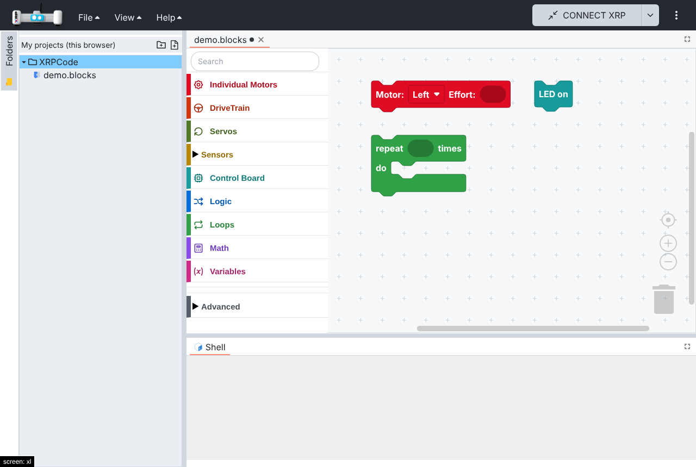 | 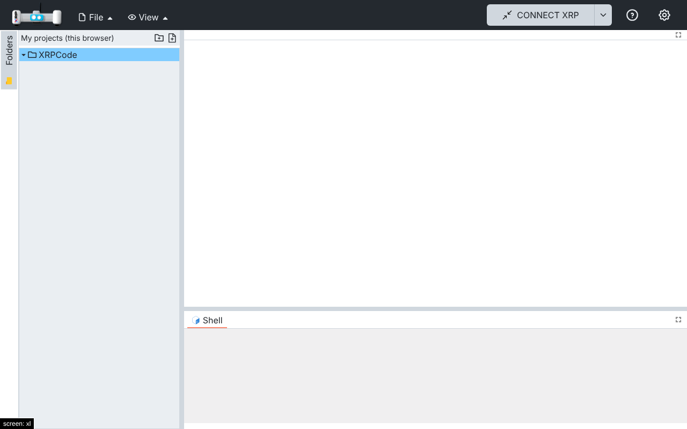 |

| Settings (⚙) | Language picker |
| --- | --- |
| 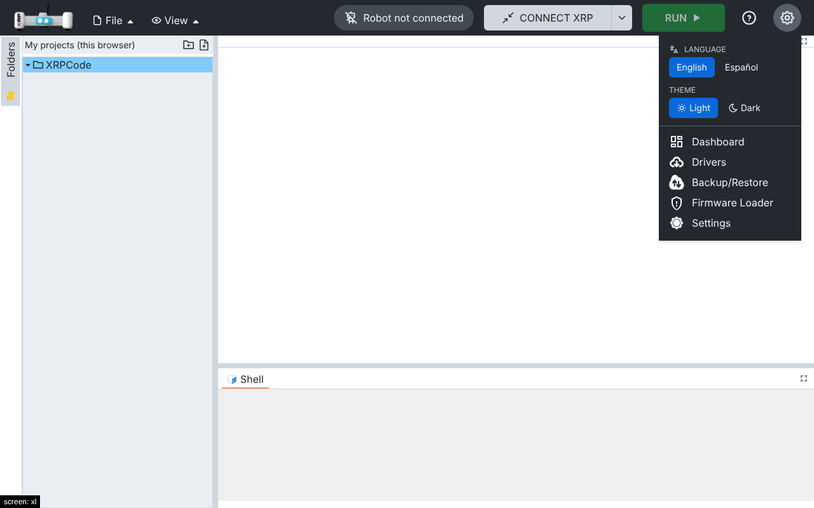 | 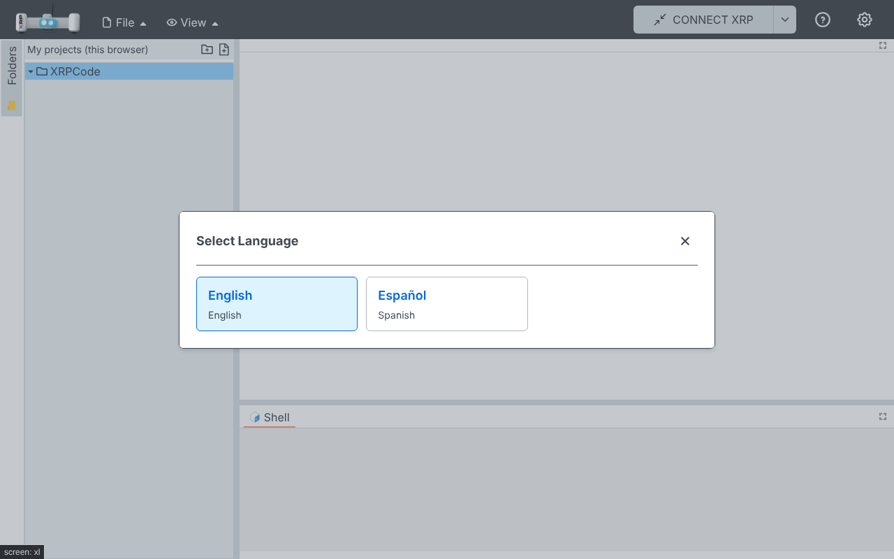 |

| Theme picker | |
| --- | --- |
| 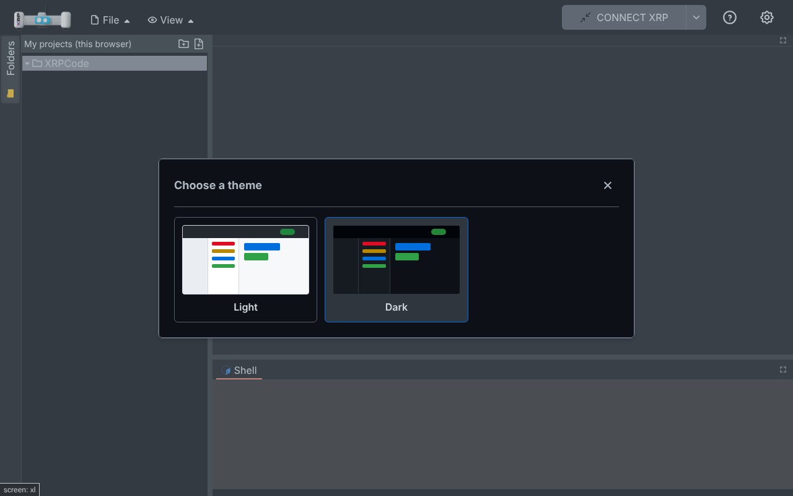 | |

| Help (?) | Dark |
| --- | --- |
| 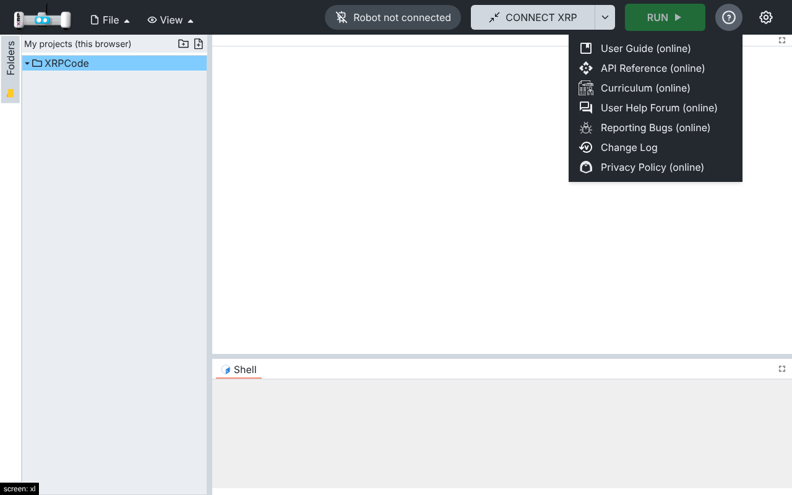 | 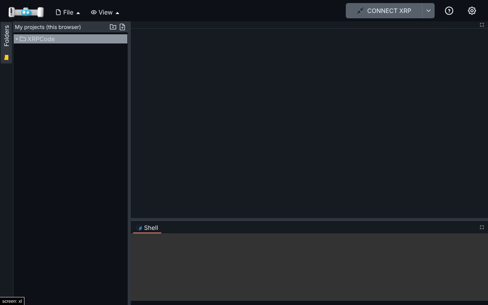 |

| Spanish, dark | Tablet (1024 px) |
| --- | --- |
| 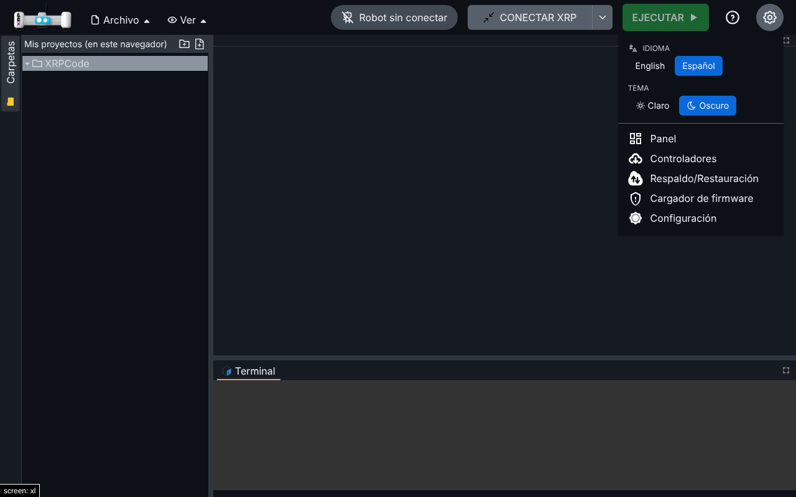 | 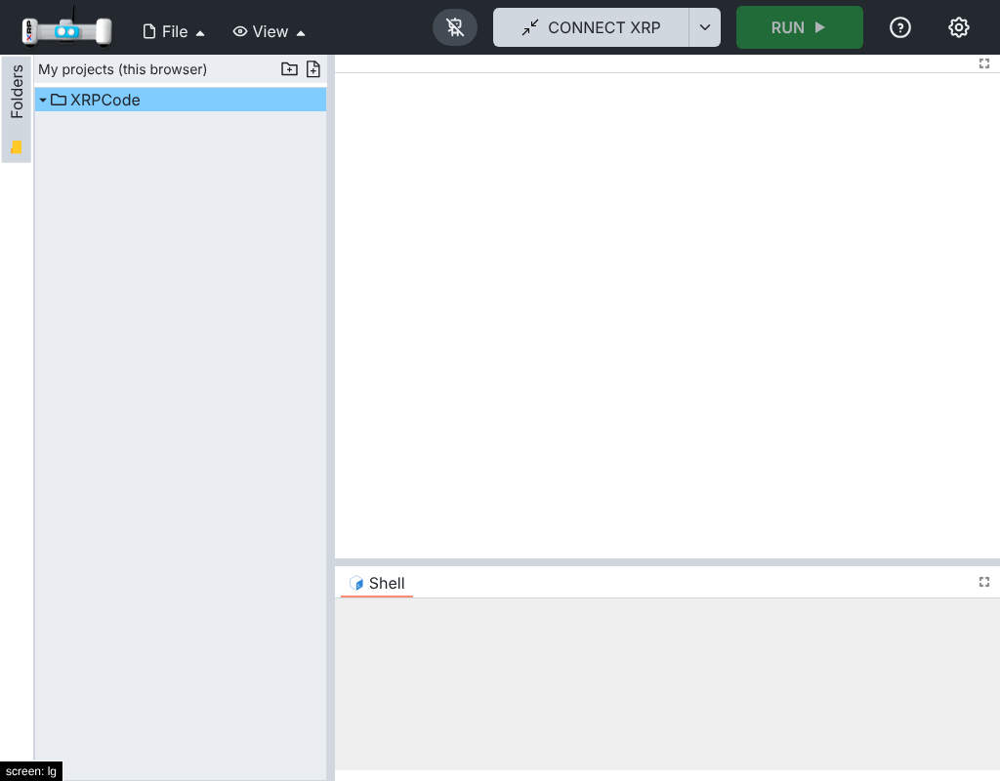 |

### Upstream

Fork-specific layout. The theme helper and moving sign-in out of the folder tree could be proposed
separately.

## Part 2 — Welcome screen

What the editor area shows when no tab is open, in four parts: start a new project, continue a
recent one, start from an example, and hide the shell until a project is open.

### New project

#### Problem

With no tab open, the editor area was an empty space: nothing invited a child to start. MakeCode,
which children often use alongside other platforms, always offers something to create.

#### Solution

- `src/components/welcome/welcome-screen.tsx` (new): shown in the editor area whenever it has no
  tab (flexlayout `onTabSetPlaceHolder` in `xrplayout.tsx`). Two big buttons: **New blocks
  project** and **New Python project**, plus a hint to open a project from the Explorer.
- Like MakeCode, the child then names the project. No name is suggested, so the child thinks of
  one that is easy to find later; **Create** (or Enter) is enabled once a valid name is typed. Names that already exist or are not valid file names are explained and cannot be
  created; accents are dropped while typing (`línea` becomes `linea`), since robot file names
  allow only plain letters, numbers, spaces, `.`, `-` and `_`. The project is saved right away in
  the top folder of the user's projects (My projects or Google Drive) and opened. No New File
  dialog.
- `src/utils/new-project.ts` (new): accent cleanup, name checks and file data. The folder and the names
  already in it come from the projects service, so it works even while the folder tree shows the
  robot's memory.
- `navbar.tsx`: the New File dialog's create step is shared as `createNewFile`, and the new
  `EVENT_NEW_PROJECT` event (`appmgr.ts`) runs it without the dialog.
- Signed out of Google (no place to save projects), the buttons ask to sign in first.

#### Files

- New: `src/components/welcome/welcome-screen.tsx`, `src/utils/new-project.ts`, tests in
  `src/components/welcome/welcome-screen.spec.tsx` and `src/utils/new-project.spec.ts`.
- Hooks: `src/components/xrplayout.tsx` (`onTabSetPlaceHolder`), `src/components/navbar.tsx`
  (`createNewFile`, `EVENT_NEW_PROJECT`), `src/managers/appmgr.ts` (`EVENT_NEW_PROJECT`,
  `getFolderData`), `src/utils/i18n/locales/{en,es}/{en,es}.json` (`welcome.*`).

#### How to test

1. My projects, no tab open: the welcome screen shows. New blocks project asks for a name (empty,
   Create disabled); type `line follower` and press Enter: `line follower.blocks` opens and
   is in the folder tree. Close it: the welcome screen comes back.
2. Typing the name of an existing project disables Create and says so; Back returns to the two
   buttons.
3. Spanish UI: "¿Qué quieres crear hoy?" and "Ponle nombre a tu proyecto"; typing
   `Seguidor de línea` creates `Seguidor de linea.blocks`.
4. Tablet and phone emulation: the buttons work with a tap and the screen scrolls when it does not
   fit.

| | Light | Dark |
| --- | --- | --- |
| Welcome | 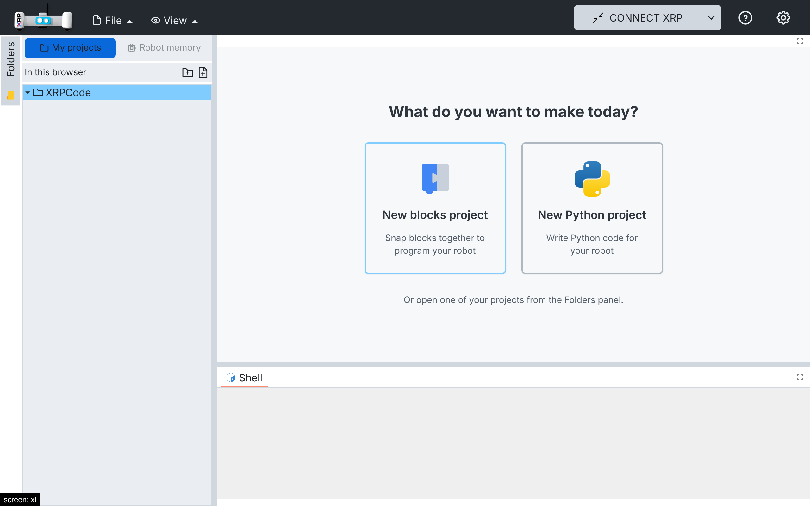 | 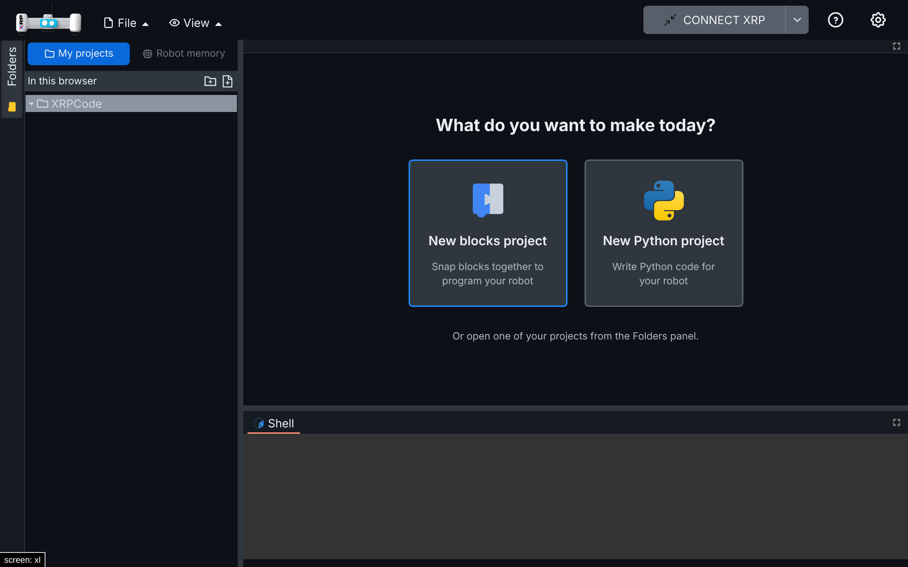 |
| Name the project | 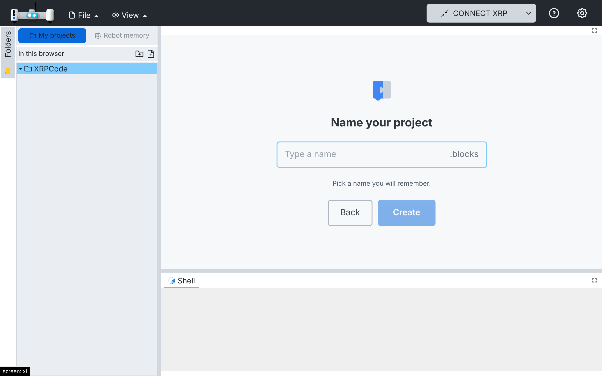 | 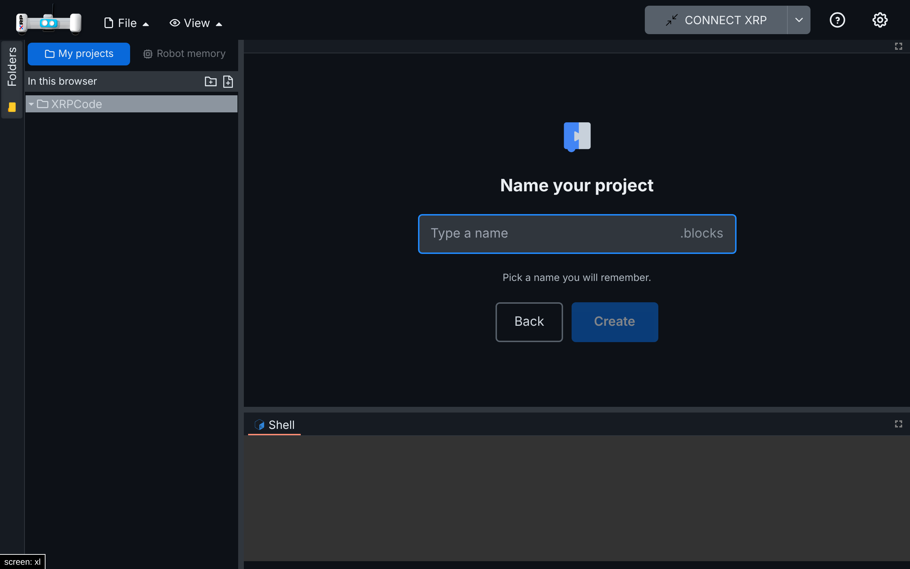 |

### Recent projects

#### Problem

The welcome screen ("New project") only offered new projects. To continue yesterday's project, a child
had to find it in the Explorer, among many files and folders.

#### Solution

- Below New blocks / New Python, **Your recent projects** shows up to six cards with the newest
  projects (`.blocks` and `.py`, subfolders included, trash left out): the blocks or Python icon,
  the name without its extension and how long ago it was changed ("5 minutes ago", "yesterday",
  "hace 2 días", "Just now"). One tap opens it, like the folder tree (`EVENT_OPEN_FILE`).
- `src/utils/recent-projects.ts` (new): picks the projects from the projects tree
  (`driveService.buildTree`, the same data as the folder tree, for My projects and Google Drive)
  and formats the time with `Intl.RelativeTimeFormat` in the app's language.
- The list loads when the welcome screen shows and again when the user signs in or out. Signed
  out, there is no list. With recent projects, the hint below says that all projects are in the
  Explorer.
- `src/managers/appmgr.ts`: `removeHandler(event, handler)` removes one handler, so the welcome
  screen unsubscribes when it unmounts without removing other components' handlers (`eventOff`
  removes them all).

#### Files

- New: `src/utils/recent-projects.ts`, `src/utils/recent-projects.spec.ts`.
- Changed: `src/components/welcome/welcome-screen.tsx` and its tests, `src/managers/appmgr.ts`
  (`removeHandler`), `src/utils/i18n/locales/{en,es}/{en,es}.json` (`welcome.recentTitle`,
  `welcome.justNow`, `welcome.moreHint`).

#### How to test

1. My projects: create `square` (blocks), `zigzag` (Python) and `line follower` (blocks) from the
   welcome screen, closing each tab. The welcome screen lists them newest first, "Just now".
2. Tap `zigzag`: `zigzag.py` opens. Close it: the list is back.
3. Spanish UI: "Tus proyectos recientes", "Recién".
4. Phone emulation: the cards stack and open with a tap.

| Light | Dark |
| --- | --- |
| 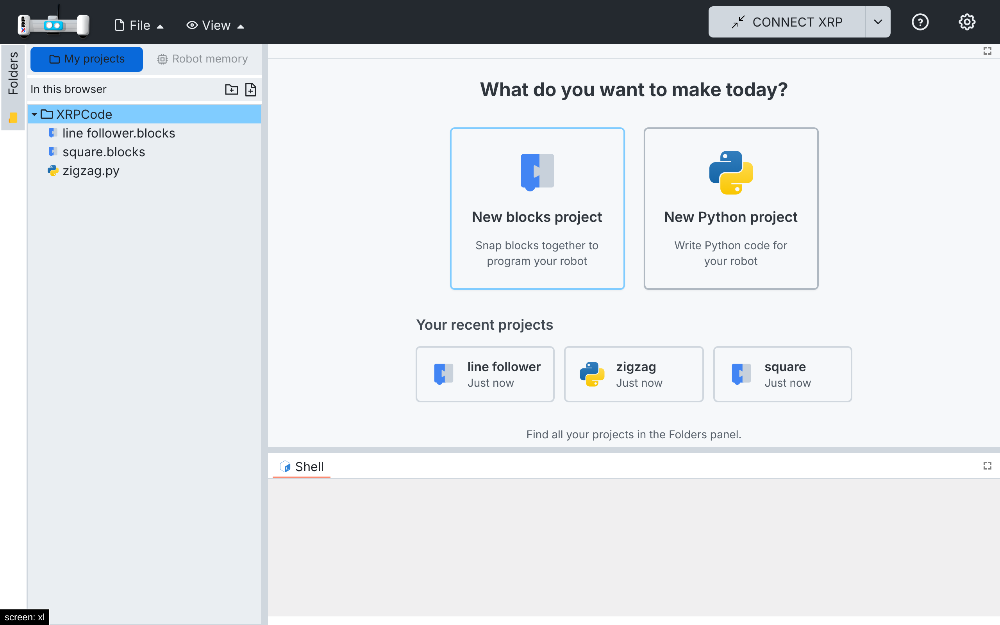 | 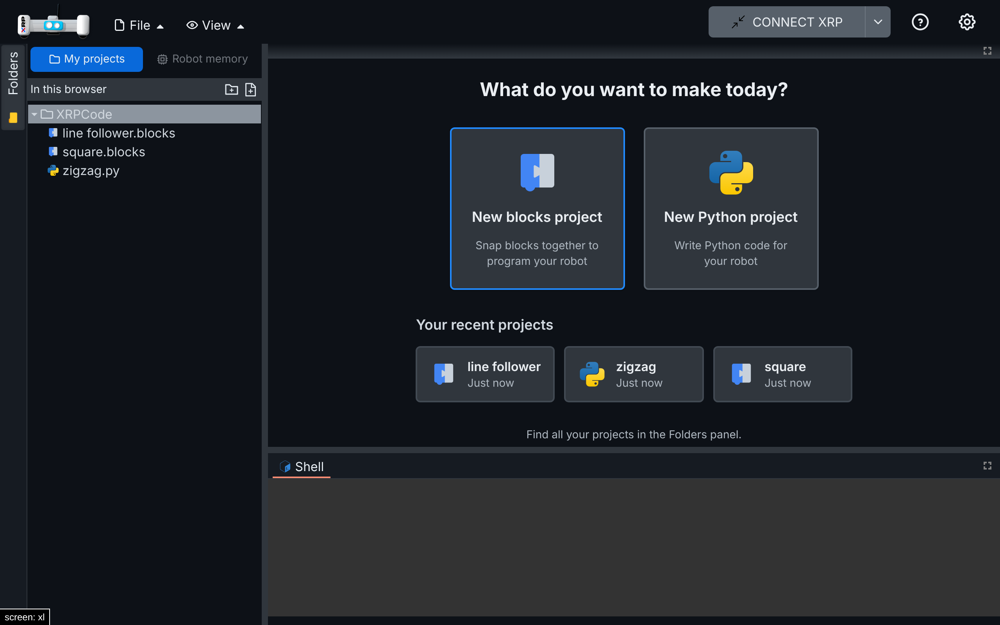 |

### Examples

#### Problem

A child who has never programmed the robot starts from an empty workspace and does not know which
blocks make it move. Working programs to start from and change are the quickest way in.

#### Solution

- Below the recent projects, **Start from an example** shows four cards, each with an icon and one
  sentence: **Drive and turn**, **Square**, **Avoid obstacles** and **Follow a line**.
- `src/utils/examples.ts` (new): the four blocks programs as Blockly JSON, built only from blocks
  in the XRP toolbox (block texts follow the app language on their own). Each one starts with
  "Wait for button press", so the robot does not drive off in the child's hand:
  - Drive and turn: straight 30 cm, turn 180°, straight 30 cm, LED on.
  - Square: repeat 4 times: straight 20 cm, turn 90°.
  - Avoid obstacles: forever: if the distance sensor reads less than 20 cm, stop and turn 90°;
    otherwise drive at effort 0.5.
  - Follow a line: forever: if the left reflectance is higher than the right one, slow the left
    wheel (0.2, 0.5); otherwise slow the right wheel (0.5, 0.2).
- Tapping a card goes through the same naming step as a new project, with the example's title
  already typed (accents dropped, so "Seguir la línea" becomes `Seguir la linea`). If that name is
  taken, the first free number is suggested (`Square 2`). The copy is saved in the user's projects
  and opened; the example itself never changes.
- `navbar.tsx` (`createNewFile`): the new file is created with `NewFileData.content` when it has
  one (empty otherwise, as before), and the editor tab loads that content when it mounts.

#### Files

- New: `src/utils/examples.ts`, `src/utils/examples.spec.ts`.
- Changed: `src/components/welcome/welcome-screen.tsx` and its tests, `src/components/navbar.tsx`
  (`createNewFile` uses `data.content`), `src/utils/i18n/locales/{en,es}/{en,es}.json`
  (`welcome.examplesTitle`, `welcome.examples.*`).

#### How to test

1. My projects, no tab open: tap **Square**. The name step shows `Square`; press Enter:
   `Square.blocks` opens with its blocks. Reload: the blocks are still there.
2. Close the tab and tap **Square** again: `Square 2` is suggested.
3. Spanish UI: "Empieza con un ejemplo"; **Evitar obstáculos** suggests `Evitar obstaculos` and the
   blocks show in Spanish.
4. With a robot (not tested yet): run each example and adjust distances, angles, efforts and the
   line comparison if needed.

| | Light | Dark |
| --- | --- | --- |
| Examples | 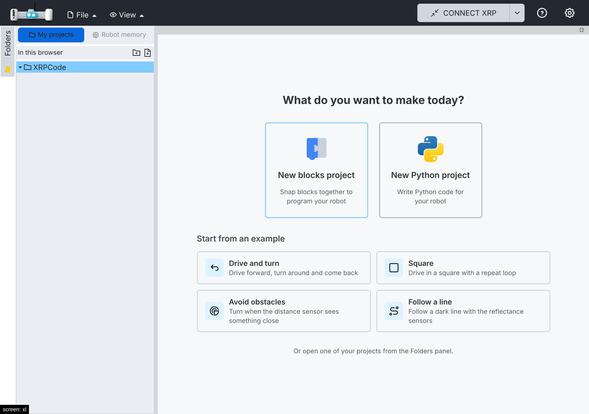 | 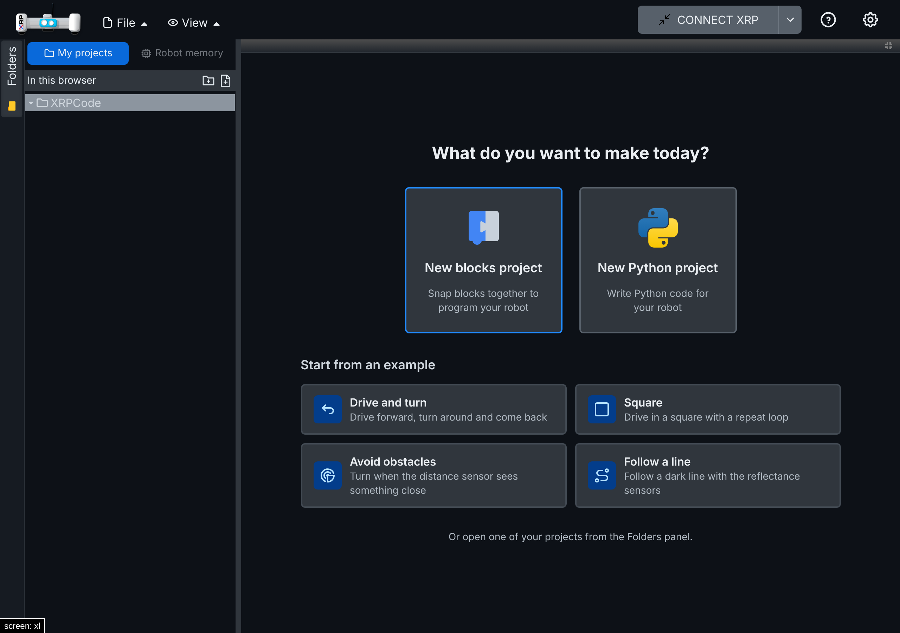 |
| Example opened | 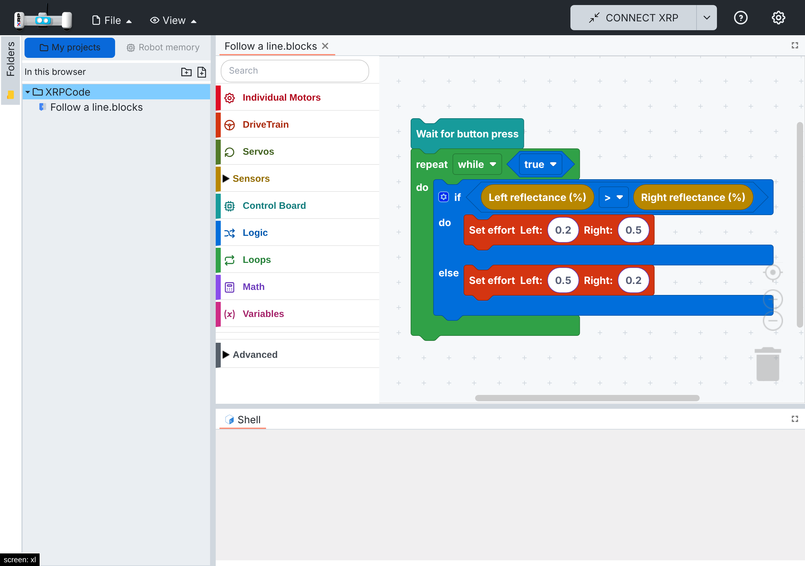 | 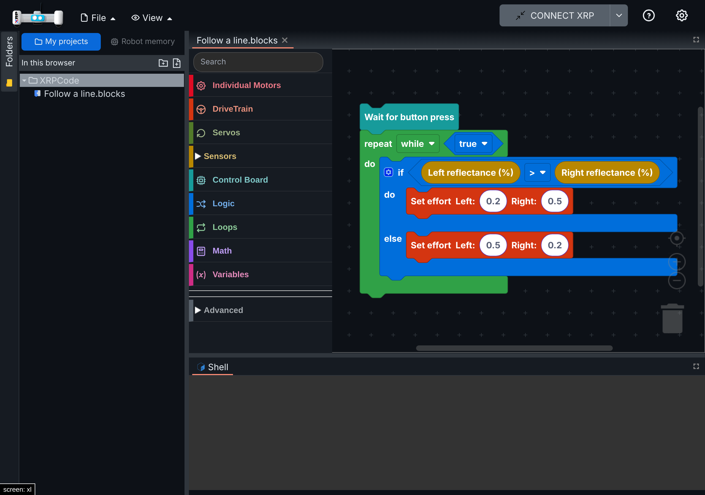 |

### Shell only with a project open

#### Problem

The shell takes a third of the screen under the welcome screen, where nothing can run yet. For a
child it is an empty black box with no purpose.

#### Solution

- `src/utils/shell-visibility.ts` (new): `syncShellVisibility(model)` maximizes the editor tabset
  while it has no tabs, which hides the shell tabset with flexlayout's own maximize (the terminal
  stays mounted, so its state and robot output are kept). The first open tab restores the layout,
  and closing the last tab hides the shell again.
- It only acts when the editor tabset changes between empty and not empty, so a maximize or restore
  the user chooses with projects open is kept.
- `xrplayout.tsx`: runs it once when the model is created and on every model change
  (`onModelChange`).
- Connecting the robot from the welcome screen shows no shell output; it appears as soon as a
  project is opened, which running a program needs anyway.

#### Files

- New: `src/utils/shell-visibility.ts`, `src/utils/shell-visibility.spec.ts`.
- Changed: `src/components/xrplayout.tsx` (3 lines).

#### How to test

1. No tab open: the welcome screen fills the editor area and there is no shell.
2. Open or create a project: the shell shows below the editor. Reload: still there.
3. Close the last tab: the shell hides and the welcome screen fills the area again.

The **Examples** screenshots above show the welcome screen without the shell, and **Example
opened** shows it back with a project open.

### Upstream

Fork-specific (kids UI). `createNewFile` / `EVENT_NEW_PROJECT` and `AppMgr.removeHandler` could
serve XRPWeb too. Hiding the shell with no tabs open is a small, separate change XRPWeb could take
on its own. Creating a new file with content (`NewFileData.content`) is a small change XRPWeb
could use for its own examples.

## Part 3 — Close button on modals

### Problem

Most modals could only be closed with their Cancel button or the Escape key. Children on tablets
expect an X in the corner, and they have no Escape key. Escape also closed the native `<dialog>`
without running the dialog's Cancel action, so state such as "Running" could stay stuck (for
example in the power switch and battery dialogs).

### Solution

- `src/components/dialogs/dialog-close.ts` (new): a context and the `useDialogClose(action)` hook.
  Dialog content registers what closing means for it: a function, `'host'` for the host's plain
  close (`toggleDialog` of `<Dialog>`), or nothing for "cannot be closed".
- `src/components/dialogs/dialog.tsx`: shows an X (40 px, top right, "Close" label through i18n)
  while a close action is registered, and runs the same action on Escape. Busy and progress
  dialogs register nothing, so they have no X and Escape works as before.
- `src/components/dialogs/dialog-footer.tsx`: registers its Cancel action automatically, so the
  16 dialogs that use it get the X with no change. For dialogs without Cancel (alert, login,
  copy files) the X closes them like their only button, and it is hidden while that button is
  disabled (copying files). New optional `closeCallback` prop to override this.
- Dialogs without the footer register their close: backup/restore menu, backup and restore
  (hidden while running), firmware backup prompt, and connections (host close).
  `ble-reconnect-faileddlg.tsx` uses the host close, because its second button is an action
  ("USB connection"), not Cancel.
- Dialogs that already had their own X (language, theme, change log, firmware loader, view
  Python) are unchanged.

### Screenshots

| Light | Dark |
| --- | --- |
| 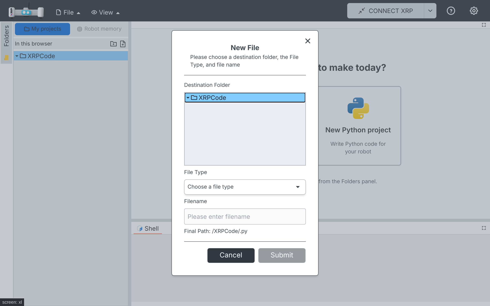 | 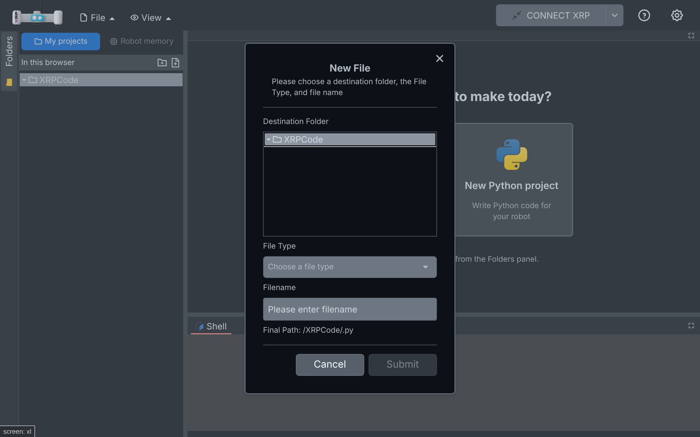 |

### Files

- New: `src/components/dialogs/dialog-close.ts`, `src/components/dialogs/dialog-close.spec.tsx`.
- Changed: `dialog.tsx`, `dialog-footer.tsx`, `ble-reconnect-faileddlg.tsx`,
  `backup-restoredlg.tsx`, `backupdlg.tsx`, `restoredlg.tsx`, `firmware-backup-promptdlg.tsx`,
  `connectiondlg.tsx` (one line each, plus the import).

### How to test

1. File > New File: the X closes it; open again and press Escape: it closes; it opens again.
2. Connect XRP: the connections dialog has an X that closes it.
4. Language and theme dialogs show a single X (their own).
5. With a robot: Run with the power switch off, close the warning with the X: Run is available
   again (same as Cancel).

### Upstream

Possible: it changes the shared XRPWeb dialog and footer with small hooks, and the behaviour is
the same as each dialog's Cancel.

## Part 4 — Layout

The side bar, the editor area and the terminal. This part replaces the rule of "Shell only with a project open" (Part 2): the terminal is now off by default and the user toggles it.

### Explorer icon in a side bar, collapsed by default

#### Problem

The left edge showed a vertical "Folders" text tab, and the folder panel opened expanded at
every start (300 px), taking room from the block canvas even when the child already had a
project open.

#### Solution

- The tab is now an icon (two files), like the activity bar of a code editor. Its tooltip and
  accessible name are "Explorer" ("Explorador" in Spanish).
- The panel starts closed. A click on the icon opens it, another click closes it. (Part 6 later
  opens it at start on wider screens; on phones it still starts closed.)
- The open panel is marked with the accent line on the icon's outer edge.
- The panel's header reads "Explorer" ("Explorador") instead of "My projects", and its new file
  and new folder buttons use clearer icons (a page and a folder, each with a plus), new file
  first.
- The file tree rows are lighter: folder and chevron icons in the same line style as the header
  buttons, a soft rounded highlight for the hovered and the selected row (no dark bar), small
  muted Rename and Delete icons that appear on hover (Delete turns red), and no outline box
  around the tree.
- Fix: the tree was empty the first time the panel was opened, because the panel starts closed
  and the tree missed the list of projects sent at start. It now reads the last list when it
  opens.

### Terminal icon, off by default

#### Problem

With a project open, the terminal (Shell) took a third of the editor area. Children only need
it to see what the program prints or to debug.

#### Solution

- A Terminal icon sits below the Explorer icon. A click shows the terminal under the editor,
  another click hides it. It is highlighted while the terminal shows.
- The terminal is off the first time. The choice is remembered on the device.
- The Terminal icon works the same on the welcome screen, with no project open.
- Hiding the terminal does not close it: what the program printed is still there when it is
  shown again.
- Its tab is named "Terminal" instead of "Shell", the more common word, and shows the same icon
  as the side bar so the two are associated.

### Rounded panels, one colour each

#### Problem

The panels were squares pressed against each other, split by grey lines, and each one mixed
several background colours: the tab bar, the folder rows, the terminal and the toolbox lines
all differed. The screen looked busy.

#### Solution

- The side panel, the editor and the terminal are rounded cards on a frame colour, with a small
  gap between them, like a modern code editor.
- The frame colour is shared by the side bar, the status bar and, in dark mode, the top bar.
- Each card has one colour, and the tab bar is a slightly different tone so tabs stand out from
  the content. The panel corners are rounded all around, also at the bottom. The folder rows and
  the terminal match the card. There
  are no lines between the tab bar and the content, under the status bar, between toolbox rows
  or around the side panel's rows.

- The toolbox search box can be clicked and typed in, has a flat focus outline and no gradient in
  dark mode. Dialogs opened from the side panel keep their own colours.

### Narrow screens: one menu

On a phone the top bar had everything of the desktop bar squeezed in: tiny text and no room. The
page also drew at desktop width, because the viewport tag was commented out in `index.html`
(upstream). Now:

- The page uses the device width, so text and buttons have their real size.
- Below 768 px the bar shows the logo, **Connect** (**Run/Stop** once a robot is connected) and a
  **menu (☰)** button at the right. Wider screens keep the bar as it was.
- The menu opens full screen, like the panels of a code editor's activity bar, and lists File, View (in the block editor), Help and Settings (language, theme, "Keep me
  signed in", and the rest of the settings items), and at the bottom the account: sign in, or
  the avatar with Sign out. The account widget is mounted once in both layouts, so its session
  logic does not start twice. In builds without sign-in the bottom stays empty.
- The menu closes with Escape, an outside tap or after choosing an entry.
- On phones the **Connect** button shows only its icon (with the full text as tooltip and
  accessible name), so the top bar keeps one height in every language.
- The app is pinned to the edges of the visible screen (a fixed box, which follows the phone's
  browser bar as it comes and goes): the top bar and the status bar take the room they need and
  the main area takes the rest, so the page itself never scrolls and no part of the top is pushed
  out of reach.

### Files

- `src/components/xrplayout.tsx`: the side bar starts collapsed; the folder tab renders the
  Explorer icon; the Terminal toggle is added to the side bar.
- `src/components/side-bar-icon.tsx` (new): a side bar icon, as a tab or as a toggle button.
- `src/components/folder-tree.tsx`, `src/utils/google-utils.tsx`: the row look; the last project
  list is kept so a tree that opens later shows it.
- `src/utils/shell-visibility.ts`: the shell shows with a project open and the terminal on;
  `toggleTerminal` and the remembered choice.
- `src/utils/localstorage.ts`: `Terminal` key.
- `src/theme/github/app.css`: side bar icon buttons; the frame colour, gaps, rounded cards and
  one colour per card.
- `src/components/folder-header.tsx`: new file and new folder icons.
- `src/components/xrpshell.tsx`: the terminal uses the card colour.
- `src/components/status-bar/status-bar.tsx`, `src/App.tsx`: the status bar (and the dark top bar) use the
  frame colour; no line above the status bar.
- `src/components/blockly/toolbox-ui.css`: no lines between toolbox rows or at separators.
- `src/utils/i18n/locales/{en,es}/*.json`: `explorer`, `terminal`; the Shell tab is "Terminal";
  the panel header is "Explorer" ("Explorador").
- `src/components/navbar/mobile-menu.tsx` (new), `src/components/navbar.tsx`, `src/App.tsx`,
  `index.html`: the narrow-screen menu, the fixed bar, the viewport tag. i18n: `menu`.
- Tests: `src/utils/shell-visibility.spec.ts`,
  `src/components/side-bar-icon.spec.tsx`, `src/components/navbar/mobile-menu.spec.tsx`.

### How to test

1. Open the app: the side bar shows two icons and no "Folders" text; the folder panel and the
   terminal are hidden.
2. Hover each icon: "Explorer" and "Terminal". In Spanish: "Explorador" and "Terminal".
3. Click Explorer: the projects panel opens with the project list (also the first time). Hover a
   file: Rename and Delete appear. Click again on the icon: it closes.
4. On the welcome screen and with a project open, click Terminal: it shows under the editor.
   Click again: it hides. The tab shows the same icon as the side bar.
5. Turn the terminal on and reload: it is still on.
6. In light and dark: the side panel, editor and terminal are rounded cards with a gap between
   them; no grey lines between panels, under the tab bar, between toolbox rows or above the
   status bar; the terminal and the folder rows have the same colour as their card.
7. On a phone (or a window narrower than 768 px): the bar shows the logo, Connect and ☰. ☰ opens
   the menu with File, Help, Settings and, at the bottom, the account. Pick an entry: the menu
   closes. On a wider window the bar is the same as before.

#### Screenshots

Collapsed side bar with a project open (the editor fills the frame):

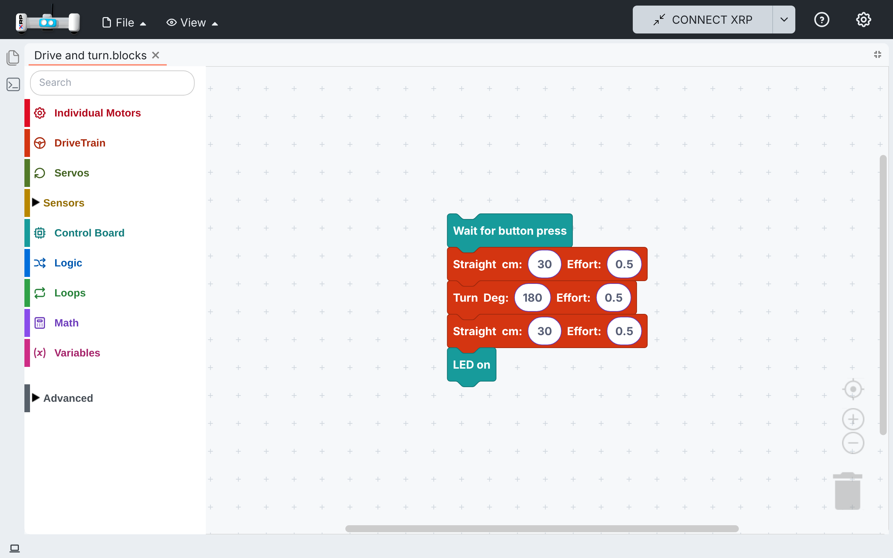
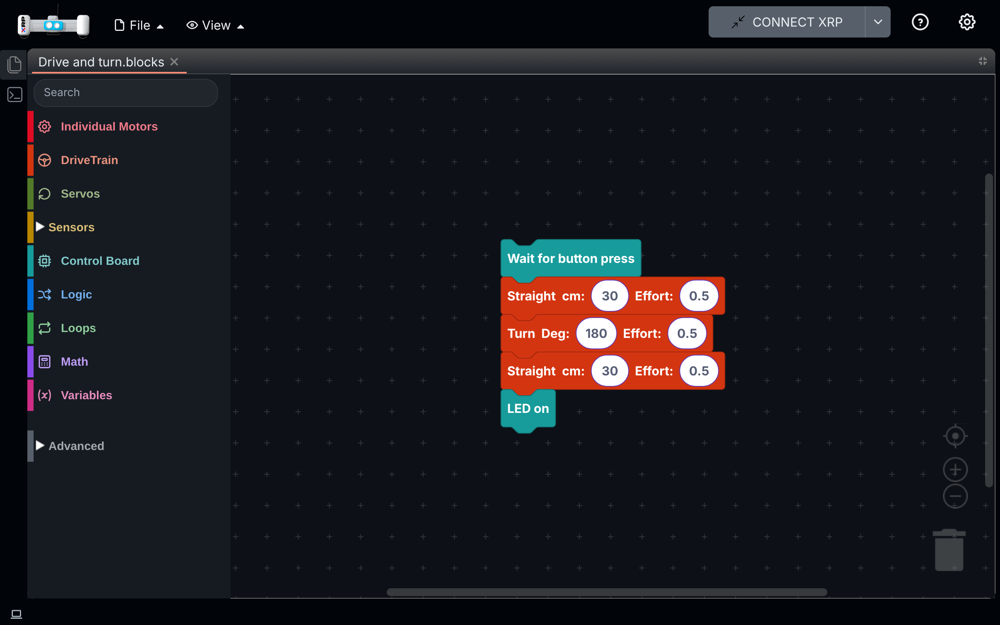

Explorer and terminal open:

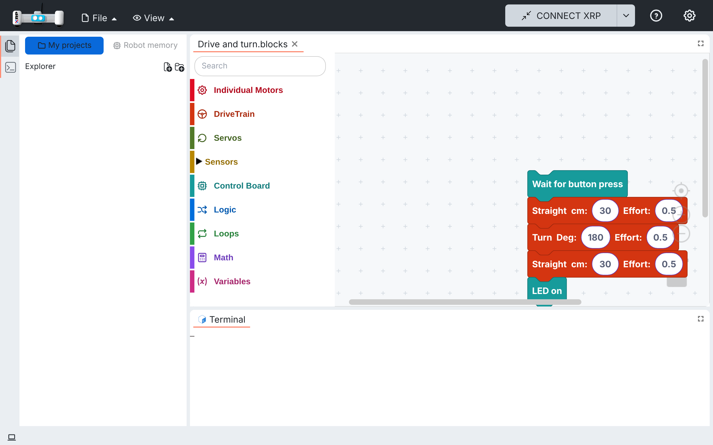
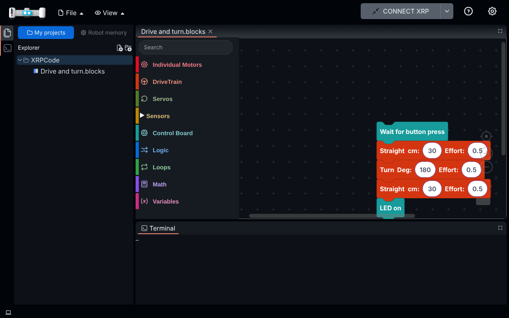

Phone width:

| Light | Menu, light | Dark | Menu, dark |
| --- | --- | --- | --- |
| 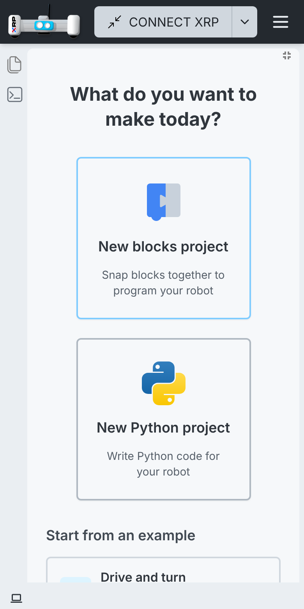 | 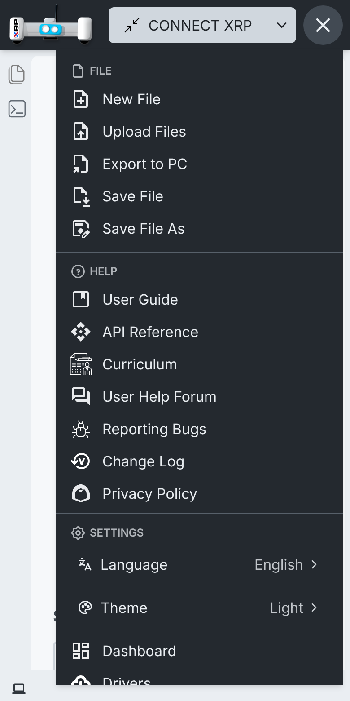 | 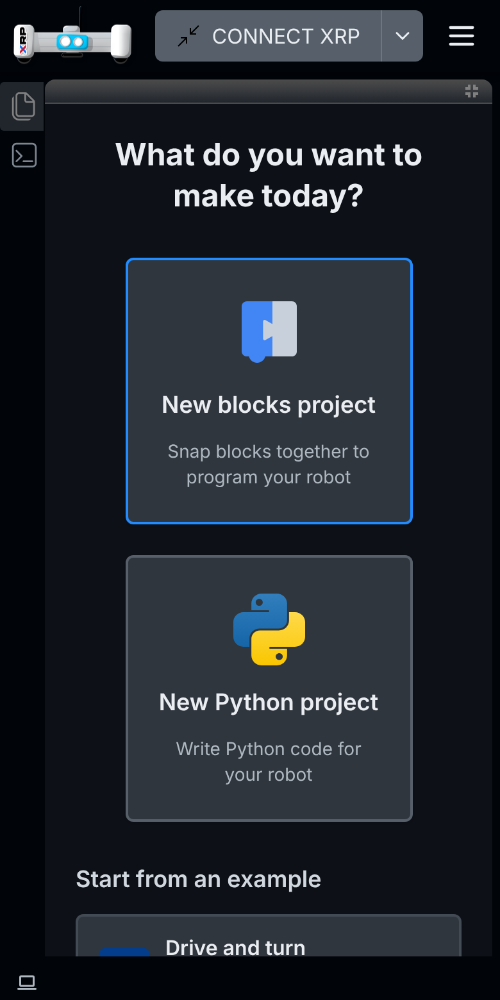 | 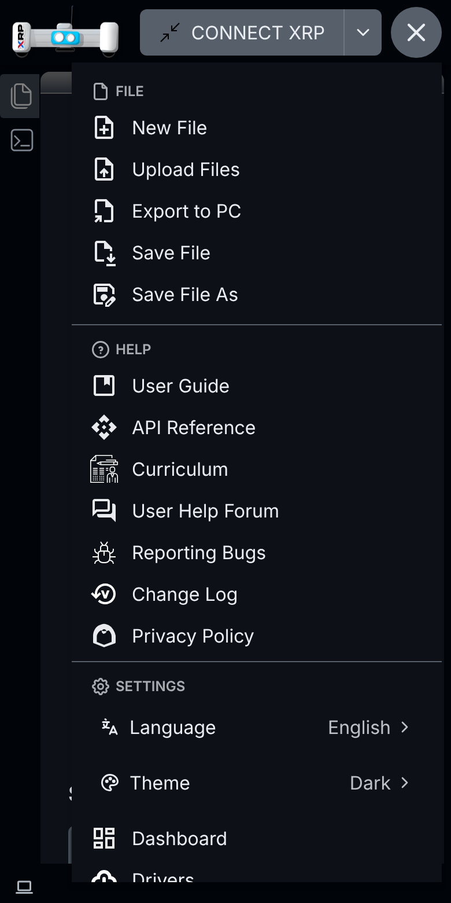 |

### Upstream

Fork-specific (kids UI). XRPWeb could take the Explorer icon on its own; hiding the terminal by
default suits a kids' editor more than XRPWeb's.

## Part 5 — Bottom of the app on phones

### Problem

In Chrome on an Android phone, the bottom of the app (the status bar, the Trash row, the last
toolbox icon and the workspace scrollbar) was under the bottom edge of the screen. About 56 px were
missing, the height of Chrome's address bar. The earlier fix for tablets (spec 002, part 5) sized
the app box by the visible area, but an older rule of the app gave the box the full screen height
(`100vh`, which counts the address bar as hidden). That rule is loaded later and won, so the fix had
no effect.

### Solution

- The app box rule is now more specific than the older one, so the visible area always wins.
- The page is exactly the visible height, and the app box takes the dynamic viewport height
  (`100dvh`, the area that is really visible) where the browser supports it.

### Files

- Changed: `src/index.css`.

### How to test

1. On an Android phone, open the app in Chrome with the address bar showing.
2. Open a blocks file: the status bar is at the bottom of the screen, and the last toolbox icon and
   the workspace scrollbar are fully visible.
3. Open the side bar: the Trash row is visible.
4. Repeat on an Android tablet: the bottom of the app is not under the bar.

No screenshots: desktop browsers and test browsers have no address bar that changes the height, so
the problem only shows on a real phone.

### Upstream

XRPWeb's `100vh` app height has the same problem on Android phones and tablets and could take the
same idea.

## Part 6 — Choosing the editor

### Problem

To see the Python of a blocks program, children had to open View > View Python File, a modal
window over the editor. View > Convert to Python asked for confirmation in another modal, then
replaced the blocks file with a Python file and moved the blocks to the trash. Neither is easy to
find, and the conversion cannot be undone from the editor. MakeCode solves this with a selector in
the middle of its top bar.

### Solution

- **Blocks file:** the top bar shows a "Blocks | Python" selector in the middle. Python shows the
  Python that comes from the blocks, in place of the canvas: read-only, coloured, with line
  numbers. A strip on top says "This Python comes from your blocks. To change it, change the
  blocks." Blocks brings the canvas back where it was. Each open tab remembers its choice.
- **Make an editable Python copy:** the button in that strip creates a Python file with the same
  name next to the blocks file (`robot.py`, or `robot 2.py`, `robot 3.py`, … when the name is
  taken) and opens it. The blocks file stays as it is. The copy is saved where the blocks file
  lives: My projects, or the robot's memory (a connected robot is needed then).
- **Python file:** there are no blocks, so the top bar only says "Python", as in MakeCode for
  Python projects.
- The two View menu entries and their modals are hidden.
- **Zoom in the Python editor:** round "+" and "−" buttons in the bottom right corner of a Python
  file make the code bigger or smaller, like the zoom buttons of the blocks. They replace the
  View menu's "Increase Font" and "Decrease Font", so the View menu is gone.
- **Explorer open on wider screens:** on a computer or tablet the Explorer starts open, so the
  project files are in sight next to the editor. On phones (below 768 px) it starts closed, as
  before, to leave the screen to the editor.
- The selector sits between the menus and the connect button, so it never covers them; when the
  top bar is narrow it moves a little off the middle.
- On phones the selector shows only its icons, so it fits between the logo and the connect button.
- The Python view uses a small built-in highlighter instead of the full Python editor, so it opens
  at once, also offline, without downloading the Python editor.

Later (backlog): an editable Python mirror of the blocks and a toolbox of code snippets with
explanations, as MakeCode's Python editor has.

| | Light | Dark |
| --- | --- | --- |
| Blocks | 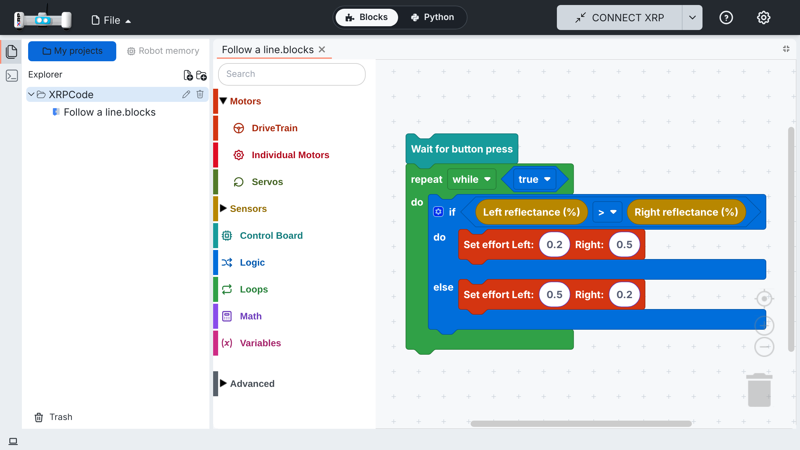 | 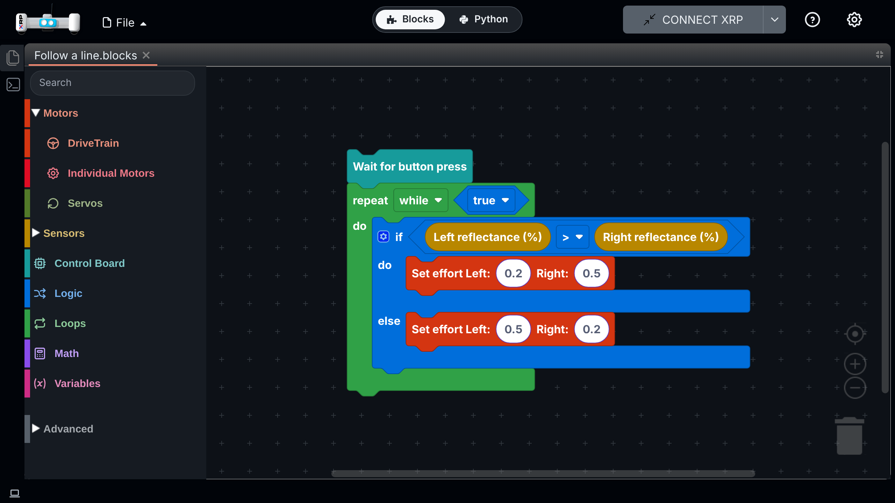 |
| Python | 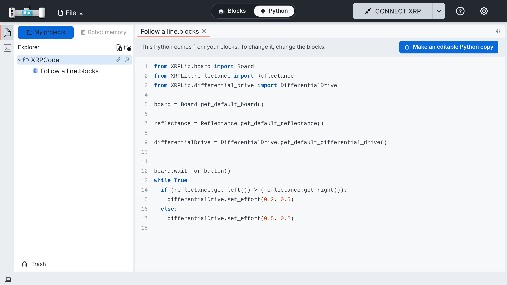 | 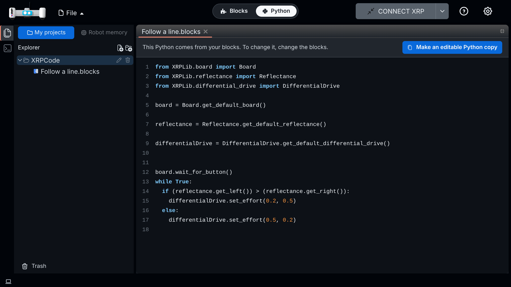 |
| Python file with zoom | 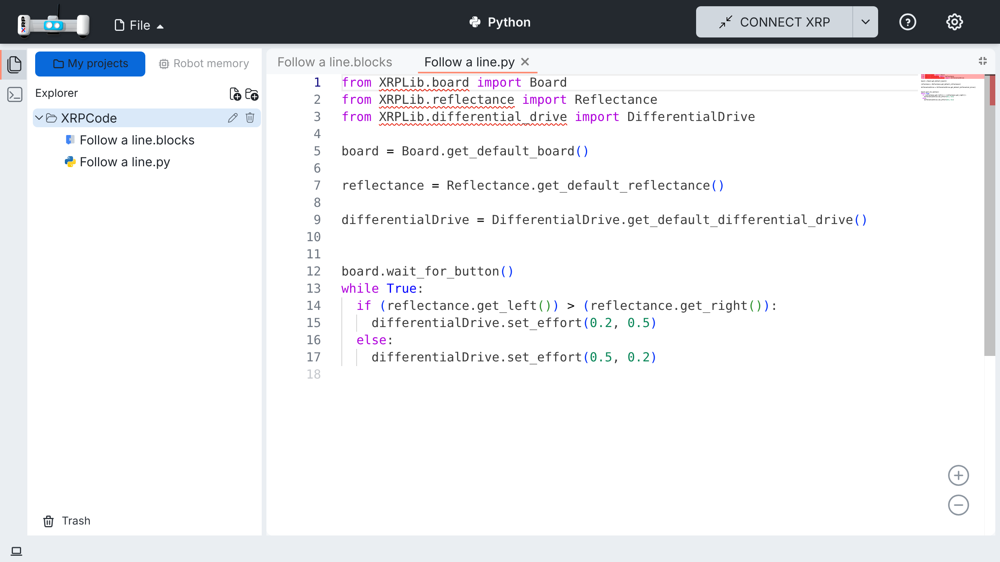 | 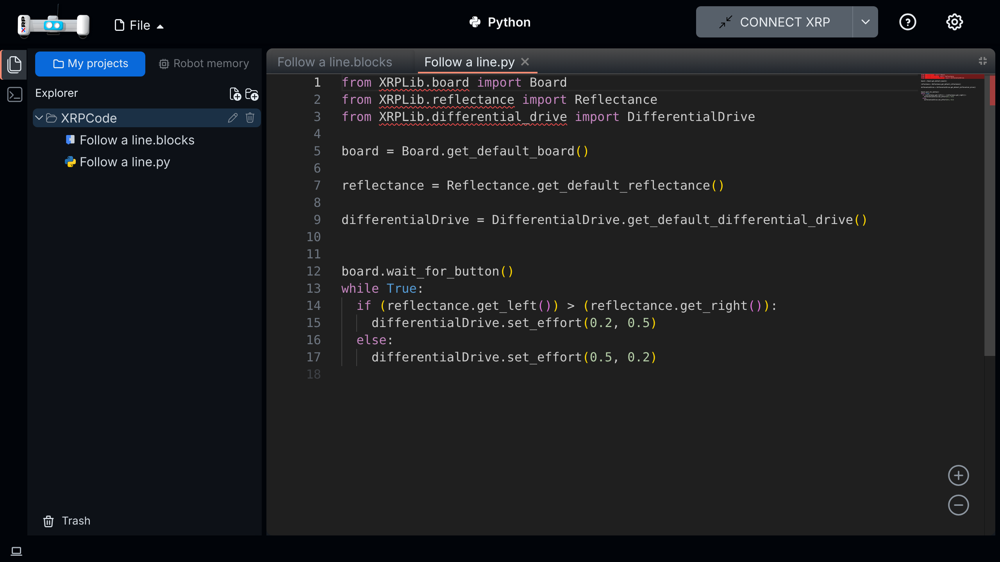 |

### Files

- New: `src/components/editor-switch.tsx` (the selector), `src/components/blockly/python-view.tsx`
  (the read-only Python), `src/components/blockly/python-copy.ts` (the editable copy),
  `src/utils/editor-view.ts` (each tab's choice, copy name, flag for the old menu entries),
  `src/utils/python-highlight.ts`, `src/components/python/zoom-controls.tsx` (zoom buttons).
- Changed: `src/components/navbar.tsx` (selector, old entries behind the flags `showPythonDialogs`
  and `showFontMenu`, empty menus hidden), `src/components/blockly.tsx` (shows the Python view),
  `src/components/MonacoEditor.tsx` (adds the zoom buttons), `src/components/xrplayout.tsx`
  (Explorer open at start on wider screens), en/es texts (`zoomIn`, `zoomOut`).
- Unchanged and still there: `src/components/dialogs/view-pythondlg.tsx` and the conversion code
  in `navbar.tsx`.
- Unit tests: `src/utils/editor-view.spec.ts`, `src/utils/python-highlight.spec.ts`,
  `src/components/editor-switch.spec.tsx`, `src/components/python/zoom-controls.spec.tsx`.

### How to test

1. Open the app on a computer: the Explorer is open. On a phone-sized window it starts closed.
   Open a blocks project: "Blocks | Python" is in the top bar, with Blocks selected, and does not
   touch the connect button. The View menu is not there.
2. Choose Python: the program shows as Python with colours and line numbers, and it cannot be
   typed in. Choose Blocks: the canvas is back at the same place and zoom.
3. Choose Python and press "Make an editable Python copy": `<name>.py` opens in a new tab and
   appears next to the blocks file in My projects; the blocks file is still there. Press it again
   from the blocks tab: the new copy is `<name> 2.py`.
4. In the Python tab, the top bar only says "Python" and there is no View menu. The "+" and "−"
   buttons in the bottom right corner make the code bigger and smaller.
5. Open two blocks files and choose Python in one: switching tabs shows each one's choice.
6. Make the window phone-sized: the selector shows only its icons and does not cover the logo or
   the connect button.
7. Switch the language to Spanish: "Bloques | Python" and the strip are in Spanish.
8. With a robot in Robot memory, a copy of a robot blocks file is written to the robot; without a
   connected robot the app says the XRP is not connected.

### Upstream

Fork-only (kids UI). XRPWeb keeps its View menu entries; the selector could be offered to XRPWeb
later.

## Part 7 — Menus above the editor

### Problem

On a phone, in Blocks mode, the menu of the top bar (File, Help and Settings entries) was drawn
under the coloured strip of block categories: the strip covered the start of the icons and texts
of every entry. The top bar sat below the block editor's own layers, so any menu opened from it
could be hidden by the toolbox.

### Solution

The top bar is now above every editor surface (toolbox, block lists, workspace, drag layer), so all
its menus are on top: the phone menu, the Help and Settings menus on tablet and desktop, and the
language and theme sub-menus. Dialogs still open above the top bar.

Before (phone, Blocks mode, menu open):

| Light | Dark |
| --- | --- |
| 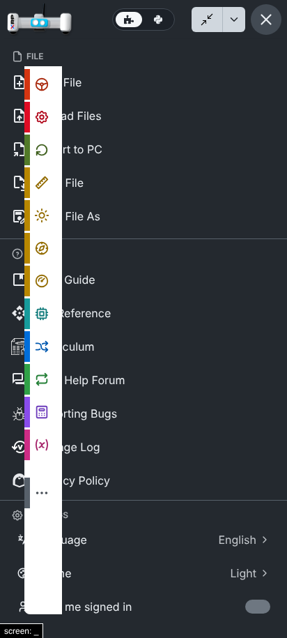 | 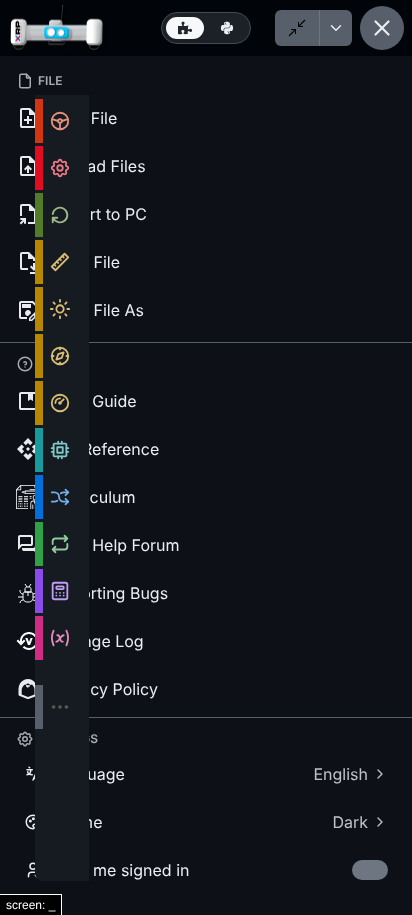 |

After:

| Light | Dark |
| --- | --- |
| 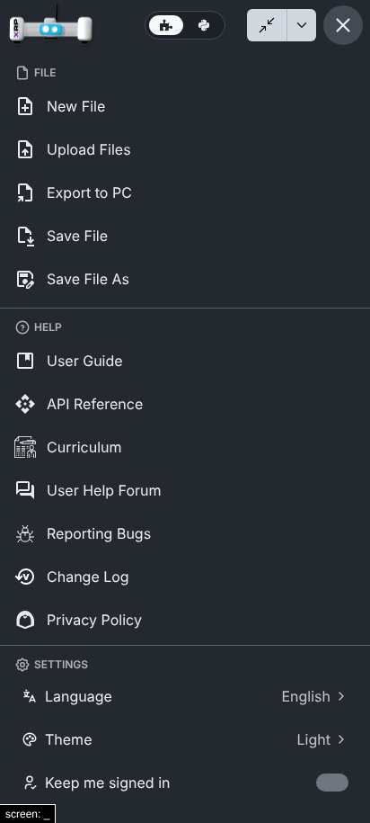 | 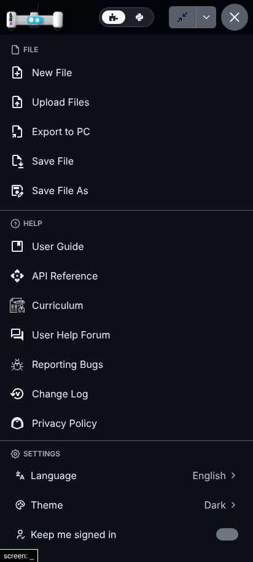 |

### Files

- `src/App.tsx`: the top bar's stacking level.
- `e2e/menu-layering.spec.ts`: on a phone the open menu is the topmost element over the toolbox; on
  desktop the Settings menu is topmost.
- `e2e/visual/screens.spec.ts`: `phone-menu-blocks-{light,dark}` screenshots.

### How to test

1. Open a Blocks project on an Android phone (portrait) and tap the menu button: every entry is
   fully visible, nothing is drawn over it.
2. On desktop and tablet open Help and Settings in Blocks mode: the menus cover the toolbox.
3. Open a dialog (for example Backup/Restore): it is still above the top bar.

### Upstream

Fork-only (the phone menu belongs to the kids UI).

## Part 8 — The Python view of older blocks files

### Problem

With "Python" chosen in the top bar, blocks files created before the selector (for example
"Follow a line.blocks" or "Drive and turn.blocks" in My projects) could show an empty Python view,
or the selector said "Python" while the blocks canvas still showed.

Two causes:

- The blocks of a file arrive a moment after its tab opens, and they are loaded without telling the
  workspace's listeners. The Python was generated when Python was chosen (or when the workspace
  was created) and never again, so it stayed empty for a file whose blocks came later.
- The tab forgot its choice when the editor component was taken down (the layout can rebuild a
  hidden tab), while the selector kept saying "Python".

Files saved by older versions only hold the blocks JSON (a project created from an example and not
edited yet is stored the same way), with or without the `##XRPBLOCKS` line and the date line. The
Python and the date in a saved file are never read: the Python always comes from the blocks.

### Solution

- The Python view is generated again every time the blocks of the tab are loaded, so it matches the
  blocks whenever Python is chosen: before the file finishes opening, after it, after switching tabs,
  and after reopening the file.
- The tab keeps its choice until the tab is closed.
- The Python is the same text the generator gives for the file's blocks, so Run and the upload to
  the robot send the same program for an old file as for a new one.
- The screen looks as before (no new screenshots).

### Files

- New: `src/components/blockly/use-python-view.tsx` (the view hook, with the reload after each load),
  `e2e/python-view-old-files.spec.ts`, `src/components/blockly/use-python-view.spec.tsx`.
- Changed: `src/components/blockly.tsx` (tells the hook when blocks were loaded; reads the blocks
  with `extractBlocksJson`), `src/components/blockly/blocks-content.ts` (`extractBlocksJson`),
  `src/managers/editormgr.ts` (forgets the choice when the tab closes), `e2e/support/app.ts`
  (the folder tree is found when a blocks tab is open too),
  `src/components/blockly/blocks-content.spec.ts`.

### How to test

1. In My projects create a blocks project from an example ("Follow a line") and close it. Open it
   again and choose Python in the top bar: the Python of the blocks shows, never an empty view.
2. Open a blocks file, choose Python right away while it is still opening: the Python appears when
   the blocks have loaded.
3. Choose Python, switch to another tab and back, or reopen the file: Python is still chosen and
   shows the code.
4. Choose Blocks: the canvas is back where it was. Run the file: the robot gets the same program as
   before.

### Upstream

Fork-only (the Python selector belongs to the fork).
