# 004 — File management

Creating, opening, saving and organising files and projects: My projects in the browser, the robot's memory, opening files with their blocks, opening projects fast, and automatic save. Add a part here for changes to how files are handled.

## Part 1 — My projects

Projects without a robot or a Google account, and the robot's files one click away. Two parts:
projects kept in the browser, then when they are used and how to switch to the robot's memory.

### Problem

XRPWeb stores projects in one of two places:

- **Robot memory** (default, no Google): the folder tree shows the files on the XRP, and New and
  Save write to it. Needs a connected robot.
- **Google Drive** (signed in): projects live in Drive; Run copies the program to the robot.

With neither a robot nor Google, the File menu is disabled and the editor stays empty. This blocks:

- Students practicing at home without a robot.
- Schools that do not allow Google accounts for kids.
- Teachers preparing programs before class.

### Projects in the browser

#### Solution

Projects are kept in the browser (IndexedDB), with no account and no robot required.

- `LocalDriveService` implements the same interface as `GoogleDriveService` (create, read, update,
  rename, move, delete, list, folder tree) on top of IndexedDB.
- `AppMgr` uses `LocalDriveService` when My projects is enabled (see "When My projects is used"), and a `LocalSession`
  widget replaces the Google sign-in button: it signs in to the local drive automatically on
  startup.
- Because the local drive behaves like Google Drive, the existing code paths work unchanged: file
  tree, New / Open / Save, autosave, and Run (which copies the program to the XRP when connected).
- The root `XRPCode` folder is created once, even when React's StrictMode mounts twice.

#### Files

- New: `src/services/local-drive.ts` (service, IndexedDB and in-memory stores),
  `src/widgets/local-session.tsx`.
- Hooks: `src/managers/appmgr.ts` (service selection), `src/widgets/login.tsx` (local session),
  `src/components/folder-tree.tsx` (skip the Google Drive first-login notice),
  `src/components/xrplayout.tsx` (no Google Drive icon on local tabs).

#### How to test

1. Open an offline build, with no robot connected.
2. File → New File → Blockly, name it, Submit: the editor opens and the file appears in the tree.
3. Add a block, File → Save File, reload the page: the file and the block are still there.
4. Rename, move and delete files and folders from the tree.

Automated: `src/services/tests/local-drive.spec.ts` (create/read/update, folder tree, rename, move,
recursive delete, persistence, single root folder under concurrent calls).

### When My projects is used, and the robot's memory

The first version only worked in offline builds, and once on, it hid the robot's files even with a
robot connected, which XRPWeb's default mode relies on.

#### Solution

Fill the gap without changing XRPWeb's two modes:

- **When it applies:** My projects is used when Google sign-in is not available, that is offline
  builds or builds without `GOOGLE_AUTH_URL` (`isLocalProjectsEnabled`). Builds with Google keep
  XRPWeb's behaviour unchanged, because Google sign-in and My projects share the same session slot
  in the code and that interaction cannot be tested here.
- **Like Google Drive in XRPWeb:** connecting a robot does not change the tree. The project stays
  open, and Run copies it to the robot (the same path XRPWeb uses for Drive files).
- **"My projects | Robot memory" switch** above the folder tree. Robot memory shows the connected
  robot's files exactly as XRPWeb does without Google (`showRobotMemory()`). It is disabled
  ("Connect the robot to see its memory") without a robot. If the robot disconnects while showing
  its memory, the switch goes back to My projects.
- Editors opened from My projects stay open while the robot memory is shown, read-only, with a
  message asking to choose My projects again.
- The tree header under the switch reads "In this browser".

#### Files

- New: `src/utils/local-projects.ts` (`startMyProjects`, `showRobotMemory`, `isRobotConnected`),
  `src/components/storage-switch.tsx`, `src/utils/i18n/locales/{en,es}/local-projects.json` (My
  projects wording, split from `offline.json`).
- Changed: `src/utils/offline.ts` (`isLocalProjectsEnabled`), `src/widgets/local-session.tsx`
  (uses `startMyProjects`); `appmgr.ts`, `login.tsx`, `xrplayout.tsx`, `folder-tree.tsx`,
  `navbar.tsx`, `session.ts` and `i18n/index.ts` check `isLocalProjectsEnabled` instead of
  `isOfflineBuild`.

#### How to test

Without a robot (tested):

1. Open a build without Google sign-in, or an offline build.
2. The switch shows My projects selected and Robot memory disabled.
3. File → New File, add a block, Save, reload: the project is still there.

With a robot (**not tested yet**; needs a real XRP):

1. Connect the robot while a project from My projects is open: the tree does not change.
2. Run: the program is copied to the robot and runs.
3. Choose Robot memory: the tree shows the robot's files and storage ("XRP Filesystem: X MB");
   New and Save write to the robot, as in XRPWeb.
4. Disconnect the robot while showing its memory: the switch goes back to My projects.

Automated: `src/components/tests/storage-switch.spec.tsx` (disabled without a robot, switching,
return to My projects on disconnect, follows sign-in events) and the locale override tests.

#### Screenshots

| Light (normal build, no Google) | Dark |
| --- | --- |
| 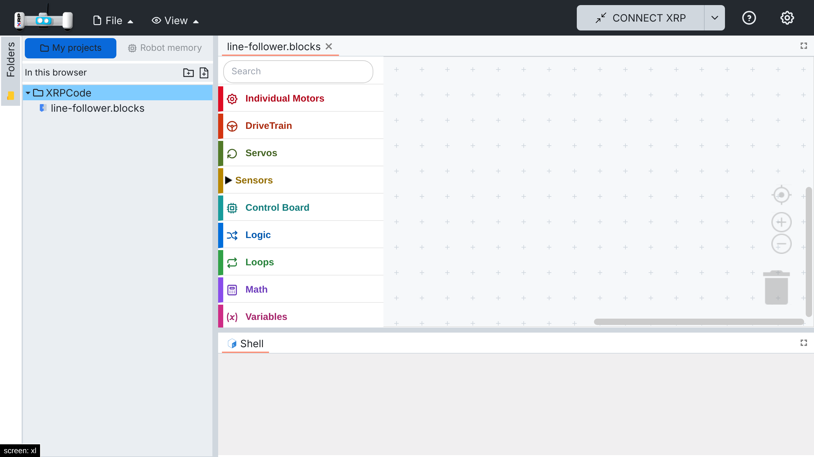 | 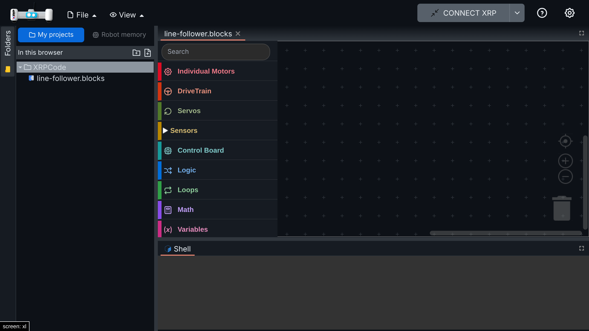 |

### Known limitations

- Projects live in one browser profile. Export to PC is the backup path; Drive backup is in the
  backlog.

### Upstream

Proposed as a feature request: [Open-STEM/XRPWeb#336](https://github.com/Open-STEM/XRPWeb/issues/336).
This answers it without changing the existing modes. The local drive service can be reused as is;
the way it is activated would follow the team's answer.

## Part 2 — Files from My projects open with their blocks

### Problem

Opening a saved `.blocks` file from My projects showed an empty workspace, even though the file was
saved correctly. Unsaved blocks were also lost after a reload.

react-blockly imports its `initialJson` (an empty workspace) one render after it injects the
workspace. My projects reads the file from IndexedDB almost instantly, so the file's blocks were
loaded before that import, and the import then cleared them. Files from Google Drive or the robot
usually arrive later, after the import, which is why XRPWeb rarely shows it.

### Solution

`src/components/blockly.tsx`: a file that arrives before the initial import (or before the
workspace exists) is kept and loaded when the import finishes (`FINISHED_LOADING`). The flag is
reset whenever a workspace is injected.

### Files

- `src/components/blockly.tsx` (`EVENT_EDITOR_LOAD` listener, workspace change listener,
  `handleOnInject`).

### How to test

1. My projects: create a `.blocks` file, add blocks, save, close the tab, open it again from the
   folder tree: the blocks are there (before: empty).
2. Add blocks without saving and reload: the tab comes back with the blocks (before: empty).
3. A new file starts empty; closing a file that was only opened does not ask about unsaved changes.

| Light | Dark |
| --- | --- |
| 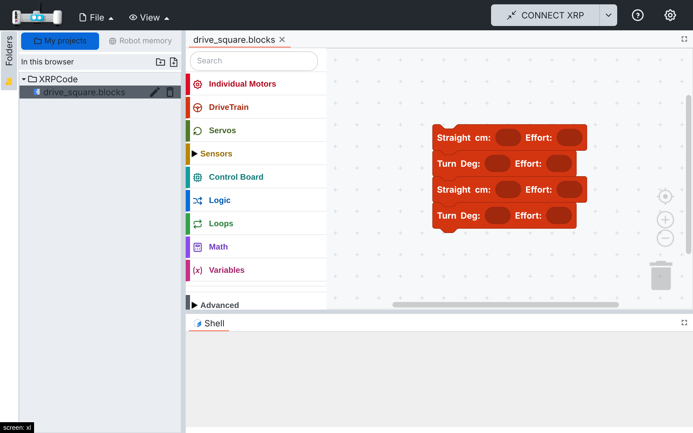 | 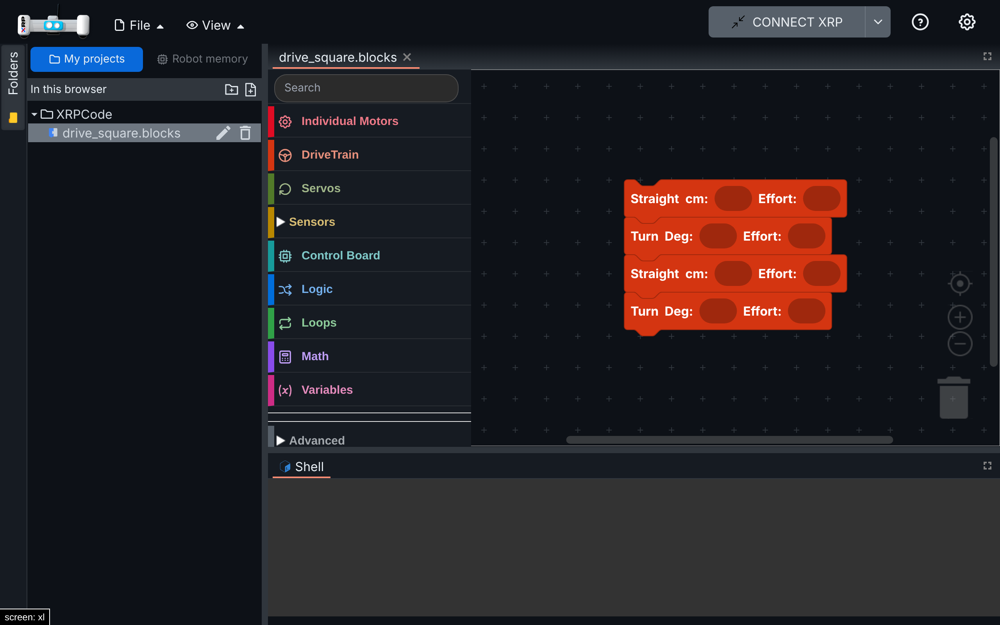 |

### Upstream

The race is in XRPWeb's code; it shows up whenever a file loads fast. Possible to propose.

## Part 3 — Opening projects

Changes that make opening projects easier for kids: open files with a single tap, reopen the last
project on startup, and open blocks projects quickly and without errors.

### Problem

#### Single tap

XRPWeb opens a file from the folder tree with a double click; a single click only selects it (or
switches to its tab if it is already open). On phones and tablets a double tap usually zooms the
page instead, so files could not be opened at all. Children also expect one tap to open things.

#### Reopen the last project

XRPWeb restores the tabs that were open when the page was closed. If the user had closed them all,
the app starts with an empty editor area, with nothing inviting the child to keep working.

#### Faster opening, without errors

- The block search (`@blockly/toolbox-search`) rebuilt its index every time a blocks editor was
  created: it created every toolbox block on a hidden workspace, even if nobody searched. All
  editors have the same toolbox, so the work was repeated for nothing.
- The search also registered its Ctrl+B shortcut once per editor. With two blocks tabs open, the
  console showed `Shortcut named "startSearch" already exists.`, and closing one tab removed the
  shortcut for the others.
- A blocks file that was created but never saved is empty. Opening it again threw
  "Unexpected end of JSON input".
- The search texts ("Search", "Type to search for blocks", "No matching blocks found") were fixed
  in English inside the plugin.

### Solution

#### Single tap

New flag `openFilesOnSingleClick` (`src/utils/folder-tree-options.ts`, on in XRP Studio). With it,
one click or tap on a file opens it, or switches to its tab when it is already open (a double click
still works and opens it once). Folders keep opening and closing with one click. Clicks on the
rename and delete buttons, or in the rename field, never open the file.

#### Reopen the last project

- `src/utils/last-project.ts` (new): when the last tab is closed, its file path is remembered
  (`LastProject` in local storage). On startup, the first time the user's projects are listed (My
  projects or Google Drive) and no tab is open, that file is opened again. A file that no longer
  exists is skipped, and the robot's own memory is never reopened this way. Closing every tab while
  working leaves the editor area empty until the next start.
- `EditorMgr.RemoveEditor` remembers the file; the folder tree calls `reopenLastProject` when its
  data arrives.
- `navbar.tsx` (`loadGoogleEditor`) also keeps the file content in the editor session. At startup
  the load event can arrive before the new tab has mounted; the editor then loads the session
  content when it mounts (Blockly and Python editors already do this).

#### Faster opening, without errors

- **Block search indexed once, when first used.** `src/components/blockly/block-search.ts` (new)
  has the trigram index, adapted from the plugin's `BlockSearcher` (Apache-2.0).
  `sharedSearchIndex` builds it the first time someone types in the search field and keeps one
  index per toolbox and language, shared by every editor. `toolbox-search-category.ts` (new) is the
  search field for the toolbox kind `search`, adapted from the plugin's `ToolboxSearchCategory`; it
  uses the shared index and its texts go through i18n (en and es). The `@blockly/toolbox-search`
  dependency is removed (one less package to move for the Blockly 13 upgrade). `toolbox-ui.ts`
  registers the new field instead of importing the plugin; the field keeps the same id, so the
  existing styles apply.
- **One search shortcut for the whole app.** `registerSearchShortcut` registers Ctrl+B once, at
  startup. It focuses the search field of the current blocks editor (`Blockly.getMainWorkspace()`),
  so it works with any number of tabs and after closing some of them.
- **Empty blocks files open without errors.** `src/components/blockly/blocks-content.ts` (new):
  `parseBlocksJson` returns "no blocks" for empty or blank content instead of failing.
  `blockly.tsx` uses it in its two places that load blocks (`loadBlocksIntoWorkspace` and the
  `EVENT_EDITOR_LOAD` handler). Broken JSON still reports an error.

- **The tab shows first.** `blockly.tsx` builds the workspace and toolbox only after the new tab
  has been painted, and shows "Loading blocks…" ("Cargando bloques…") in the meantime. The
  click now answers with a tab right away instead of freezing the page until Blockly is ready.
  The blocks themselves appear about as before (a frame later).

Measured on a dev build, 4× slower CPU (Chrome DevTools throttling), toolbox with 93 blocks:

| | Before | After |
| --- | --- | --- |
| Search indexing when a blocks editor opens | 40–135 ms, every editor | 0 ms |
| Search indexing when typing the first search | 0 ms (already done) | 35–135 ms, once per language |
| Click on a project until its tab shows (production build, 4× slower CPU) | 320–380 ms | 110–130 ms |
| Click until the blocks are visible | 540–670 ms | 700–740 ms (a frame later) |

### Files

- Single tap: new `src/utils/folder-tree-options.ts`; hook in `src/components/folder-tree.tsx`
  (`Node` click handler).
- Reopen: new `src/utils/last-project.ts`, `src/utils/tests/last-project.spec.ts`; hooks in
  `src/utils/localstorage.ts` (`LAST_PROJECT`), `src/managers/editormgr.ts` (`RemoveEditor`),
  `src/components/folder-tree.tsx` (`EVENT_FILESYS`), `src/components/navbar.tsx`
  (`loadGoogleEditor`).
- Faster opening: new `src/components/blockly/block-search.ts`, `toolbox-search-category.ts`,
  `blocks-content.ts`, and tests in `src/components/blockly/tests/`; changed
  `src/components/blockly/toolbox-ui.ts` (registers the search field), `src/components/blockly.tsx`
  (two calls to `parseBlocksJson`; loading state before the workspace is built), `src/utils/i18n/locales/{en,es}/blockly.json` (`searchHint`,
  `searchNone`, `loadingBlocks`), `package.json` and `package-lock.json` (plugin removed).

### How to test

#### Single tap

On desktop (click) and with phone emulation (tap), in My projects with two `.blocks` files:

1. One click/tap on a closed file opens it; a double click opens it once (no duplicate tab).
2. One click/tap on an open file switches to its tab.
3. The rename (pencil) and delete buttons do not open the file.

#### Reopen the last project

1. My projects: create `robot.blocks`, add blocks, save, close the tab, reload: `robot.blocks`
   opens with its blocks. Same with a Python file.
2. Opening a file from the folder tree still loads it once (no duplicated blocks).

#### Faster opening, without errors

1. Create a blocks project, close its tab without saving, and open it again from the folder tree:
   it opens empty and the console has no "Unexpected end of JSON input".
2. Open a second blocks file: the console has no `startSearch` warning.
3. Type "forward" in the search field: the matching blocks appear. Type "zzzz": "No matching
   blocks found". In Spanish the field says "Buscar" and the hints are in Spanish.
4. Click on the workspace and press Ctrl+B: the search field of that editor gets the focus. Close
   one of the two tabs and try again in the other.

### Screenshots

| | Light | Dark |
| --- | --- | --- |
| Single tap (tablet) | 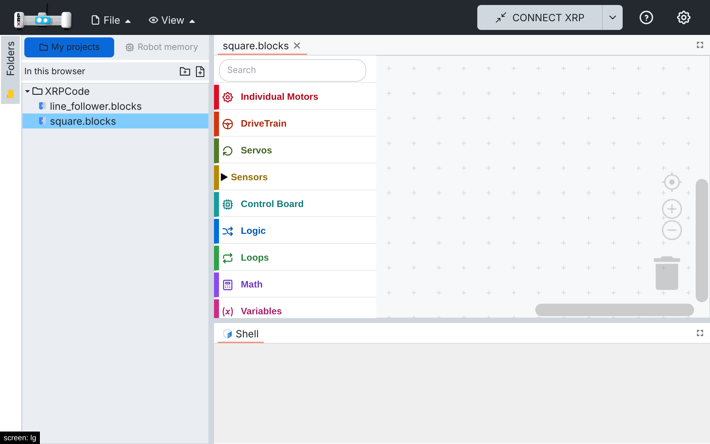 | 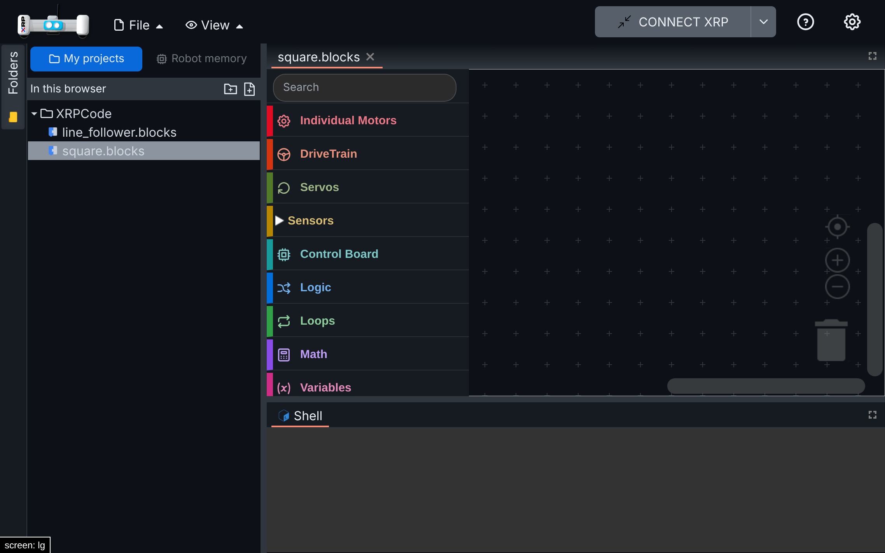 |
| Reopened on startup | 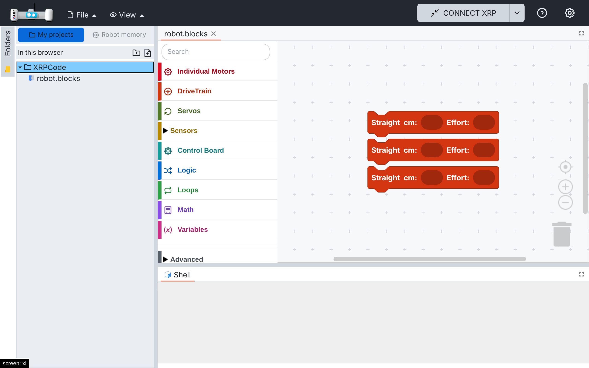 | 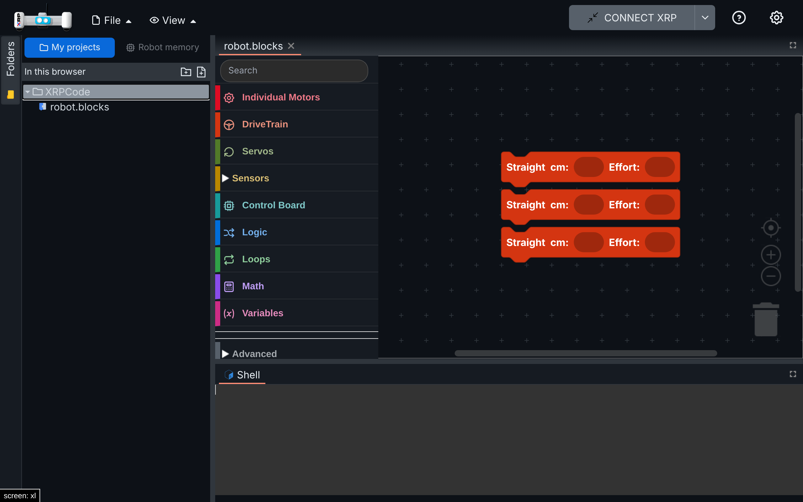 |

### Upstream

- Single tap: possible behind the same flag; it helps XRPWeb on tablets too.
- Reopen: fork-specific; the `loadGoogleEditor` change could help XRPWeb on slow devices.
- Faster opening: XRPWeb does not use the block search (it was added by spec 002), so the search
  changes are fork-only. The empty-file fix is an XRPWeb bug too (the same `JSON.parse` of an
  empty file is in its `blockly.tsx`); `parseBlocksJson` could be proposed as a small fix.

## Part 4 — Automatic save

### Problem

Saving was manual (File > Save or Ctrl+S). Each save showed a blocking "Saving to XRP" dialog:
with a robot connected it wrote the file to the robot over USB or Bluetooth, which takes a few
seconds, and with Google Drive it also uploaded the file. Children forget to save, and the wait
interrupts them. Apps like MakeCode save on their own.

### Solution

Files in My projects or Google Drive (files with a Drive id, while that session is active) save
themselves. Files opened from Robot memory keep the manual save to the robot.

- **`src/utils/autosave.ts` (new).**
  - Every change in the block or Python editor schedules a save 1.5 s after the last change, so
    quick edits make one write.
  - The write uses the same `driveService.upsertFileToGoogleDrive` call as the Save menu, without
    a dialog.
  - Only one write per file runs at a time. A change made during a write is written right after
    it.
  - A failed write (for example Google Drive without internet) keeps the change. It is tried
    again when the network comes back, on the next change, or after 15 s. The change is also in
    the browser's copy of open tabs, which already survived a reload.
  - Waiting changes are written at once when the page is hidden or closed, on Save, on Run and
    when a tab closes.
- **Save no longer writes to the robot.** Run already copies the program to the robot before
  running it (`saveAllFilesInGoogleDriveToXRP` and the active file). Save and Ctrl+S still work:
  they write at once.
- **Indicator** in the status bar at the bottom (see spec 005), next to the storage icon:
  "Saving…", "Saved", or "Couldn't save" with a tooltip saying the changes are kept and will be
  saved again. It is hidden until the first change.
- **No unsaved-tab prompt for these files.** Closing a tab writes its last change. The changed
  dot on the tab goes away once the file is saved (`EditorMgr.markSessionSaved`).

Hooks in upstream files:
- `blockly.tsx` and `MonacoEditor.tsx`: one `scheduleAutosave(tabId)` call in their change
  listeners.
- `editormgr.ts`: the autosave branch in `saveEditor`, plus `markSessionSaved`.
- `xrplayout.tsx`: closing a tab.
- `navbar.tsx`: Run.
- `main.tsx`: `startAutosave()`.

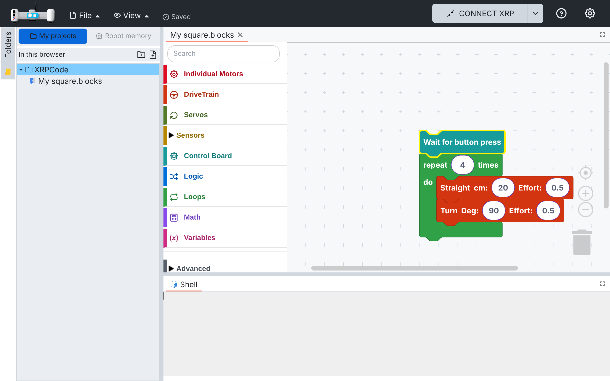
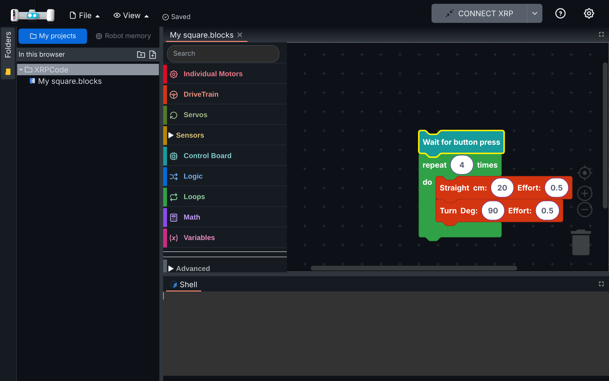

### Fix: Google Drive saves

- **Problem:** with Google sign-in, two things made autosave unreliable:
  - When Drive refused a write, the indicator still said "Saved", because the Drive upload
    reports a failure by returning nothing instead of an error.
  - The app gets a new Google access token every hour, but the Drive service kept the one from
    sign-in, so every save failed after about an hour.
- **Solution:**
  - Autosave treats an empty answer from the upload as a failure: the change is kept, the
    indicator shows "Couldn't save", and it tries again later.
  - The sign-in service hands each new access token to the Drive service
    (`onAccessToken` in `src/services/google-auth.ts`, set in `src/widgets/login.tsx`).

### Files

- New: `src/utils/autosave.ts`, tests in
  `src/utils/tests/autosave.spec.ts`.
- Changed: `src/managers/editormgr.ts`, `src/components/blockly.tsx`,
  `src/components/MonacoEditor.tsx`, `src/components/xrplayout.tsx`, `src/components/navbar.tsx`,
  `src/main.tsx`, `src/utils/i18n/locales/{en,es}/{en,es}.json` (`autosave`).
- Drive fix: `src/utils/autosave.ts`, `src/services/google-auth.ts`, `src/widgets/login.tsx`, tests
  in `src/utils/tests/autosave.spec.ts` and `src/services/tests/google-auth.spec.ts`.

### How to test

1. In a build with My projects, create a Python project and type: "Saving…" then "Saved" appears
   next to View, with no dialog. Close the tab right after typing: no prompt. Reload and open the
   file: the last change is there.
2. Open the Square example and move a block: same as step 1.
3. In a build with Google sign-in, signed in: edit, wait for "Saved", and check the file in Drive.
   Go offline and edit: "Couldn't save". Back online: "Saved".
4. Same build, signed in: leave the app open for more than an hour, then edit. "Saved" appears and
   the change is in Drive.
5. Same build: remove the app's access in your Google account settings and edit. The indicator
   shows "Couldn't save", not "Saved".
6. With a robot: Run a My projects or Drive file after editing; the robot runs the latest
   version. Files from Robot memory: Save still writes to the robot. **Pending: needs a robot.**

### Upstream

Possible behind a setting. It changes XRPWeb's save model (Save wrote to the robot), so it would
need their agreement.

## Part 5 — Trash

### Problem

Deleting a file or folder in My projects asked for confirmation and then removed it. A child who
deleted the wrong project had no way back. With Google sign-in, deleted files went to the Drive
trash, but they could only be restored from Drive, which children do not use.

### Solution

- **Delete moves to the trash, with no confirmation.** In My projects, Delete in the folder tree
  moves the file or folder to the trash at once. Files in Robot memory keep the old delete (with
  confirmation, no trash).
- **Rename and Delete on touch screens.** The tree showed these buttons only while the mouse was
  over a row, so phones and tablets had no way to delete. They now also show on the selected row:
  tap a file or folder, then tap the trash-can icon.
- **Trash row.** A "Trash" row at the bottom of the Explorer shows how many items are in the
  trash. It opens a dialog that lists them, newest first, with the days left for each one:
  - **Restore** puts the item back in its folder. If that folder is in the trash or gone, the item
    goes to the top folder. If the name is taken, it gets a number, for example `maze (2).py`.
  - **Delete forever** (trash-can icon) deletes the item for good.
  - **Empty trash** asks once ("Delete 2 items for good? This cannot be undone.") and deletes all
    of them.
- **30 days.** Items are deleted for good 30 days after they were trashed.
- **Sync with the account (spec 005).** With Google sign-in, the trash is the Drive trash of the
  account:
  - Trashing or restoring here does the same in Drive; Delete forever deletes the file in Drive
    too.
  - Items trashed, restored or deleted for good on another device (or in Drive) follow here at
    the next sync.
  - If the same item was trashed or restored here since the last sync, this device's choice wins.
  - Items trashed before they were ever uploaded stay on this device only.
- Only the trashed item is marked; the files inside a trashed folder are hidden with it and come
  back with it.

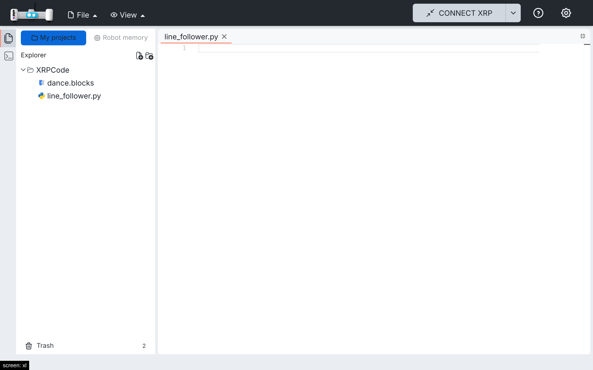
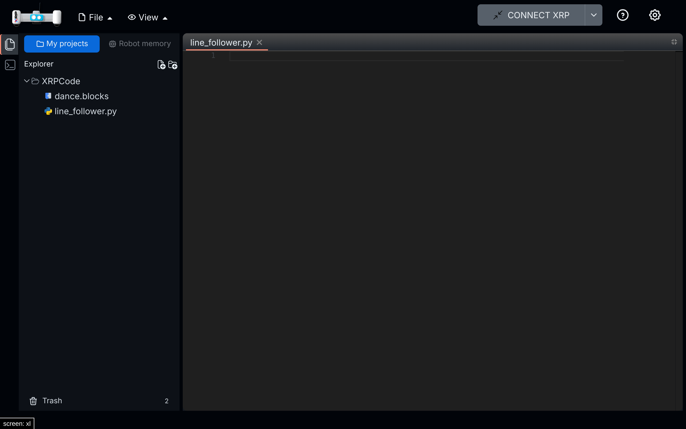
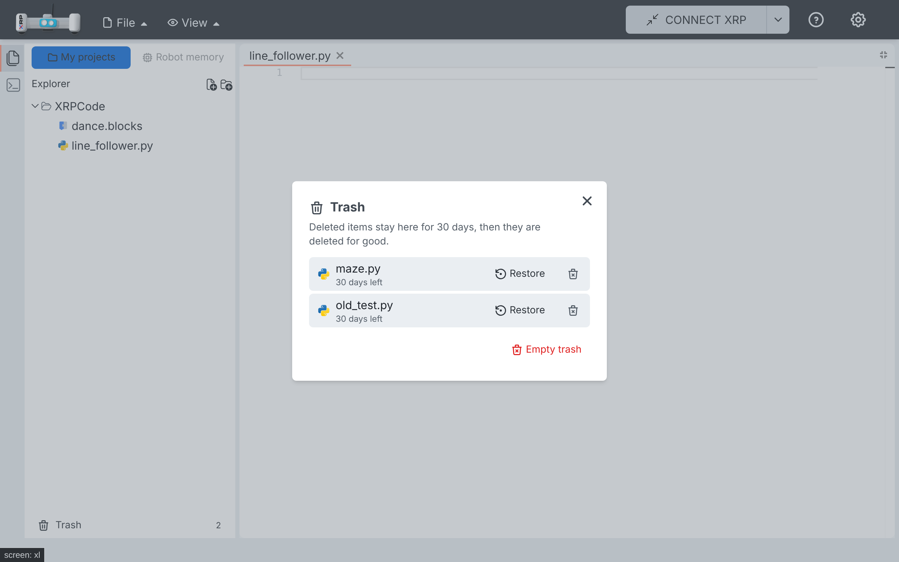
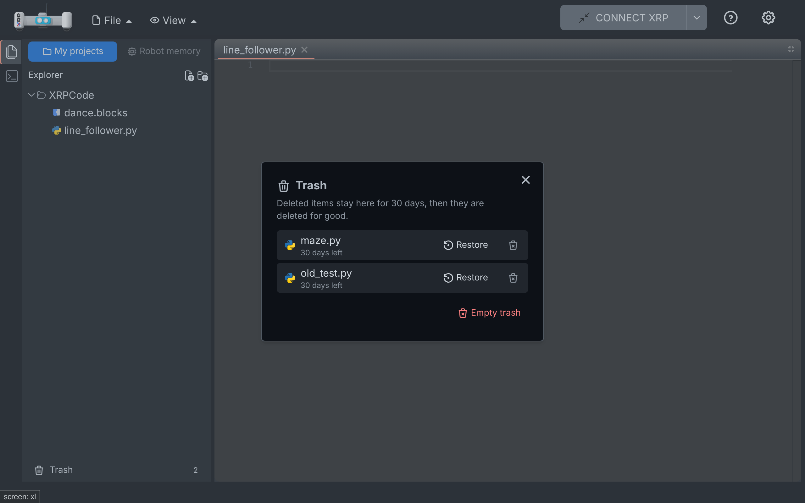

### Files

- New: `src/components/trash.tsx` (Trash row and dialog), tests in
  `src/components/tests/trash.spec.tsx`.
- `src/services/local-drive.ts`: `trashFile`, `trashItems` (also deletes items older than 30
  days), `restoreFile`; trashed items are hidden from the tree. Tests in
  `src/services/tests/local-drive.spec.ts`.
- `src/services/drive-sync.ts` and `src/services/drive-api.ts`: trash state in both directions,
  permanent delete in Drive. Tests in `src/services/tests/drive-sync.spec.ts` and
  `src/services/tests/drive-api.spec.ts`.
- `src/components/folder-tree.tsx` (upstream, small hooks): Delete moves to the trash in My
  projects, the Trash row, and Rename and Delete on the selected row. Test in
  `src/components/tests/folder-tree.spec.tsx`.
- `src/utils/i18n/locales/{en,es}/{en,es}.json` (`trash`).
- Browser test: `e2e/accounts.spec.ts` (trash, restore and delete forever with a signed-in
  account), with trash support in `e2e/support/google-mock.ts`.

### How to test

1. In My projects, create a project with two files. Delete one from the tree: it goes away with no
   dialog, and the Trash row shows 1.
2. Open Trash: the file is listed with "30 days left". Restore: it is back in its folder.
3. Delete a folder with files, then create a new folder with the same name. Restore the first
   one: it comes back as `name (2)` with its files.
4. Delete two files, open Trash, Empty trash → Delete for good: the trash is empty and the files
   do not come back after a reload.
5. With Google sign-in: delete a file; a few seconds later it is in the Drive trash. Restore it in
   the app; it leaves the Drive trash. Delete forever; it is gone from Drive.
6. Same account on a second device (or in Drive): trash a file there. Here it moves to the trash
   at the next sync (within a minute, or when coming back to the app).
7. On a phone or tablet: tap a file; the rename and trash-can icons show on its row. Tap the
   trash-can: the file goes to the trash.
8. Switch to Robot memory with a robot connected: Delete still asks for confirmation and there is
   no Trash row. **Pending: needs a robot.**

### Upstream

Fork-only for now: it depends on My projects. The Drive part (trash and restore follow the Drive
trash) could help XRPWeb's Google Drive mode, which today trashes in Drive without a way back in
the app.

## Part 6 — Archived projects

### Problem

Children keep every project they ever made, so the Explorer grows long and the project they want
is hard to find. Deleting old projects to tidy up is risky: after 30 days in the trash they are
gone for good.

### Solution

- **Archive button.** In My projects, each project at the top of the tree (a file or folder
  directly inside `XRPCode`) has an archive-box icon next to Rename and Delete ("Archive (put away
  without deleting)"). Archiving hides the project from the Explorer and from the recent projects
  on the welcome screen at once, with no dialog. Nothing is deleted, and it never expires. Its
  editor tab closes.
- **Archived row.** While there are archived projects, an "Archived" row above the Trash row at
  the bottom of the Explorer shows how many. It opens the "Archived projects" dialog, newest
  first, where **Bring back** puts a project back in the tree. If the name is taken by then, it
  gets a number, for example `maze (2).py`, as Restore does in the trash.
- **Sync with the account (spec 005).** With Google sign-in, an archived project stays in the
  account's `XRPCode` folder in Drive, marked as archived with a hidden app property
  (`xrpArchived`). Archiving or bringing back here does the same in the account; projects archived
  or brought back on another device follow here at the next sync. If the same project was
  archived or brought back here since the last sync, this device's choice wins, as with the
  trash. A project archived before it was ever uploaded is uploaded already archived.
- Files inside an archived folder are hidden with it and come back with it. An archived project
  that goes to the trash (for example inside a trashed folder) leaves the Archived list.

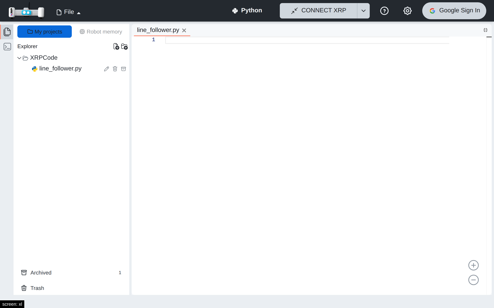
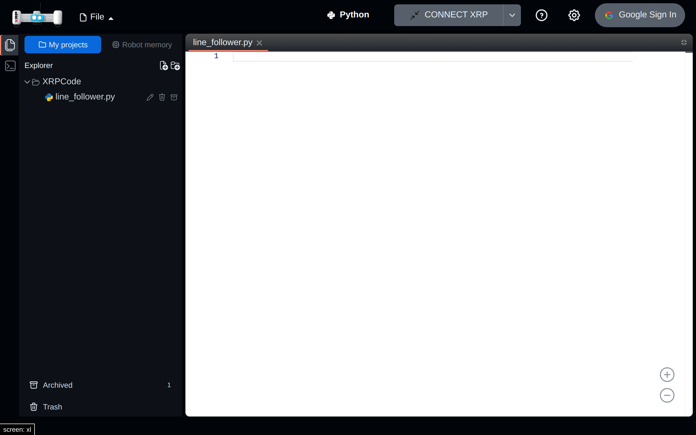
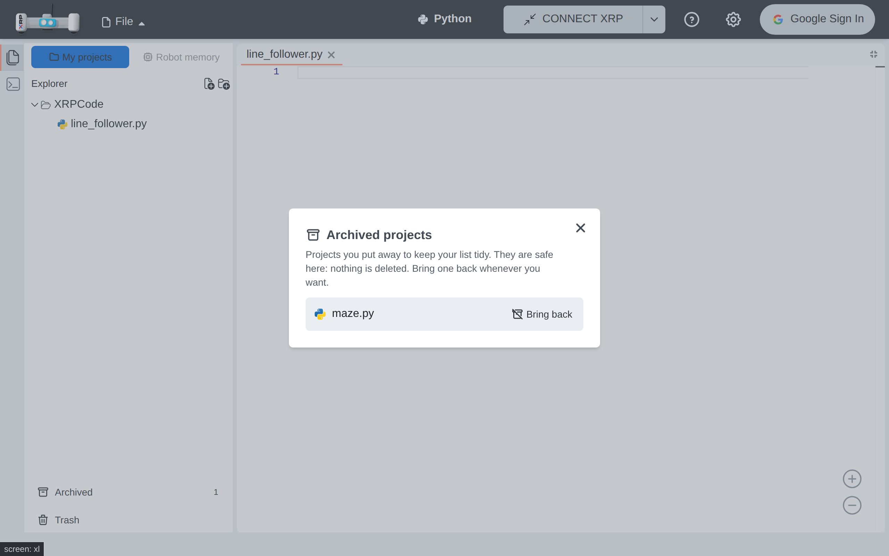
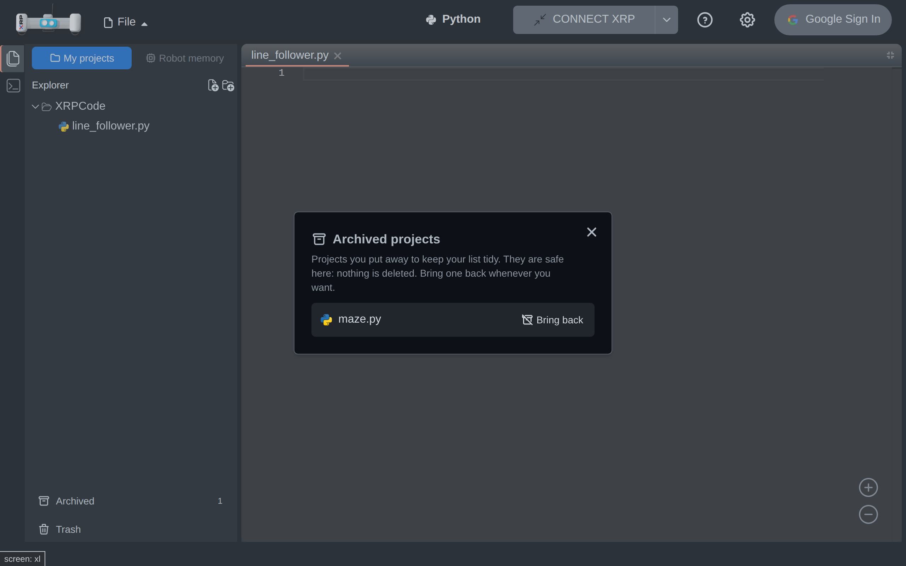

### Files

- New: `src/components/archived.tsx` (Archived row and dialog), tests in
  `src/components/tests/archived.spec.tsx`.
- New: `src/components/item-icon.tsx` and `src/utils/hidden-items.ts`, shared by the Trash and
  Archived rows (moved out of `src/components/trash.tsx`).
- `src/services/local-drive.ts`: `archiveFile`, `archivedItems`, `unarchiveFile`; archived
  projects are hidden from the tree. Tests in `src/services/tests/local-drive.spec.ts`.
- `src/services/drive-sync.ts` and `src/services/drive-api.ts`: the archived state in both
  directions, as an app property in Drive. Tests in `src/services/tests/drive-sync.spec.ts` and
  `src/services/tests/drive-api.spec.ts`.
- `src/components/folder-tree.tsx` (upstream, small hook): the Archive button and the Archived row.
- `src/utils/i18n/locales/{en,es}/{en,es}.json` (`archived`).
- Browser tests: `e2e/accounts.spec.ts` (archive and bring back with a signed-in account; a project
  archived on another device), with app properties in `e2e/support/google-mock.ts`.

### How to test

1. In My projects, create two projects. Hover (or tap) one in the tree and press the archive-box
   icon: it leaves the tree and the welcome screen, and an "Archived 1" row appears above Trash.
2. Open Archived: the project is listed. Bring back: it is in the tree again, with its content,
   and the Archived row goes away.
3. Archive `maze.py`, create a new `maze.py`, bring the first one back: it comes back as
   `maze (2).py`.
4. Reload the app: archived projects stay archived.
5. With Google sign-in: archive a project; it stays in the `XRPCode` folder in Drive. On a second
   device with the same account, it shows under Archived, not in the tree. Bring it back there:
   here it is back in the tree at the next sync (within a minute, or when coming back to the app).
6. Switch to Robot memory: there is no Archive button and no Archived row.

### Upstream

Fork-only: it depends on My projects. The app property keeps archived projects in the same Drive
folder, so XRPWeb with the same folder still sees them as normal files.
