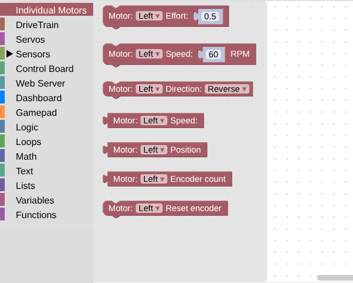
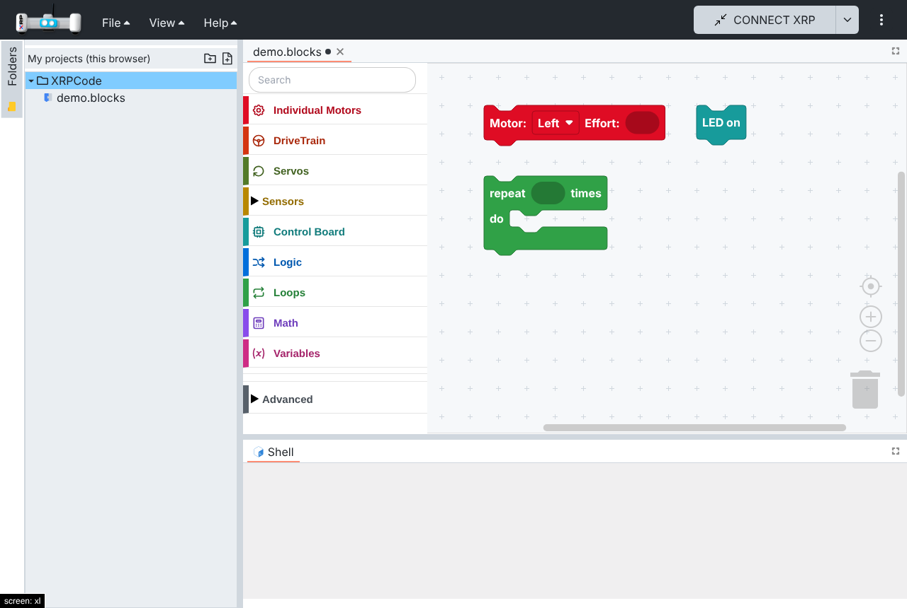
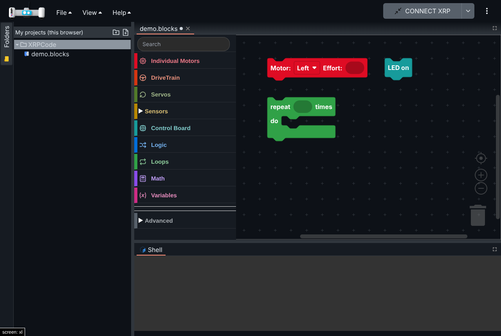
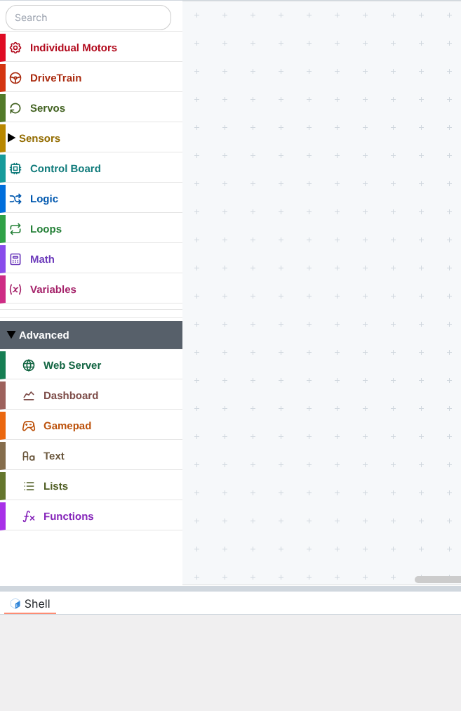
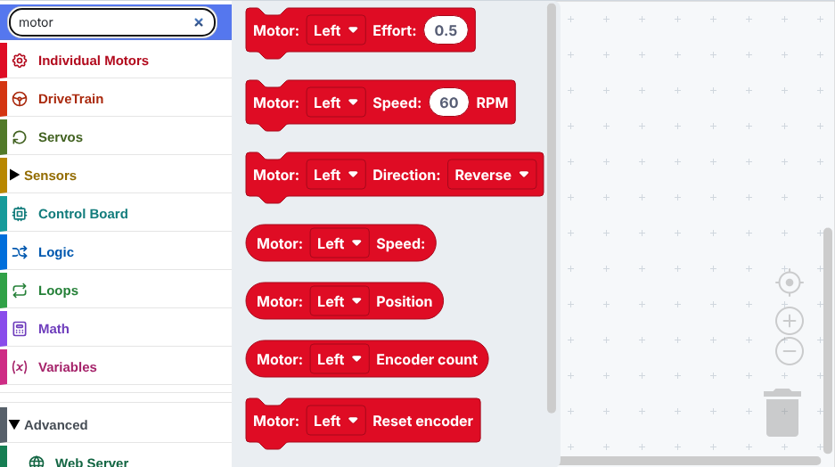

# 004 — Friendly theme and block editor

## Problem

The block editor is hard to read for young students: small square blocks, muted colours that look
alike, a plain text toolbox with every category at the same level, and no way to search for a block.
The rest of the app looks like an IDE for adults.

## Solution

### Block editor

- **Rounded blocks:** zelos renderer. Blocks are larger and easier to tap on tablets.
- **One colour per category:** each toolbox category gets a colour from a theme, and every block takes
  the colour of the category it lives in. Built-in Blockly styles (logic, loops, math, text, lists,
  variables, functions) use the same colours.
- **Toolbox:** an icon per category (react-icons, bundled, works offline), labels in the category
  colour (darker on the light theme, lighter on the dark theme), taller rows with separators.
- **Search:** a search field at the top of the toolbox (`@blockly/toolbox-search` 3.1.9, compatible
  with Blockly 12; replaced by an adapted copy in spec 016).
- **Advanced group:** Web Server, Dashboard, Gamepad, 3rd Party, Text, Lists and Functions move into a
  collapsed "Advanced" category. Grouping happens when the toolbox is built, so the plugin manager
  still finds Gamepad when it inserts the 3rd Party category.
- **Canvas:** theme background and a sparser cross grid.

### App theme (GitHub colours by default)

- The app's components use named Tailwind palettes (`curious-blue`, `matisse`, `shark`, ...). The
  theme replaces their values with GitHub's Primer colours, so components restyle without edits:
  dark header, neutral grays, blue accents, green Run, red Stop, 6px corners.
- System font stack and layout tabs with an underline on the active tab.

### Themes

A theme lives in `src/theme/<name>/`:

- `tailwind.ts` — app palette, applied with `withGitHubTheme()` in `tailwind.config.ts`.
- `app.css` — font and layout tabs.
- `blocks.ts` — one colour per toolbox category and the editor surfaces (light and dark), typed by
  `src/theme/types.ts`.

`src/theme/index.ts` selects the active theme (GitHub by default). A theme selector can be added
later; `src/components/blockly/block-theme.ts` applies any block theme to Blockly.

## Files

- New: `src/theme/` (types, index, `github/`), `src/components/blockly/block-theme.ts`,
  `src/components/blockly/toolbox-ui.ts` and `.css`.
- Hooks: `src/components/blockly.tsx` (renderer, theme options, toolbox builder, grid),
  `tailwind.config.ts`, `src/main.tsx` (theme CSS), `src/utils/i18n/locales/{en,es}/blockly.json`
  ("Search", "Advanced").
- Dependency: `@blockly/toolbox-search` 3.1.9.

## How to test

1. Open a blocks file: rounded blocks, each category in its own colour, icons in the toolbox.
2. Type "motor" in the search field: the motor blocks appear.
3. Expand "Advanced": Web Server, Dashboard, Gamepad, Text, Lists and Functions are inside.
4. Switch to the dark theme in Settings: labels and icons stay readable.
5. Save and reload a project created before the change: it opens unchanged, and the generated
   Python is the same.

Automated: `src/components/tests/block-theme.spec.ts` (category and subcategory colours, block
colouring, built-in styles) and `src/components/tests/toolbox-ui.spec.ts` (Advanced grouping,
search entry).

## Screenshots

**Before**

**After (light)**

**After (dark)**

| Advanced expanded | Search |
| --- | --- |
|  |  |

## Upstream

- **Block editor** (renderer, toolbox icons, search, Advanced group, block theme): could be proposed
  as an option in Settings rather than a forced change.
- **App theme:** fork-specific design choice.
