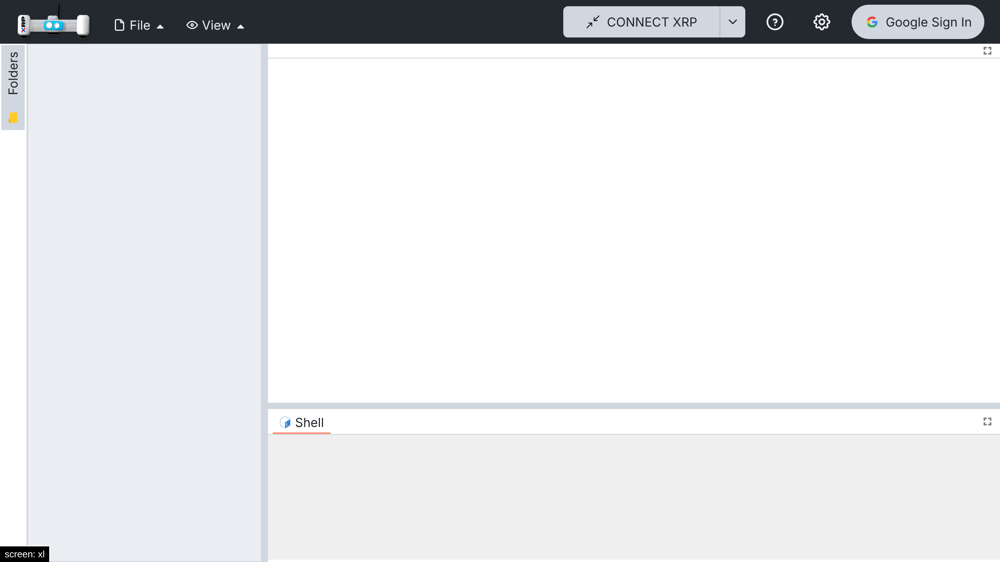
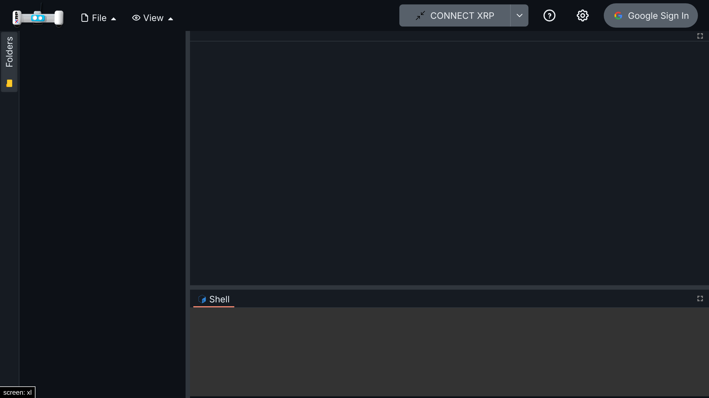
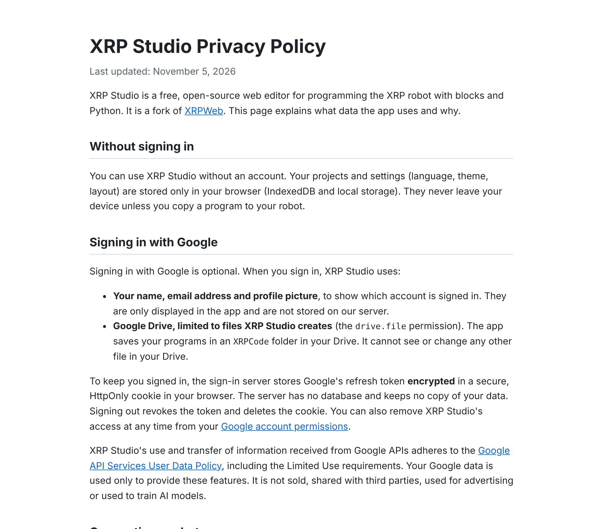
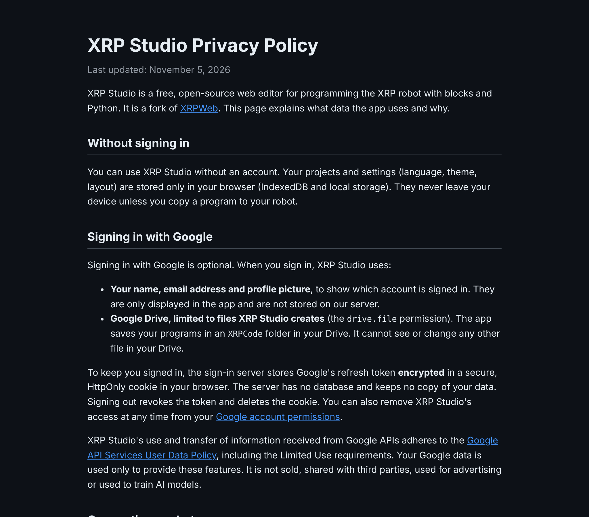
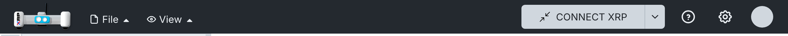
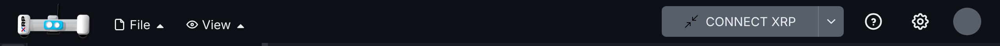
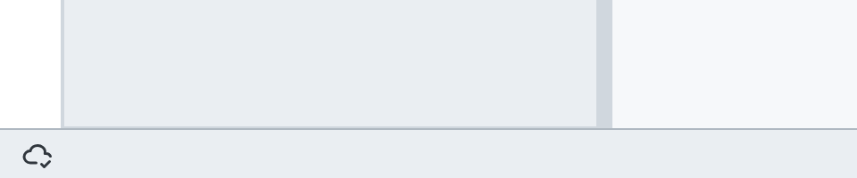
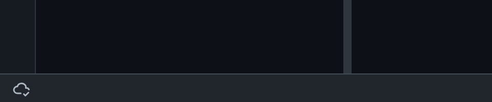

# 005 — Accounts and sync

Google sign-in and keeping the projects in the account. Two parts: the sign-in server and session, then accounts on a device and sync with Drive.

## Part 1 — Google sign-in

Google sign-in for the fork in two parts: a sign-in server the app can use, and keeping the session
after a reload.

### Sign-in server

#### Problem

XRPWeb's Google sign-in needs a backend at `GOOGLE_AUTH_URL` that exchanges Google's authorization
code for tokens (it holds the OAuth client secret). That backend is private, and Google only
accepts the origins registered in its project, so a fork cannot use it. Without a backend, the
"Google Sign In" button does nothing.

#### Solution

A small, stateless sign-in server that implements the same endpoints and response shapes the app
already calls (`src/services/google-auth.ts`), so the app's sign-in code is unchanged:

| Endpoint | Does |
| --- | --- |
| `GET /google-auth/client-id` | Returns the OAuth client ID. |
| `GET /google-auth/handshake` | Starts a session: random token in the body and in an HttpOnly cookie. |
| `POST /google-auth/exchange-code` | Exchanges the popup's code for tokens (`redirect_uri=postmessage`). |
| `POST /google-auth/refresh-token` | New access token from the stored refresh token. |
| `DELETE /google-auth/session/{token}` | Sign out: revokes the refresh token and clears the cookies. |

- Every call must send the handshake token in `X-Handshake-Token`, matching the handshake cookie.
- The Google refresh token is stored **encrypted** (AES-GCM, `AUTH_SESSION_SECRET`) in an
  HttpOnly, Secure, SameSite=Strict cookie scoped to `/api/google-auth`. The browser's JavaScript
  only receives a placeholder. No database.
- Hosted as Vercel functions in `api/` next to the static app, so `GOOGLE_AUTH_URL=/api` (same
  origin, no CORS).
- In development, a Vite plugin serves the same handlers under `/api/google-auth` when the server
  variables are set.
- Relative imports in `api/` and `server/` use explicit `.js` extensions: the repo is
  `"type": "module"`, so Vercel runs the functions as native ES modules, which do not resolve
  extensionless paths (Vite does, so it only failed once deployed). A test checks this.
- Server variables avoid the `GOOGLE_` and `VITE_` prefixes on purpose: Vite exposes those to the
  browser bundle (`envPrefix`), and the client secret must never reach it.

Setting `GOOGLE_AUTH_URL` switches the app to XRPWeb's Google Drive mode. Syncing the fork's
browser projects with Drive is a separate, later change.

#### Files

- New: `public/privacy.html` (privacy policy for the OAuth consent screen),
  `server/google-auth/` (`handlers.ts`, `crypto.ts`, `cookies.ts`, `vite-plugin.ts`,
  `tests/handlers.spec.ts`), `api/google-auth/` (one thin Vercel function per endpoint),
  `vercel.json`.
- Hooks: `vite.config.ts` (dev plugin), `tsconfig.node.json` (type-check `api` and `server`).

#### Setup

##### Google Cloud

1. Create a project at <https://console.cloud.google.com>.
2. APIs & Services → Library → enable **Google Drive API**.
3. OAuth consent screen: External, app name, support email. Scope: `drive.file` (the only one
   the app requests). While in **Testing**, add your Google account under Test users. Testing
   shows a "Google hasn't verified this app" warning and expires sessions after 7 days; to
   publish, Branding needs a home page (`https://xrp-studio.vercel.app`) and a privacy policy
   (`https://xrp-studio.vercel.app/privacy.html`, served from `public/privacy.html`).
4. Credentials → Create credentials → OAuth client ID → **Web application**. Authorized
   JavaScript origins: your Vercel domain (for example `https://xrp-studio.vercel.app`) and
   `http://localhost:3000`. No redirect URIs are needed (popup flow).
5. Copy the client ID and client secret.

##### Vercel

1. Import the GitHub repository (the settings in `vercel.json` are picked up).
2. Project → Settings → Environment Variables:

| Variable | Value |
| --- | --- |
| `OAUTH_CLIENT_ID` | Client ID from Google Cloud |
| `OAUTH_CLIENT_SECRET` | Client secret from Google Cloud |
| `AUTH_SESSION_SECRET` | A long random string (`openssl rand -base64 32`) |
| `GOOGLE_AUTH_URL` | `/api` |
| `NODE_OPTIONS` | `--max-old-space-size=8192` (build memory) |

3. Redeploy.

##### Local development

Put the same variables in `.env.local` (not committed) and run `npm run dev`.

#### How to test

1. `npx vitest run server`: 8 tests with a fake Google endpoint (client ID, handshake cookie,
   code exchange with the encrypted cookie and hidden refresh token, handshake mismatch, rejected
   code, missing configuration, refresh, tampered cookie, sign out).
2. `npm run dev` with dummy values: `/api/google-auth/client-id` returns the ID, the handshake sets
   the cookie, and the app shows "Google Sign In".
3. With real credentials (local `.env.local`): sign in, create a file (it appears in Drive's
   `XRPCode` folder), sign out (`DELETE .../session/...` returns 200 and clears both cookies).
   Tested locally with a real Google Cloud project; Vercel deployment not tested yet.

#### Screenshots

| Light | Dark |
| --- | --- |
|  |  |
|  |  |

### Keep the session after a reload

#### Problem

XRPWeb keeps the Google session in memory only (`src/services/google-auth.ts`). Reloading the page
signs the user out, and they have to open Google's popup again.

#### Solution

On startup, the sign-in widget asks the auth backend for a new access token; if it gets one, it
loads the profile and finishes the sign-in as usual (same `finalizeLogin` path as the popup).

- `GoogleAuthService.restoreSession()` only tries when the last sign-in in this browser did not end
  with a sign-out (`GoogleSession` in `localStorage`, set after the code exchange and removed on
  sign-out). Signed-out users make no extra request.
- It calls the existing `refresh-token` endpoint. With the fork's server (Part 1) the refresh
  token lives in an HttpOnly cookie that survives the reload. A backend that cannot restore the
  session answers with an error: the hint is cleared and the user signs in as before.
- Called once per page load, even with React StrictMode or more than one widget.
- While it restores, the top bar shows an avatar-sized placeholder instead of the sign-in button,
  so the bar does not jump from "Google Sign In" to "Signing in..." to the avatar. The placeholder
  is also shown while the OAuth client ID loads, so the Settings button does not move.

#### Files

- `src/services/google-auth.ts`: `restoreSession()`, hint set on exchange and cleared on sign-out.
- `src/widgets/login.tsx`: one effect that restores the session on mount (`isRestoring`).
- `src/widgets/compact-account.tsx`: `isRestoring` placeholder.
- `src/utils/localstorage.ts`: `GOOGLE_SESSION` key.
- Test: `src/services/tests/google-auth.spec.ts`.

#### How to test

1. With the Part 1 setup, `npm run dev`, sign in with Google.
2. Reload: the avatar comes back without the popup.
3. Sign out and reload: the "Google Sign In" button is shown and no `refresh-token` request is made.
4. Expired session: with `GoogleSession=true` in `localStorage` and no refresh cookie, a reload makes
   one `refresh-token` request (401), clears the hint and shows the sign-in button (checked with
   Playwright).

Automated: `src/services/tests/google-auth.spec.ts` (no hint, restore once, backend refusal,
sign-out) and `src/widgets/tests/compact-account.spec.tsx` (placeholder while restoring).

#### Screenshots

Top bar while the session is restored:

| Light | Dark |
| --- | --- |
|  |  |

### Upstream

- Server: possibly useful to XRPWeb as a reference or self-hosting option; their own backend stays
  as is.
- Session restore: possible. With XRPWeb's own backend it depends on whether that backend can
  refresh with a new handshake token; if not, it falls back to today's behaviour.

## Part 2 — Projects in the browser, synced with your account

### Problem

- Builds with Google sign-in behaved like XRPWeb: without signing in there was nowhere to keep
  projects, and once signed in every open, save and list went to Google Drive over the network.
  Without internet, or with a slow one, children could not work.
- The UI talked about "Google Drive file system", which means nothing to a child.
- Shared computers (schools, libraries) need projects to leave the device when the child leaves.

### Solution

Projects always live in the browser (My projects, spec 004). Signing in with Google only adds a
copy in the account: the `XRPCode` folder of its Drive. Drive is the backend; the UI never names
it. Two parts:

- **(a) This change:** every build opens into My projects, accounts on a device, sync on
  sign-in and on every change, status bar.
- **(b) Later:** bring in changes from other devices while signed in, and name the device in
  conflict copies (see the backlog).

#### Part (a): accounts on a device

- Every build opens straight into My projects, without signing in. Without an account the user
  sees the device's guest projects.
- Each account has its own space on the device, so two children on one computer do not see each
  other's projects.
- The settings menu (⚙) has a **"Keep me signed in"** switch for the device, **off by default**
  (shown only where accounts can sync). There is no question at sign-in; a teacher or adult sets
  it once for the device:
  - **Off (shared device):** the session is not remembered, the account signs out after 30
    minutes without use, and its projects are removed from the device when the session ends. If
    the app was closed without signing out, they are removed the next time it opens, before any
    tab is shown.
  - **On (own device):** the session is remembered and the projects stay on the device.
  - Changing the switch applies to the open session too. Its tooltip explains both modes.
- If the device has guest projects, the first sign-in offers **"Move them to your account?"**.
- **Signing out** first uploads what is left. If that is not possible (no internet), the app warns
  that those changes would be lost and lets the user stay signed in. Then the account's projects
  are removed from the device; they come back at the next sign-in.
- The account's name and photo show in the bar, as before.

#### Part (a): sync

- Every change (new file or folder, edit, rename, move, delete) is uploaded 2 s after the last
  one. Folders go before their files.
- Deleted files go to the account's trash, where they stay 30 days.
- At sign-in, when the network comes back, and when a sync failed (tried again after 30 s), the
  app also brings in what changed in the account: new, changed and deleted files.
- **Same file changed here and in the account:** both are kept. The account's version keeps the
  name; this device's version becomes a copy, for example `square (this device).py`.
- Without internet nothing is lost: changes stay on the device and are uploaded later.

#### Part (a): status bar

A thin bar at the bottom of the screen, like MakeCode's. It has one indicator: an icon for where the projects are kept, followed by the automatic save text (spec 004: "Saving…", "Saved", "Couldn't save") once there is a change. The tooltip explains the icon:

| Icon | Meaning (tooltip) |
| --- | --- |
| Cloud with a check | Saved in your account |
| Spinner | Saving to your account… |
| Crossed cloud | No connection: changes are kept on this device |
| Laptop | Saved on this device only (no account signed in) |

#### Part (a): wording

- The project header says "My projects" instead of "Google Drive file system".
- Since My projects is always on, the Drive wording elsewhere uses the My projects texts, and
  the Drive logo on the folder tab is not shown.

#### Hooks in upstream files

- `offline.ts`: `isLocalProjectsEnabled` is always true; new `isDriveSyncEnabled` (builds with a
  Google auth backend that are not offline builds).
- `appmgr.ts`: a second Drive service used only by sign-in and sync.
- `login.tsx`: with sync, signing in keeps My projects open and starts the account; signing out
  goes through the account (and can be cancelled); idle sign-out on shared devices.
- `session.ts`, `local-projects.ts`: open the account's space on sign-in and the guest space on
  sign-out.
- `google-auth.ts`: an offline restore keeps the remembered session.
- `main.tsx`: clear a shared session left open; `App.tsx`: status bar and question dialog; `src/components/navbar/quick-settings.tsx`: the switch.

### Files

- New: `src/services/drive-api.ts` (Drive requests), `src/services/drive-sync.ts` (push and
  pull), `src/utils/accounts.ts` (accounts on a device), `src/utils/ask.ts` and
  `src/components/ask-dialog.tsx` (questions), `src/components/status-bar.tsx`.
- Changed: `src/services/local-drive.ts` (one store per account, sync fields, deleted files kept
  until uploaded), `src/utils/offline.ts`, `src/managers/appmgr.ts`, `src/widgets/login.tsx`,
  `src/utils/session.ts`, `src/utils/local-projects.ts`, `src/services/google-auth.ts`,
  `src/utils/localstorage.ts`, `src/main.tsx`, `src/App.tsx`,
  `src/utils/i18n/locales/{en,es}/{en,es,local-projects}.json` (`account`, `sync`, `statusBar`).
- Tests: `src/services/tests/drive-sync.spec.ts`, `src/services/tests/drive-api.spec.ts`,
  `src/services/tests/local-drive.spec.ts`, `src/utils/tests/accounts.spec.ts`,
  `src/components/tests/ask-dialog.spec.tsx`, `src/components/tests/status-bar.spec.tsx`.

### How to test

1. Open the app without signing in: My projects opens, the bar shows the laptop. Create a project.
2. Open ⚙ and turn on "Keep me signed in". Sign in with Google; "Move them to your account?" →
   Move.
   The cloud spins, then shows a check. The project is in the `XRPCode` folder of the account's
   Drive.
3. Edit, rename, move and delete files: each change reaches Drive a few seconds later; deleted
   files are in the Drive trash.
4. Go offline and edit: crossed cloud. Back online: spinner, then check.
5. Change a file in Drive (another device, or upload a new version), sign out and in again: the new
   version is in the app. Change the same file here while offline and in Drive, then go online:
   both versions are there, this device's one named "… (this device)".
6. Sign out: the account's projects leave the device and the guest projects show. Sign in again:
   they come back at the next sign-in.
7. With "Keep me signed in" off (the default), sign in and reload the page: the session is gone
   and so are its projects and tabs. Sign in again and leave it unused for 30 minutes: it signs
   out. Turn the switch on and reload: the session and projects stay.
8. Offline build: no sign-in, the bar shows the laptop, everything else as in spec 004.

### Upstream

Fork-only for now: it changes XRPWeb's storage model (Drive first). The Drive request layer and
the sync engine could be offered later behind a setting.
