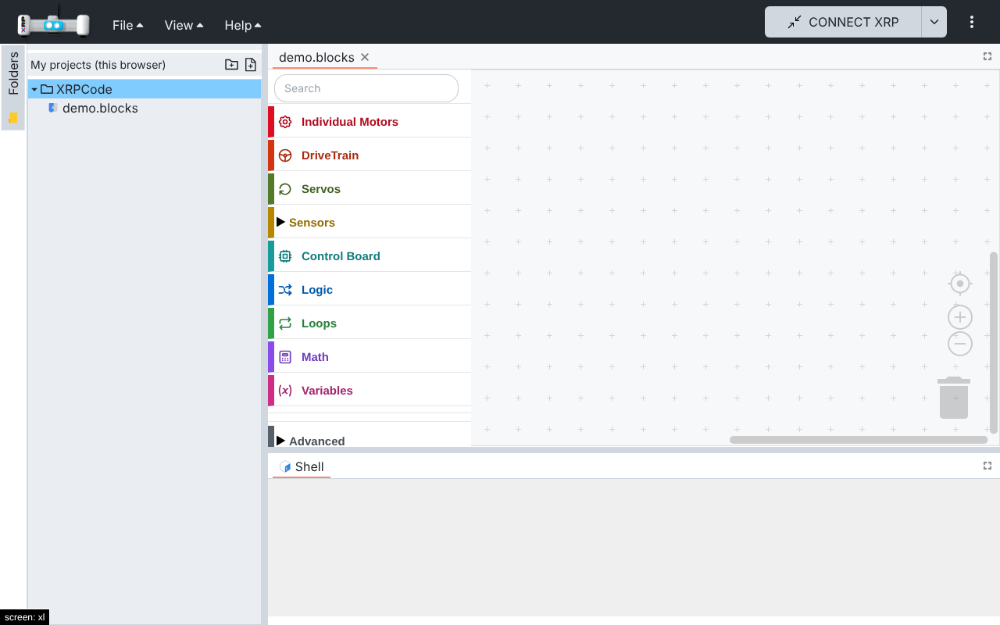
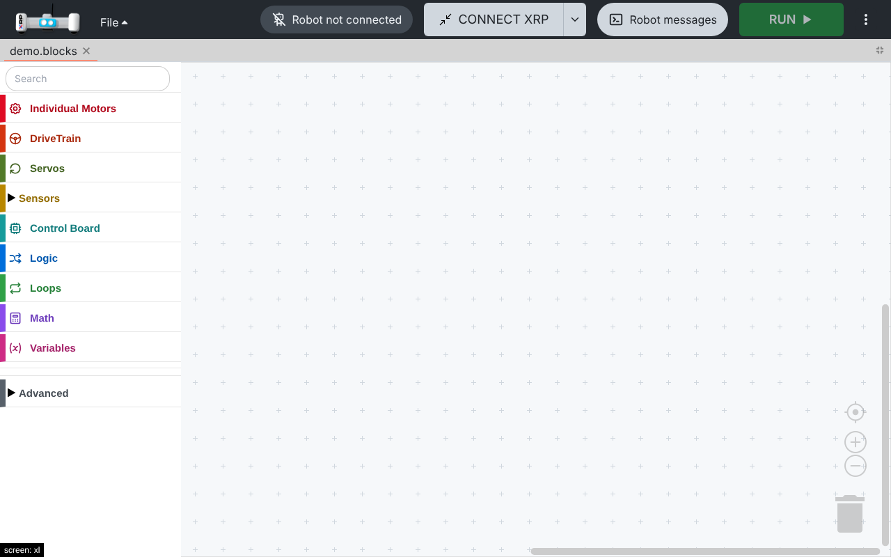
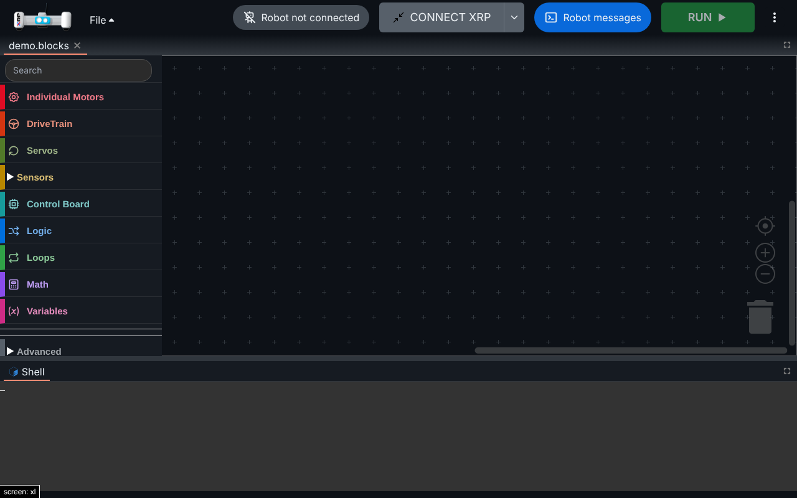
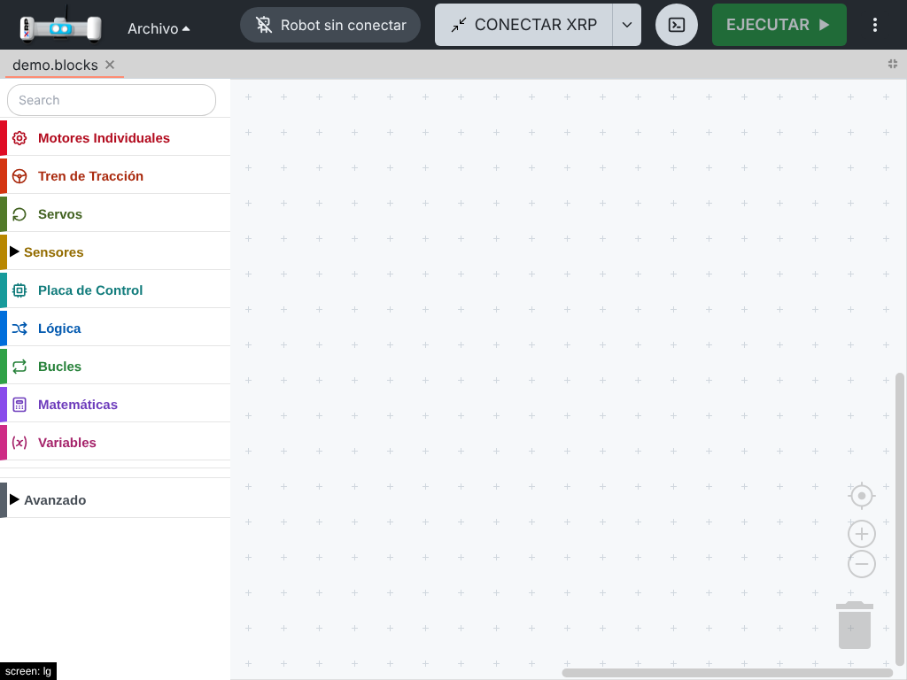

# 006 — Kids mode

## Problem

The app looks like an IDE for adults: text menus (File, View, Help), the folder tree and the
terminal are always on screen, and Run only appears after connecting, so a child does not see what
to do next.

## Solution

A **kids mode**, off by default and turned on in Settings → Kids mode. The app reloads when the
setting is saved, because the layout is built at load time.

With kids mode on:

- **Top bar:** only the File menu stays (until the home screen replaces it); View and Help are
  hidden. Connect, Run/Stop and "Robot messages" are large buttons (48 px high) with icons. Run is
  always visible and disabled until a robot is connected.
- **Connection status:** a pill that says "Robot not connected" or "Robot connected · USB/Bluetooth
  · XRP-ID".
- **Folder tree hidden.** It hosts the sign-in widget (the local session in offline builds), and
  flexlayout only mounts a border tab once it has been shown. The kids layout therefore starts with
  the tree open and `enableRenderOnDemand: false`, and hides it (collapse + `show: false`) once the
  local session has signed in (offline builds) or once it has rendered (other builds). It stays
  mounted, so sign-in and file system updates keep working.
- **Terminal hidden** by starting with the editor maximized. "Robot messages" toggles the maximize
  state, so the terminal stays mounted and keeps receiving output (useful for Python errors).
- At tablet width the "Robot messages" button shows only its icon and the XRP-ID is hidden, so the
  bar fits on one line.

With kids mode off the app is unchanged.

## Files

- New: `src/utils/kids-mode.ts`, `src/components/kids/kids-layout.ts`,
  `src/components/kids/connection-status.tsx`, `src/components/kids/messages-toggle.tsx`,
  `src/components/kids/kids-mode-setting.tsx`.
- Hooks: `src/components/navbar.tsx` (menus, status, button sizes),
  `src/components/xrplayout.tsx` (kids layout, hide the tree), `src/components/dialogs/settings.tsx`
  (Kids mode tab), `src/utils/localstorage.ts` (`KidsMode` key), `src/utils/i18n/locales/{en,es}`.

## How to test

1. `npm run dev:offline`, open Settings → Kids mode, turn it on and Save: the app reloads.
2. The bar shows File, the connection pill, Connect, the messages button and a disabled Run.
3. File → New File works (the local session signed in even though the tree is hidden).
4. "Robot messages" shows and hides the terminal.
5. Turn kids mode off: the app looks as before.

Automated: `src/components/tests/kids-layout.spec.ts` (tree starts open and mounted, editor
maximized, `hideFolderTree` collapses and hides the border, original layout untouched) and
`src/utils/tests/kids-mode.spec.ts`.

## Screenshots

| Kids mode off | Kids mode on |
| --- | --- |
|  |  |

| Robot messages shown (dark) | Tablet, Spanish |
| --- | --- |
|  |  |

## Pending

- **Battery level** in the status pill. `CommandToXRPMgr.batteryVoltage()` returns 0 while the REPL
  is busy, which looks like "power switch off", and it cannot be tested without a robot without
  risking interference with the connection.
- Home screen with project cards (next change) and guided examples.

## Upstream

Fork-specific (kids UI).
