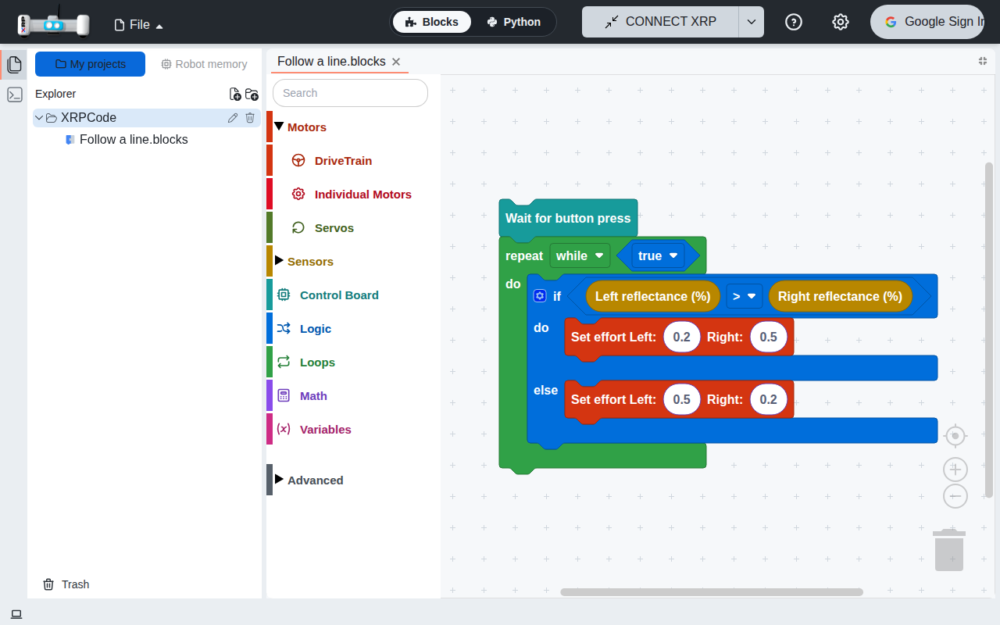
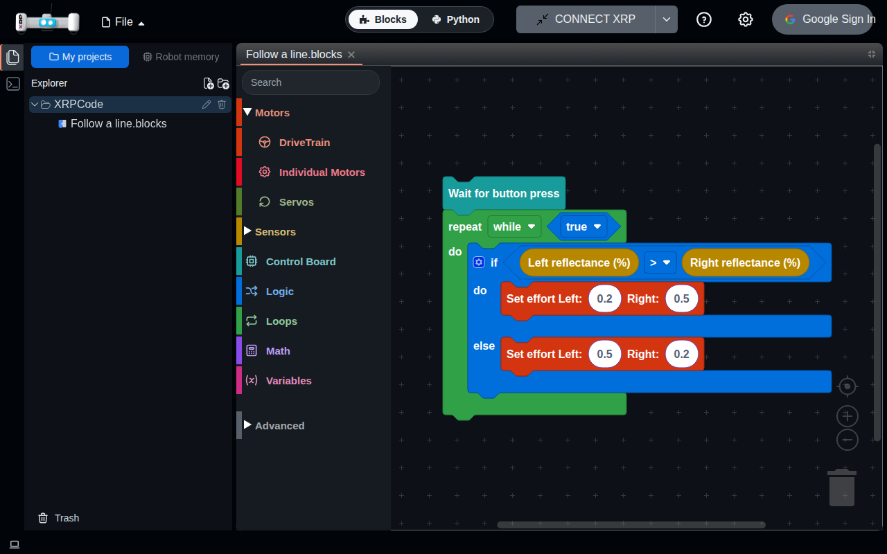
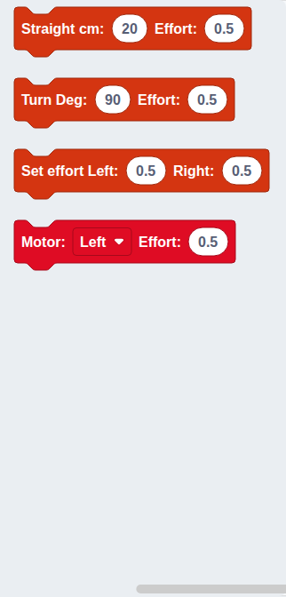
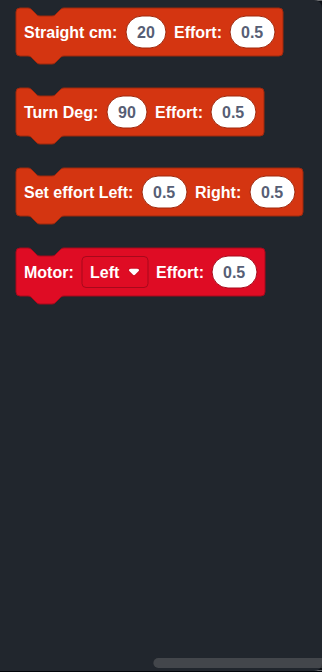

# 006 — Maintenance

Dependency, lockfile and build upkeep. Pending upgrades and the backlog are in [pending-upgrades.md](pending-upgrades.md). Six parts: lockfile and minor updates, faster builds, the build and test tools, React 19, unused and replaceable dependencies, and Blockly 13.

## Part 1 — Lockfile, Tailwind config and minor updates

### Problem

- `npm ci` failed: `package-lock.json` was out of sync with `package.json` (missing `@emnapi/*`
  packages).
- `tailwind.config.js` mixed CommonJS `require()` with `export default` and was not type-checked.
- Many dependencies were behind on minor and patch releases.

### Solution

1. **Lockfile** regenerated with `npm install`; `npm ci` works again.
2. **Tailwind config in TypeScript:** `tailwind.config.ts` with ES imports, type-checked through
   `tsconfig.node.json`, plus a small type declaration for `tailwindcss-debug-screens`
   (`tailwind-plugins.d.ts`). The generated CSS is byte-for-byte identical.
3. **Minor/patch updates** with `npm update`, within the existing semver ranges. Pinned to their
   current versions because newer releases break the build or the editor:
   - `flexlayout-react` 0.8.4 (0.8.19 makes the `Model` constructor protected).
   - `react-xtermjs` 1.0.9 (newer versions use React 19 ref types; moved to 1.0.12 in part 4).
   - `monaco-languageclient` 9.4.1 and `vscode-ws-jsonrpc` 3.4.0 (9.11 pulls
     `@codingame/monaco-vscode-api` 20 while the editor packages are on 11, installing a second,
     incompatible copy).

### Files

`package.json`, `package-lock.json`, `tailwind.config.ts` (renamed from `.js`),
`tailwind-plugins.d.ts`, `tsconfig.node.json`.

### How to test

1. `npm ci` completes.
2. `npx tsc -b`, `npx vitest run` and `npm run build` pass.
3. Open a blocks file and a Python file: same behaviour as before the update.

### Upstream

All three changes are generic and could be proposed together or separately.

## Part 2 — Faster builds with Rolldown

### Problem

The production build took about 48 seconds on a 4-core machine. Minifying was not the cost (turning
it off saved 2 seconds); the time went into transforming the roughly 4,900 modules of the app,
mostly the Python editor (Monaco), with Rollup.

### Solution

Vite is replaced by `rolldown-vite` 7.3.1 (the same Vite with Rolldown, a bundler written in Rust,
in place of Rollup and esbuild), through a package alias in `package.json`. Part 3 later moved to
Vite 8, which includes Rolldown, and removed the alias. The build takes
about 18 to 20 seconds, a bit under half, and the app is unchanged: same chunks (plus small
helper ones), same size, same behaviour. Moving to Vite 8, which includes Rolldown itself, stays
in the backlog.

- Needs Node 20.19 or newer (22.12 or newer on 22).
- Known warnings, harmless: the dev server reports an unused `jsx` option from the React plugin,
  and the build reports that a `default` import of Monaco is undefined (the code already falls
  back to the namespace).

### Files

- `package.json`, `package-lock.json`, `scripts/build.mjs` (new), `vercel.json`.

### How to test

1. Build the app and compare the time with the previous version.
2. Open a Python project: the editor opens, a typing mistake such as `x: int = "text"` shows a
   red underline from Pyright, and the text is still there after reloading.
3. With the app opened once and its offline copy ready, go offline and reload: the app opens.
4. Open an example in the block editor: blocks and toolbox work.
5. Introduce a type error in any source file and build: the build fails and shows the error.

#### Faster install and build

The hosted build (2 cores) took 1 min 42 s, of which `npm ci` was 66 s, the type check 11 s and the
bundle 12 s. Two small changes:

- The type check and the bundle run **at the same time** (`scripts/build.mjs`) instead of one after
  the other, so the build lasts as long as the slower one. A type error still fails the build.
  Locally the whole build went from about 18 s to about 13 s.
- The hosted install uses `npm ci --prefer-offline --no-audit --no-fund` (`vercel.json`): it prefers
  the downloads already stored and skips the vulnerability and funding requests.

Try next, as its own change: a faster package manager (Bun or pnpm) for the install, which is most
of the time left.

### Upstream

Possible: a build-only change, independent of the fork's UI.

## Part 3 — Build and test tools: Vite 8, Vitest 5, ESLint 10

### Problem

`npm audit` reported 20 vulnerabilities, 2 of them critical: Vitest 3 and its `tinypool` (the
test runner could be made to run code from a crafted request to its server). None of them ships
in the app, but the tools were also behind (Vite 6, Vitest 3, ESLint 9, which npm calls no longer
supported).

### Solution

- **Vite 8** (it includes Rolldown itself, so the `rolldown-vite` alias of part 2 is gone),
  `@vitejs/plugin-react` 6, `vite-plugin-static-copy` 4.
- **Vitest 5** and `@testing-library/jest-dom` 7 (its matchers are now loaded from
  `@testing-library/jest-dom/vitest`; `src/jest-dom.d.ts` gives the tests their types).
- **ESLint 10**, `typescript-eslint`, the React hooks plugin 7 and the React Refresh plugin.
  The rules that ESLint 10 and the hooks plugin added (unused assignments, error causes, React
  Compiler checks) flag code inherited from XRPWeb, so they are off and the lint result is the
  same as before.
- Three changes the new versions needed: the static copy plugin keeps the folder structure now, so
  the destinations in `vite.config.ts` are `./` (the layout styles, Blockly media and Gridstack
  styles are still served from `node_modules/...`); a test mocked `ResizeObserver` with an arrow
  function, which is not a constructor; and the Google sign-in functions of the host (`api/`,
  `server/`) lost their Node types, because the root `tsconfig.json` limits the types to
  `vitest/globals` and Vitest 3 used to bring the Node ones in: `node` is now listed there too.
- Result: no critical vulnerability is left. `npm audit` still lists 20 (2 high, 15 moderate, 3
  low): the 2 high ones are `flowbite-react` through `deepmerge-ts`, which needs an upstream
  update and needs attacker-controlled objects to matter, and the rest are in build and lint
  tools (`minimatch` through ESLint and Workbox, `postcss-selector-parser` through the Tailwind
  typography plugin). The build takes about 10 seconds locally.

Known warnings, harmless: Vite reports that the config uses `__dirname` and imports without file
extensions (not supported by a loader that will be the default in a later major version), that
the `esbuild` options are ignored now that Oxc is used, and the same Monaco `default` import as in
part 2.

### Files

- `package.json`, `package-lock.json` (regenerated with a plain `npm install` so `npm ci` works),
  `tsconfig.json`, `vite.config.ts`, `eslint.config.js`, `setupTests.ts`, `src/jest-dom.d.ts` (new),
  `src/components/tests/folder-tree.spec.tsx`.

### How to test

1. Build the app: it works and the layout looks as before (the styles of the tab layout load).
2. Open a Python project: Pyright underlines `x: int = "text"`; reload keeps the text; with the
   app opened once, go offline and reload: it opens.
3. Open an example in the block editor: blocks, toolbox and block list work.
4. Run the unit tests and the linter: same results as before (the linter keeps its one known
   error).

### Upstream

Possible: dependency upgrades, independent of the fork's UI.

## Part 4 — React 19

### Problem

The app ran on React 18. Several libraries (`react-xtermjs` after 1.0.9, `react-i18next` 17,
`react-hotkeys-hook` 5) already expect React 19, so they were held back, and React 18 only gets
security fixes.

### Solution

- **React 19** and `react-dom` 19, with their types (`@types/react`, `@types/react-dom` 19).
- `react-i18next` 17, which needs `i18next` 26; `react-hotkeys-hook` 5 (the block editor's
  Ctrl/Cmd+S shortcut keeps the same key list); `react-xtermjs` 1.0.12 (the terminal).
- The other React libraries already accept React 19: `flowbite-react`, `flexlayout-react`,
  `react-arborist` (Explorer), `recharts` (dashboard), `usehooks-ts`, `use-file-picker`,
  `react-customizable-progressbar`, `react-icons`, `@react-oauth/google` and Testing Library.
- Two libraries have not declared React 19 support yet, and both only use hooks that React 19
  keeps, so `package.json` `overrides` lets them use the app's React:
  - `react-blockly` 9 (the block editor). Its `propTypes` are ignored by React 19, nothing else
    changes.
  - `use-resize-observer` 9 (Explorer and the busy dialog). Version 10 accepts React 19 but
    changes its API, so the fork stays on 9.
- Type changes React 19 needs: `useRef` takes an initial value (`useRef<AppMgr>(undefined)`),
  and a ref that starts empty is typed `RefObject<Layout | null>` (the tab layout ref passed to
  the editor tabs).

### Files

- `package.json`, `package-lock.json`.
- `src/App.tsx`, `src/components/folder-tree.tsx`, `src/components/xrplayout.tsx`,
  `src/components/editor-chooser.tsx`, `src/utils/editorUtils.ts` (ref types).

### How to test

1. Open the app: the welcome screen shows; switch the language to Spanish and back.
2. Start a project from an example: the block editor, its toolbox and the Python view work;
   Ctrl+S (Cmd+S) saves.
3. Create a Python project and type in it.
4. Open and close the Explorer, create, rename and delete a file, open the Trash.
5. Open the terminal, the dashboard (Settings → Dashboard) and a dialog (Backup/Restore).
6. Sign in with Google and sign out.

### Upstream

Possible: dependency upgrades, independent of the fork's UI. The ref type fixes are in upstream
files and are needed by any React 19 upgrade.

## Part 5 — Unused and replaceable dependencies

### Problem

Some packages were installed but not needed: `remark`, `remark-html`, `remark-rehype`,
`rehype-raw`, `rehype-sanitize` and `rehype-stringify` are imported nowhere (Markdown is rendered
with `markdown-it`); `moment` (plus `@types/moment`) formatted one date; and `use-resize-observer`
measured two elements, which `usehooks-ts`, already a dependency, also does (and it needed an
`overrides` entry to run on React 19, part 4).

### Solution

- The six `remark`/`rehype` packages are removed.
- `moment` is replaced by `formatBlocksDate` (`src/utils/blocks-date.ts`), which writes the date
  line above `##XRPBLOCKS` in a blocks file with the native `Date`. It keeps upstream's string
  exactly, quirks included: the pattern `YYYY-MM-DD HH:MM:SS` means year, month, day, hour, month
  again and hundredths of a second, so 9 November 2026 at 14:07:23.456 is written as
  `2026-11-09 14:11:45`. Nothing reads that line back, so it is left as it was.
- The folder tree and the busy dialog measure their containers with `useResizeObserver` from
  `usehooks-ts` instead of `use-resize-observer`. Same sizes (content box); the only difference is
  that sizes are no longer rounded to whole pixels, which the tree and the dialog do not need.
  Its `overrides` entry in `package.json` is removed; only `react-blockly` keeps one.
- `usehooks-ts` 3 types its `ref` option for React 18, so the two refs are typed as
  `RefObject<HTMLDivElement>` for it (with React 19 `useRef(null)` also allows `null`).
- Result: 80 fewer packages in `node_modules` (1103 → 1023) and a smaller app: the build's
  JavaScript goes from 19,600,296 to 19,535,490 bytes (−65 KB; −21 KB gzipped, 5,263,313 →
  5,242,722). No visible change.

### Files

- `package.json`, `package-lock.json`, `docs/specs/pending-upgrades.md`.
- `src/utils/blocks-date.ts` (new), `src/components/blockly.tsx`.
- `src/components/folder-tree.tsx`, `src/components/dialogs/busydlg.tsx`.
- Unit tests: `src/utils/tests/blocks-date.spec.ts` (the strings moment gave for a set of dates).

### How to test

1. Open My projects: the folder tree fills the side panel and follows its size when the panel or
   the window is resized; long lists scroll.
2. Open a blocks project, change it and look at the saved file (for example with Run, on the
   robot): the line above `##XRPBLOCKS` has the same date format as before.
3. Connect a robot and do something that shows the busy dialog (for example installing the
   library): the animated logo is shown, larger on wide screens.

### Upstream

Possible: these packages come from XRPWeb and the change does not depend on the fork's UI.

## Part 6 — Blockly 13

### Problem

The block editor used Blockly 12 (12.5, which came in through `react-blockly`) and
`@blockly/field-colour` 6. Blockly 13 is the maintained line and its plugins (`@blockly/*` 13.x)
only support it. Blockly 13 also turns on keyboard navigation and its own focus handling by
default, which changes how the toolbox reacts to clicks and keys. The block search field of the
toolbox is our own copy of `@blockly/toolbox-search` (spec 004), so it did not get the plugin's
fixes for that.

### Solution

- **Blockly 13.4** is now a direct dependency (it was only installed through `react-blockly`), with
  `@blockly/field-colour` 13.4. Blockly 13 asks for jsdom 27.4 or newer, which only the unit tests
  use, so jsdom goes from 26 to 30. jsdom 30 and Blockly 13 need Node 22 to run the unit tests;
  the app itself is unchanged for the browser.
- **The Python sent to the robot is the same.** A new unit test keeps the Python generated for
  every welcome example, every toolbox block and a program with a variable and a function. It was
  recorded with Blockly 12 and passes unchanged with Blockly 13.
- **Block search follows the plugin's 13.4 version**: the results update on every change of the
  text (not only on key release), the arrow keys leave the field for the toolbox or the block list
  when the caret is at the start or end of the text, Escape clears the text, and the hint shows
  once the toolbox has finished drawing. The shared index and the translated texts stay.
- **A second tap in the search field keeps the typing.** In Blockly 13 a click on the selected
  toolbox row closes it and moves the focus to the toolbox, so after tapping the field again the
  next letters were lost. A tap in the field while it is open now only moves the caret.
- **Small drawing changes.** The app already chose the `zelos` renderer and its own media folder,
  so the new default renderer and media location of Blockly 13 do not apply. The blocks look the
  same, with differences of one or two pixels: block edges are drawn a little sharper, the round
  number fields are slightly wider, and the toolbox scrolls a few pixels differently when a group
  is opened.

Editor with an example, light and dark:

Search for "effort", light and dark:

Found while testing, not changed here: the generator of the "reset encoders" block (inherited from
XRPWeb) reads an input that block does not have, so a program with that block fails to generate
Python. It fails the same way with Blockly 12; it is listed under known issues in
[pending-upgrades.md](pending-upgrades.md).

### Files

- `package.json`, `package-lock.json`.
- `src/components/blockly/toolbox-search-category.ts`.
- Tests: `src/components/blockly/tests/python-generator.spec.ts` (new, with its snapshot),
  `e2e/block-search.spec.ts` (new, typing in the search field), `e2e/visual/screens.spec.ts`
  (the search screenshot now searches for "effort", which shows blocks) and the approved
  screenshots in `e2e/visual/__screenshots__`.

### How to test

1. Open an example in the block editor: the blocks look as before; zoom in, zoom out and reset
   with the buttons; drag a block from the toolbox; undo.
2. Tap the search field and type "effort": the matching blocks show while typing. Tap the field
   again and keep typing: no letter is lost. Press Escape: the text is cleared.
3. Switch to the Python view: the code is the same as before the upgrade.
4. Open the toolbox groups (Sensors, Advanced) and every category: the blocks show and can be
   dragged. Repeat in Spanish and in dark mode.
5. On a phone-sized window, the toolbox is a column of icons and the blocks open in their panel.

### Upstream

Possible: XRPWeb uses Blockly 12 and the same search plugin, so the upgrade and the search fix
apply there too.
