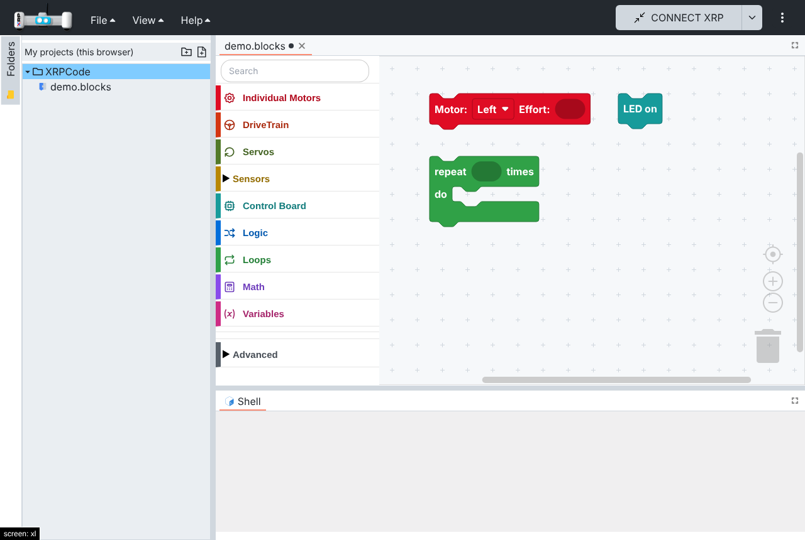
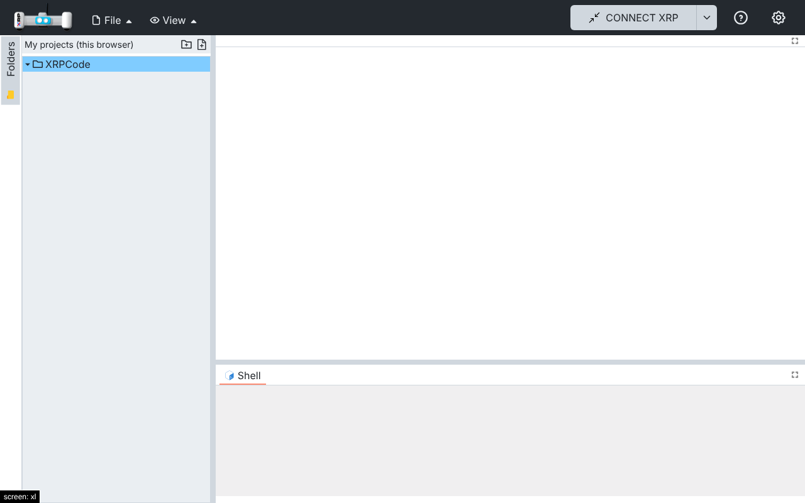
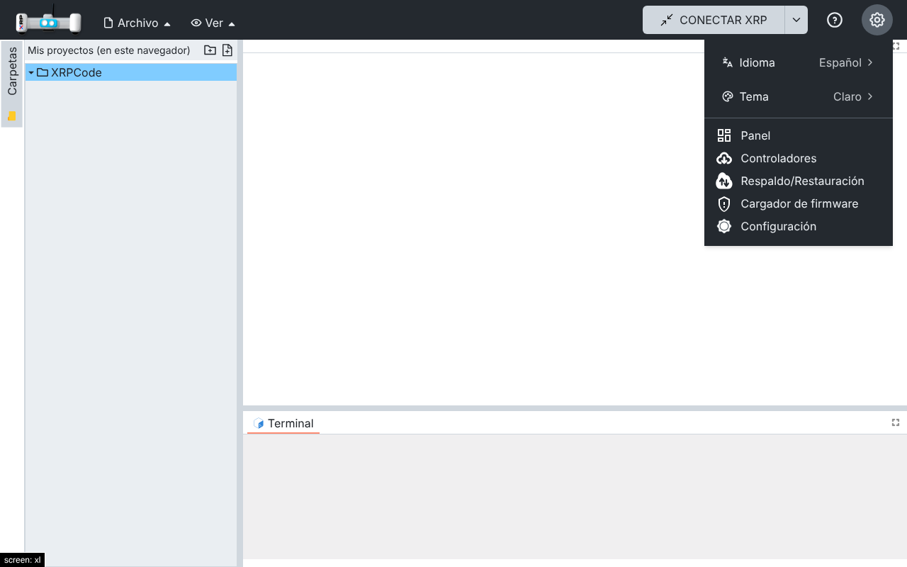
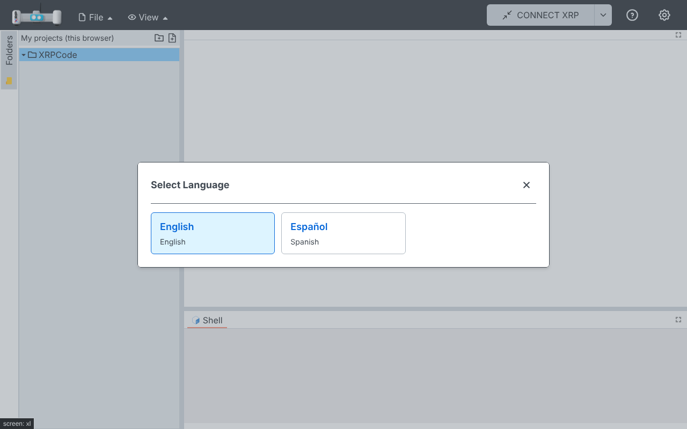
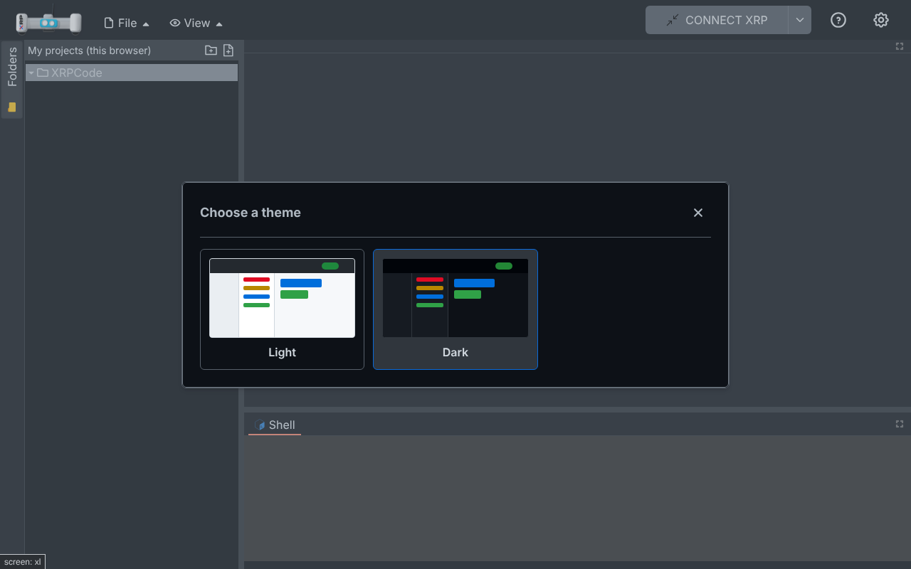
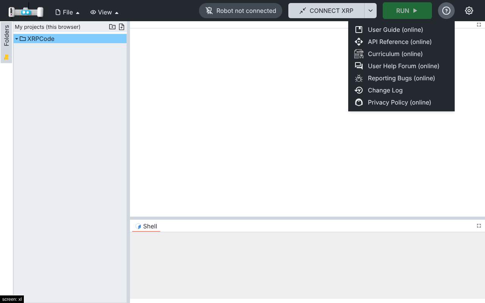
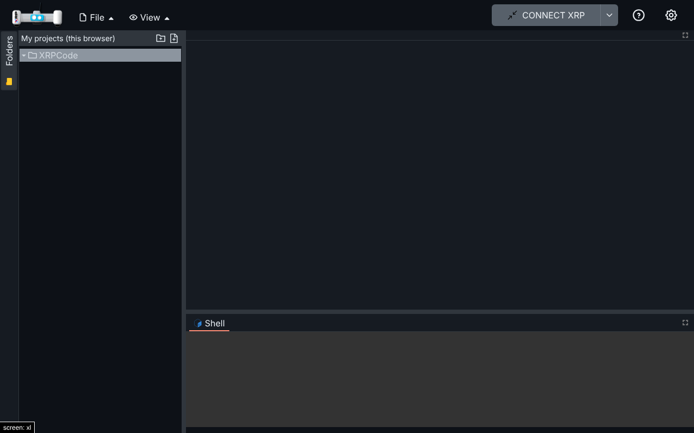
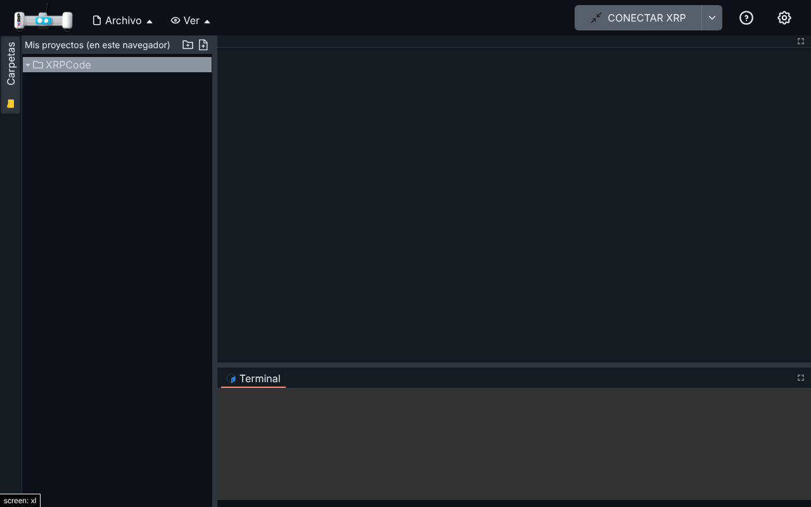
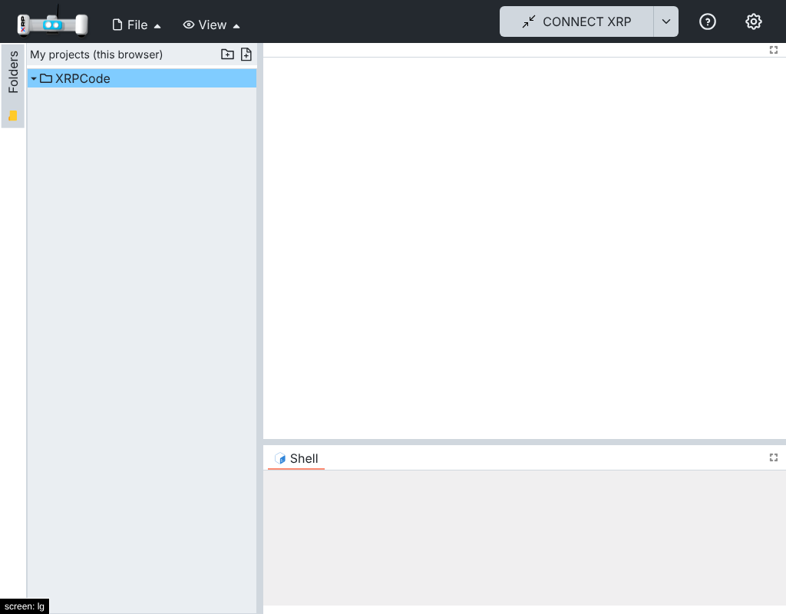

# 006 — Top bar

## Problem

The top bar mixed text menus (File, View, Help) with a "more" (⋮) menu, language and theme were
only reachable through the Settings dialog, and the Google
sign-in lived in the folder tree header, so it disappeared with the tree. In offline builds the
local session also lives in the sign-in widget, so closing the tree could stop it from signing in.

## Solution

One friendly top bar for everyone (no separate "kids mode"):

- **Left:** logo and the File and View menus, now with icons.
- **Right**, in order:
  - **Connect**, which becomes **Run/Stop** once a robot is connected (unchanged from XRPWeb; the
    run behaviour is left as is until it can be tested with a robot).
  - **Connection status** while connected: "Robot connected · USB/Bluetooth · XRP-ID" (icon only
    below 1280 px).
  - **Help (?)**: the former Help menu (guides, forum, change log, privacy).
  - **Settings (⚙)**: Language and Theme rows that show the current choice and open their pickers;
    below them, the former ⋮ items (Dashboard, Drivers, Backup/Restore, Firmware,
    Settings, AI chat when enabled).
  - **Language picker:** a dialog with one card per language (native and English name), so it
    scales beyond two languages. Languages are listed once in `src/utils/i18n/languages.ts`, also
    used by the Settings dialog.
  - **Theme picker:** a dialog with one card per theme and a miniature preview of the app in its
    colours. Themes are listed in `src/theme/app-themes.ts`, so a new one (for example Dracula) is
    one more entry plus its colours.
  - **Account**, at the top right like most apps: a "Google Sign In" button, or an avatar with the
    name, email and Sign out. In offline builds this slot hosts the local session and shows
    nothing.
- The folder tree no longer shows the sign-in widget; it follows `EVENT_LOGIN_STATUS`.

## Files

- New: `src/components/navbar/` (`connection-status.tsx`, `nav-dropdown.tsx`,
  `quick-settings.tsx`), `src/components/dialogs/language-dlg.tsx`, `src/components/dialogs/theme-dlg.tsx`,
  `src/utils/i18n/languages.ts`, `src/theme/app-themes.ts`, `src/widgets/compact-account.tsx`, `src/utils/theme.ts` (`applyTheme`,
  shared with the Settings dialog), `src/utils/session.ts` (sign-in and sign-out handling moved out
  of the folder tree; `isSignInInNavbar`).
- Hooks: `src/components/navbar.tsx` (layout of the bar, help items, settings dropdown, account),
  `src/widgets/login.tsx` (`compact` variant), `src/components/folder-tree.tsx` (listens to the login
  event, hides its sign-in when it is in the top bar), `src/components/dialogs/settings.tsx` (uses
  `applyTheme`), `src/utils/i18n/locales/{en,es}` (`navbar.*`).

## How to test

1. `npm run dev:offline`: the bar shows File, View, Connect, ? and ⚙.
2. ⚙ → Language → Español, and ⚙ → Theme → Dark: the app switches language and theme immediately, and keeps
   them after a reload.
3. ? lists the help links.
4. File → New File works (the local session signs in from the top bar).
5. At 1024 px the bar fits on one line.

Automated: `src/widgets/tests/compact-account.spec.tsx` (sign-in button, avatar menu, sign out),
`src/components/tests/language-dlg.spec.tsx`, `src/components/tests/theme-dlg.spec.tsx` and `src/utils/tests/theme.spec.ts`. The real Google sign-in needs the auth backend and was not run.

## Screenshots

| Before | After |
| --- | --- |
|  |  |

| Settings (⚙) | Language picker |
| --- | --- |
|  |  |

| Theme picker | |
| --- | --- |
|  | |

| Help (?) | Dark |
| --- | --- |
|  |  |

| Spanish, dark | Tablet (1024 px) |
| --- | --- |
|  |  |

## Upstream

Fork-specific layout. The theme helper and moving sign-in out of the folder tree could be proposed
separately.
