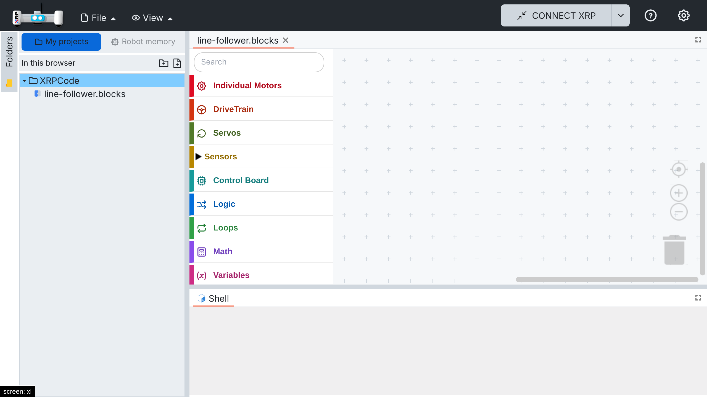
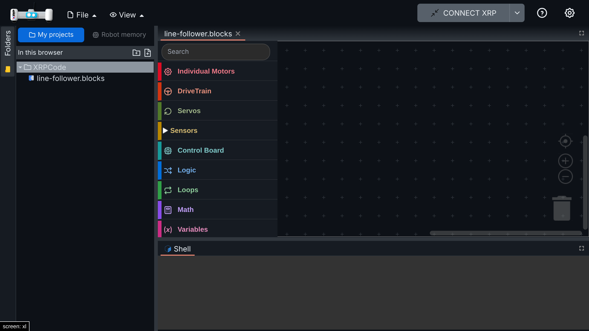

# 007 — My projects

Projects without a robot or a Google account, and the robot's files one click away. Two parts:
projects kept in the browser, then when they are used and how to switch to the robot's memory.

## Problem

XRPWeb stores projects in one of two places:

- **Robot memory** (default, no Google): the folder tree shows the files on the XRP, and New and
  Save write to it. Needs a connected robot.
- **Google Drive** (signed in): projects live in Drive; Run copies the program to the robot.

With neither a robot nor Google, the File menu is disabled and the editor stays empty. This blocks:

- Students practicing at home without a robot.
- Schools that do not allow Google accounts for kids.
- Teachers preparing programs before class.

## Part 1 — Projects in the browser

### Solution

Projects are kept in the browser (IndexedDB), with no account and no robot required.

- `LocalDriveService` implements the same interface as `GoogleDriveService` (create, read, update,
  rename, move, delete, list, folder tree) on top of IndexedDB.
- `AppMgr` uses `LocalDriveService` when My projects is enabled (Part 2), and a `LocalSession`
  widget replaces the Google sign-in button: it signs in to the local drive automatically on
  startup.
- Because the local drive behaves like Google Drive, the existing code paths work unchanged: file
  tree, New / Open / Save, autosave, and Run (which copies the program to the XRP when connected).
- The root `XRPCode` folder is created once, even when React's StrictMode mounts twice.

### Files

- New: `src/services/local-drive.ts` (service, IndexedDB and in-memory stores),
  `src/widgets/local-session.tsx`.
- Hooks: `src/managers/appmgr.ts` (service selection), `src/widgets/login.tsx` (local session),
  `src/components/folder-tree.tsx` (skip the Google Drive first-login notice),
  `src/components/xrplayout.tsx` (no Google Drive icon on local tabs).

### How to test

1. Open an offline build, with no robot connected.
2. File → New File → Blockly, name it, Submit: the editor opens and the file appears in the tree.
3. Add a block, File → Save File, reload the page: the file and the block are still there.
4. Rename, move and delete files and folders from the tree.

Automated: `src/services/tests/local-drive.spec.ts` (create/read/update, folder tree, rename, move,
recursive delete, persistence, single root folder under concurrent calls).

## Part 2 — When My projects is used, and the robot's memory

The first version only worked in offline builds, and once on, it hid the robot's files even with a
robot connected, which XRPWeb's default mode relies on.

### Solution

Fill the gap without changing XRPWeb's two modes:

- **When it applies:** My projects is used when Google sign-in is not available, that is offline
  builds or builds without `GOOGLE_AUTH_URL` (`isLocalProjectsEnabled`). Builds with Google keep
  XRPWeb's behaviour unchanged, because Google sign-in and My projects share the same session slot
  in the code and that interaction cannot be tested here.
- **Like Google Drive in XRPWeb:** connecting a robot does not change the tree. The project stays
  open, and Run copies it to the robot (the same path XRPWeb uses for Drive files).
- **"My projects | Robot memory" switch** above the folder tree. Robot memory shows the connected
  robot's files exactly as XRPWeb does without Google (`showRobotMemory()`). It is disabled
  ("Connect the robot to see its memory") without a robot. If the robot disconnects while showing
  its memory, the switch goes back to My projects.
- Editors opened from My projects stay open while the robot memory is shown, read-only, with a
  message asking to choose My projects again.
- The tree header under the switch reads "In this browser".

### Files

- New: `src/utils/local-projects.ts` (`startMyProjects`, `showRobotMemory`, `isRobotConnected`),
  `src/components/storage-switch.tsx`, `src/utils/i18n/locales/{en,es}/local-projects.json` (My
  projects wording, split from `offline.json`).
- Changed: `src/utils/offline.ts` (`isLocalProjectsEnabled`), `src/widgets/local-session.tsx`
  (uses `startMyProjects`); `appmgr.ts`, `login.tsx`, `xrplayout.tsx`, `folder-tree.tsx`,
  `navbar.tsx`, `session.ts` and `i18n/index.ts` check `isLocalProjectsEnabled` instead of
  `isOfflineBuild`.

### How to test

Without a robot (tested):

1. Open a build without Google sign-in, or an offline build.
2. The switch shows My projects selected and Robot memory disabled.
3. File → New File, add a block, Save, reload: the project is still there.

With a robot (**not tested yet**; needs a real XRP):

1. Connect the robot while a project from My projects is open: the tree does not change.
2. Run: the program is copied to the robot and runs.
3. Choose Robot memory: the tree shows the robot's files and storage ("XRP Filesystem: X MB");
   New and Save write to the robot, as in XRPWeb.
4. Disconnect the robot while showing its memory: the switch goes back to My projects.

Automated: `src/components/tests/storage-switch.spec.tsx` (disabled without a robot, switching,
return to My projects on disconnect, follows sign-in events) and the locale override tests.

### Screenshots

| Light (normal build, no Google) | Dark |
| --- | --- |
|  |  |

## Known limitations

- Projects live in one browser profile. Export to PC is the backup path; Drive backup is in the
  backlog.

## Upstream

Proposed as a feature request: [Open-STEM/XRPWeb#336](https://github.com/Open-STEM/XRPWeb/issues/336).
This answers it without changing the existing modes. The local drive service can be reused as is;
the way it is activated would follow the team's answer.
