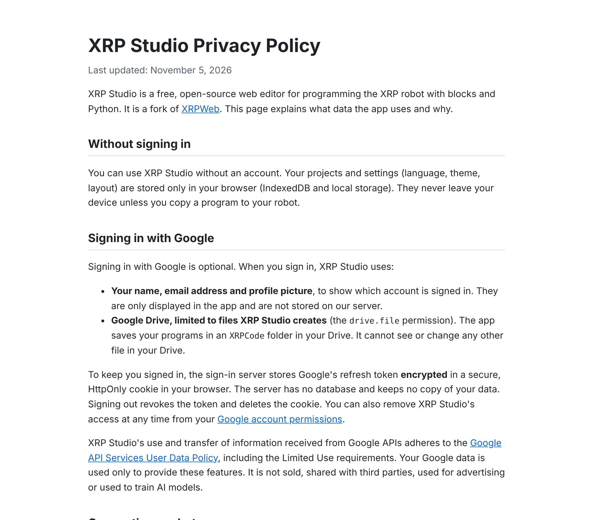
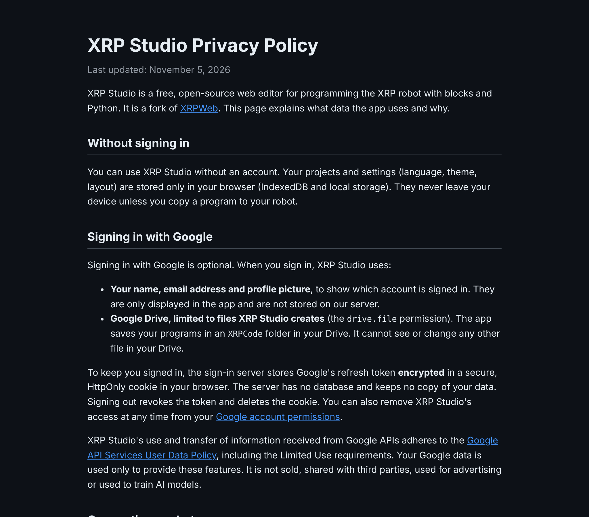
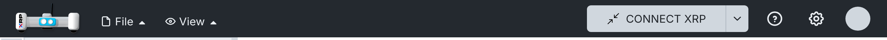
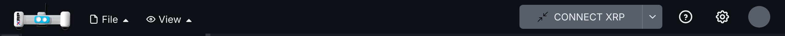

# 008 — Google sign-in

Google sign-in for the fork in two parts: a sign-in server the app can use, and keeping the session
after a reload.

## Part 1 — Sign-in server

### Problem

XRPWeb's Google sign-in needs a backend at `GOOGLE_AUTH_URL` that exchanges Google's authorization
code for tokens (it holds the OAuth client secret). That backend is private, and Google only
accepts the origins registered in its project, so a fork cannot use it. Without a backend, the
"Google Sign In" button does nothing.

### Solution

A small, stateless sign-in server that implements the same endpoints and response shapes the app
already calls (`src/services/google-auth.ts`), so the app's sign-in code is unchanged:

| Endpoint | Does |
| --- | --- |
| `GET /google-auth/client-id` | Returns the OAuth client ID. |
| `GET /google-auth/handshake` | Starts a session: random token in the body and in an HttpOnly cookie. |
| `POST /google-auth/exchange-code` | Exchanges the popup's code for tokens (`redirect_uri=postmessage`). |
| `POST /google-auth/refresh-token` | New access token from the stored refresh token. |
| `DELETE /google-auth/session/{token}` | Sign out: revokes the refresh token and clears the cookies. |

- Every call must send the handshake token in `X-Handshake-Token`, matching the handshake cookie.
- The Google refresh token is stored **encrypted** (AES-GCM, `AUTH_SESSION_SECRET`) in an
  HttpOnly, Secure, SameSite=Strict cookie scoped to `/api/google-auth`. The browser's JavaScript
  only receives a placeholder. No database.
- Hosted as Vercel functions in `api/` next to the static app, so `GOOGLE_AUTH_URL=/api` (same
  origin, no CORS).
- In development, a Vite plugin serves the same handlers under `/api/google-auth` when the server
  variables are set.
- Relative imports in `api/` and `server/` use explicit `.js` extensions: the repo is
  `"type": "module"`, so Vercel runs the functions as native ES modules, which do not resolve
  extensionless paths (Vite does, so it only failed once deployed). A test checks this.
- Server variables avoid the `GOOGLE_` and `VITE_` prefixes on purpose: Vite exposes those to the
  browser bundle (`envPrefix`), and the client secret must never reach it.

Setting `GOOGLE_AUTH_URL` switches the app to XRPWeb's Google Drive mode. Syncing the fork's
browser projects with Drive is a separate, later change.

### Files

- New: `public/privacy.html` (privacy policy for the OAuth consent screen),
  `server/google-auth/` (`handlers.ts`, `crypto.ts`, `cookies.ts`, `vite-plugin.ts`,
  `tests/handlers.spec.ts`), `api/google-auth/` (one thin Vercel function per endpoint),
  `vercel.json`.
- Hooks: `vite.config.ts` (dev plugin), `tsconfig.node.json` (type-check `api` and `server`).

### Setup

#### Google Cloud

1. Create a project at <https://console.cloud.google.com>.
2. APIs & Services → Library → enable **Google Drive API**.
3. OAuth consent screen: External, app name, support email. Scope: `drive.file` (the only one
   the app requests). While in **Testing**, add your Google account under Test users. Testing
   shows a "Google hasn't verified this app" warning and expires sessions after 7 days; to
   publish, Branding needs a home page (`https://xrp-studio.vercel.app`) and a privacy policy
   (`https://xrp-studio.vercel.app/privacy.html`, served from `public/privacy.html`).
4. Credentials → Create credentials → OAuth client ID → **Web application**. Authorized
   JavaScript origins: your Vercel domain (for example `https://xrp-studio.vercel.app`) and
   `http://localhost:3000`. No redirect URIs are needed (popup flow).
5. Copy the client ID and client secret.

#### Vercel

1. Import the GitHub repository (the settings in `vercel.json` are picked up).
2. Project → Settings → Environment Variables:

| Variable | Value |
| --- | --- |
| `OAUTH_CLIENT_ID` | Client ID from Google Cloud |
| `OAUTH_CLIENT_SECRET` | Client secret from Google Cloud |
| `AUTH_SESSION_SECRET` | A long random string (`openssl rand -base64 32`) |
| `GOOGLE_AUTH_URL` | `/api` |
| `NODE_OPTIONS` | `--max-old-space-size=8192` (build memory) |

3. Redeploy.

#### Local development

Put the same variables in `.env.local` (not committed) and run `npm run dev`.

### How to test

1. `npx vitest run server`: 8 tests with a fake Google endpoint (client ID, handshake cookie,
   code exchange with the encrypted cookie and hidden refresh token, handshake mismatch, rejected
   code, missing configuration, refresh, tampered cookie, sign out).
2. `npm run dev` with dummy values: `/api/google-auth/client-id` returns the ID, the handshake sets
   the cookie, and the app shows "Google Sign In".
3. With real credentials (local `.env.local`): sign in, create a file (it appears in Drive's
   `XRPCode` folder), sign out (`DELETE .../session/...` returns 200 and clears both cookies).
   Tested locally with a real Google Cloud project; Vercel deployment not tested yet.

### Screenshots

| Light | Dark |
| --- | --- |
|  |  |
|  |  |

## Part 2 — Keep the session after a reload

### Problem

XRPWeb keeps the Google session in memory only (`src/services/google-auth.ts`). Reloading the page
signs the user out, and they have to open Google's popup again.

### Solution

On startup, the sign-in widget asks the auth backend for a new access token; if it gets one, it
loads the profile and finishes the sign-in as usual (same `finalizeLogin` path as the popup).

- `GoogleAuthService.restoreSession()` only tries when the last sign-in in this browser did not end
  with a sign-out (`GoogleSession` in `localStorage`, set after the code exchange and removed on
  sign-out). Signed-out users make no extra request.
- It calls the existing `refresh-token` endpoint. With the fork's server (Part 1) the refresh
  token lives in an HttpOnly cookie that survives the reload. A backend that cannot restore the
  session answers with an error: the hint is cleared and the user signs in as before.
- Called once per page load, even with React StrictMode or more than one widget.
- While it restores, the top bar shows an avatar-sized placeholder instead of the sign-in button,
  so the bar does not jump from "Google Sign In" to "Signing in..." to the avatar. The placeholder
  is also shown while the OAuth client ID loads, so the Settings button does not move.

### Files

- `src/services/google-auth.ts`: `restoreSession()`, hint set on exchange and cleared on sign-out.
- `src/widgets/login.tsx`: one effect that restores the session on mount (`isRestoring`).
- `src/widgets/compact-account.tsx`: `isRestoring` placeholder.
- `src/utils/localstorage.ts`: `GOOGLE_SESSION` key.
- Test: `src/services/tests/google-auth.spec.ts`.

### How to test

1. With the Part 1 setup, `npm run dev`, sign in with Google.
2. Reload: the avatar comes back without the popup.
3. Sign out and reload: the "Google Sign In" button is shown and no `refresh-token` request is made.
4. Expired session: with `GoogleSession=true` in `localStorage` and no refresh cookie, a reload makes
   one `refresh-token` request (401), clears the hint and shows the sign-in button (checked with
   Playwright).

Automated: `src/services/tests/google-auth.spec.ts` (no hint, restore once, backend refusal,
sign-out) and `src/widgets/tests/compact-account.spec.tsx` (placeholder while restoring).

### Screenshots

Top bar while the session is restored:

| Light | Dark |
| --- | --- |
|  |  |

## Upstream

- Server: possibly useful to XRPWeb as a reference or self-hosting option; their own backend stays
  as is.
- Session restore: possible. With XRPWeb's own backend it depends on whether that backend can
  refresh with a new handshake token; if not, it falls back to today's behaviour.
