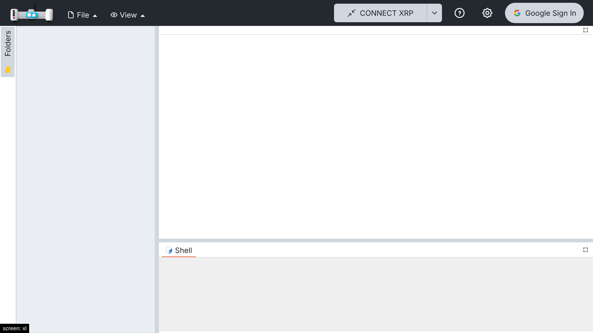
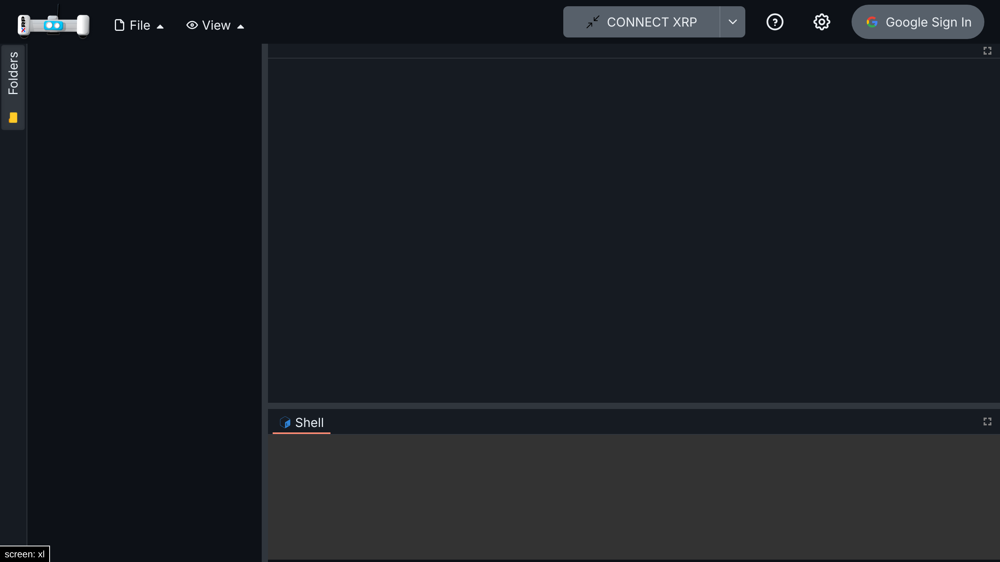

# 008 — Google sign-in server

## Problem

XRPWeb's Google sign-in needs a backend at `GOOGLE_AUTH_URL` that exchanges Google's authorization
code for tokens (it holds the OAuth client secret). That backend is private, and Google only
accepts the origins registered in its project, so a fork cannot use it. Without a backend, the
"Google Sign In" button does nothing.

## Solution

A small, stateless sign-in server that implements the same endpoints and response shapes the app
already calls (`src/services/google-auth.ts`), so the app's sign-in code is unchanged:

| Endpoint | Does |
| --- | --- |
| `GET /google-auth/client-id` | Returns the OAuth client ID. |
| `GET /google-auth/handshake` | Starts a session: random token in the body and in an HttpOnly cookie. |
| `POST /google-auth/exchange-code` | Exchanges the popup's code for tokens (`redirect_uri=postmessage`). |
| `POST /google-auth/refresh-token` | New access token from the stored refresh token. |
| `DELETE /google-auth/session/{token}` | Sign out: revokes the refresh token and clears the cookies. |

- Every call must send the handshake token in `X-Handshake-Token`, matching the handshake cookie.
- The Google refresh token is stored **encrypted** (AES-GCM, `AUTH_SESSION_SECRET`) in an
  HttpOnly, Secure, SameSite=Strict cookie scoped to `/api/google-auth`. The browser's JavaScript
  only receives a placeholder. No database.
- Hosted as Vercel functions in `api/` next to the static app, so `GOOGLE_AUTH_URL=/api` (same
  origin, no CORS).
- In development, a Vite plugin serves the same handlers under `/api/google-auth` when the server
  variables are set.
- Server variables avoid the `GOOGLE_` and `VITE_` prefixes on purpose: Vite exposes those to the
  browser bundle (`envPrefix`), and the client secret must never reach it.

Setting `GOOGLE_AUTH_URL` switches the app to XRPWeb's Google Drive mode. Syncing the fork's
browser projects with Drive is a separate, later change.

## Files

- New: `server/google-auth/` (`handlers.ts`, `crypto.ts`, `cookies.ts`, `vite-plugin.ts`,
  `tests/handlers.spec.ts`), `api/google-auth/` (one thin Vercel function per endpoint),
  `vercel.json`.
- Hooks: `vite.config.ts` (dev plugin), `tsconfig.node.json` (type-check `api` and `server`).

## Setup

### Google Cloud

1. Create a project at <https://console.cloud.google.com>.
2. APIs & Services → Library → enable **Google Drive API**.
3. OAuth consent screen: External, app name, support email. Scope: `drive.file` (the only one
   the app requests). While in **Testing**, add your Google account under Test users.
4. Credentials → Create credentials → OAuth client ID → **Web application**. Authorized
   JavaScript origins: your Vercel domain (for example `https://xrp-studio.vercel.app`) and
   `http://localhost:3000`. No redirect URIs are needed (popup flow).
5. Copy the client ID and client secret.

### Vercel

1. Import the GitHub repository (the settings in `vercel.json` are picked up).
2. Project → Settings → Environment Variables:

| Variable | Value |
| --- | --- |
| `OAUTH_CLIENT_ID` | Client ID from Google Cloud |
| `OAUTH_CLIENT_SECRET` | Client secret from Google Cloud |
| `AUTH_SESSION_SECRET` | A long random string (`openssl rand -base64 32`) |
| `GOOGLE_AUTH_URL` | `/api` |
| `NODE_OPTIONS` | `--max-old-space-size=8192` (build memory) |

3. Redeploy.

### Local development

Put the same variables in `.env.local` (not committed) and run `npm run dev`.

## How to test

1. `npx vitest run server`: 8 tests with a fake Google endpoint (client ID, handshake cookie,
   code exchange with the encrypted cookie and hidden refresh token, handshake mismatch, rejected
   code, missing configuration, refresh, tampered cookie, sign out).
2. `npm run dev` with dummy values: `/api/google-auth/client-id` returns the ID, the handshake sets
   the cookie, and the app shows "Google Sign In".
3. With real credentials (Vercel or local): sign in, create a file (it appears in Drive's
   `XRPCode` folder), reload (still signed in), sign out.

Step 3 has not been run yet: it needs real Google credentials.

## Screenshots

| Light | Dark |
| --- | --- |
|  |  |

## Upstream

Possibly useful to XRPWeb as a reference or self-hosting option; their own backend stays as is.
