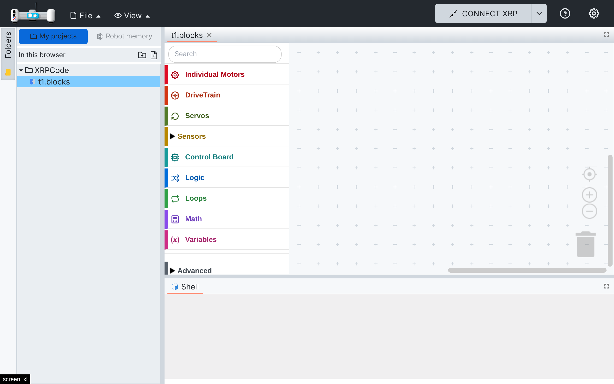
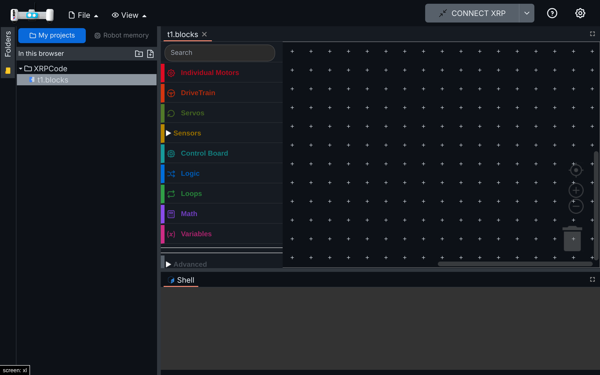

# 010 — Theme switch fixes

## Problem

Two bugs when switching between light and dark:

1. **Glitch on every switch.** The layout (flexlayout) loads its theme as a stylesheet file. The
   old file was removed before the new one had downloaded, so the whole layout lost its styles for
   a moment (most visible in production, where the file comes over the network).
2. **Layout and shell stuck on the old theme after closing a tab.** Closing an editor tab called
   `eventOff(EVENT_THEME)`, which drops *every* theme listener, including the layout's and the
   shell's. After that, switching themes left the tab bars and the shell on the old theme.

## Solution

1. New `src/utils/swap-stylesheet.ts`: adds the new stylesheet next to the old one and removes the
   old one only after the new one has loaded (or failed). A swap still loading is cancelled when
   another one starts, so fast toggling ends on the last choice. `xrplayout.tsx` uses it in
   `changeTheme`.
2. `EditorMgr.RemoveEditor` no longer removes theme listeners. A closed editor's listener finds no
   session and does nothing.

## Files

- New: `src/utils/swap-stylesheet.ts`, `src/utils/tests/swap-stylesheet.spec.ts`.
- Hooks: `src/components/xrplayout.tsx` (`changeTheme`), `src/managers/editormgr.ts`
  (`RemoveEditor`).

## How to test

1. On a slow network (the layout stylesheets take almost a second to load): switching theme keeps
   the layout styled during the load (before: unstyled layout).
2. Open a `.blocks` file, close its tab, reopen it, switch to Dark: tab bars, shell and blocks turn
   dark (before: tab bars and shell stayed light). Switch back to Light: all light.

Captured during the switch, with the stylesheet download delayed:

| Light | Dark |
| --- | --- |
|  |  |

## Upstream

Both bugs are in XRPWeb's code. The two code commits are on the `theme-switch-flash` branch, based
on `upstream/main`, ready to propose.
