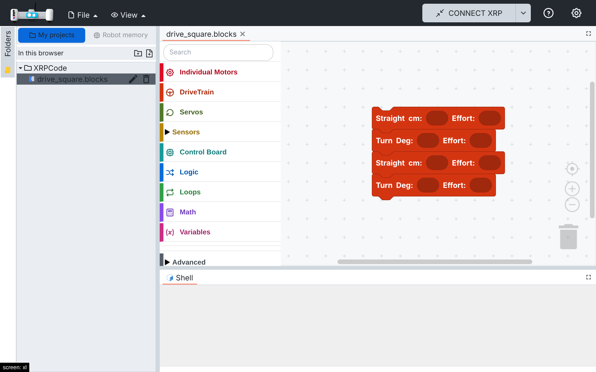
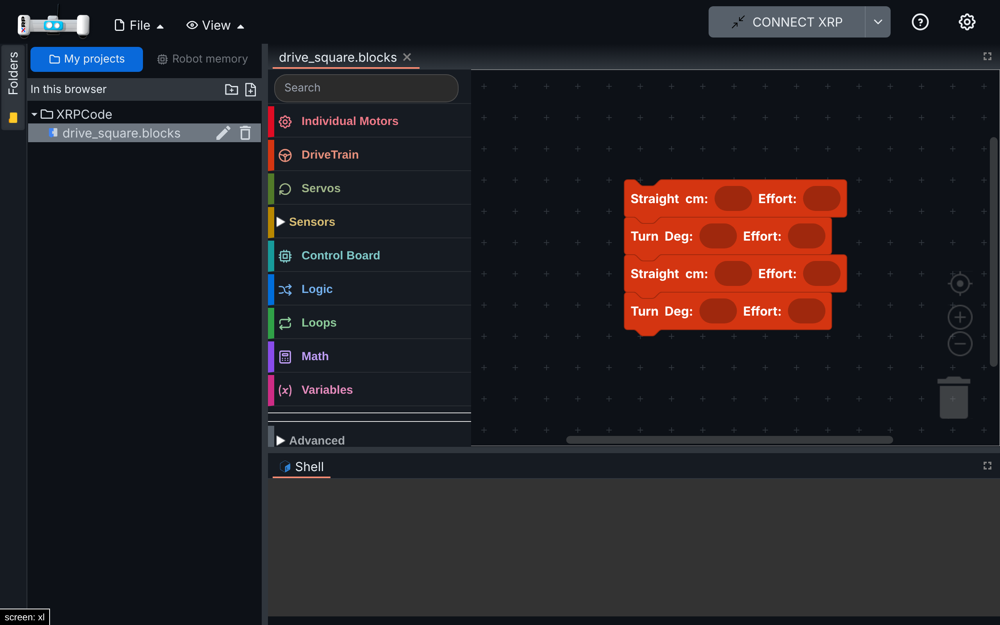

# 011 — Files from My projects open with their blocks

## Problem

Opening a saved `.blocks` file from My projects showed an empty workspace, even though the file was
saved correctly. Unsaved blocks were also lost after a reload.

react-blockly imports its `initialJson` (an empty workspace) one render after it injects the
workspace. My projects reads the file from IndexedDB almost instantly, so the file's blocks were
loaded before that import, and the import then cleared them. Files from Google Drive or the robot
usually arrive later, after the import, which is why XRPWeb rarely shows it.

## Solution

`src/components/blockly.tsx`: a file that arrives before the initial import (or before the
workspace exists) is kept and loaded when the import finishes (`FINISHED_LOADING`). The flag is
reset whenever a workspace is injected.

## Files

- `src/components/blockly.tsx` (`EVENT_EDITOR_LOAD` listener, workspace change listener,
  `handleOnInject`).

## How to test

1. My projects: create a `.blocks` file, add blocks, save, close the tab, open it again from the
   folder tree: the blocks are there (before: empty).
2. Add blocks without saving and reload: the tab comes back with the blocks (before: empty).
3. A new file starts empty; closing a file that was only opened does not ask about unsaved changes.

| Light | Dark |
| --- | --- |
|  |  |

## Upstream

The race is in XRPWeb's code; it shows up whenever a file loads fast. Possible to propose.
