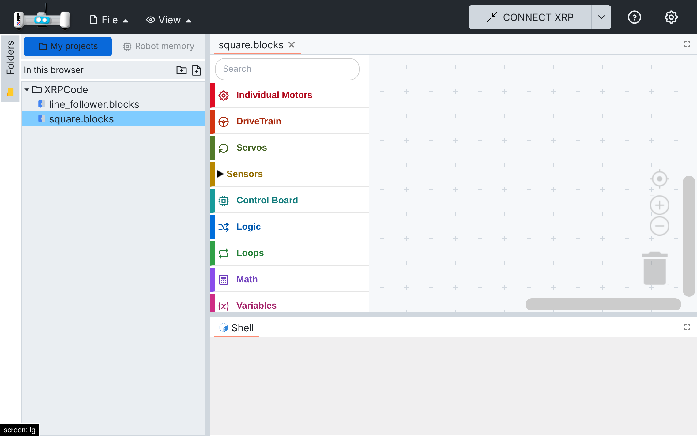
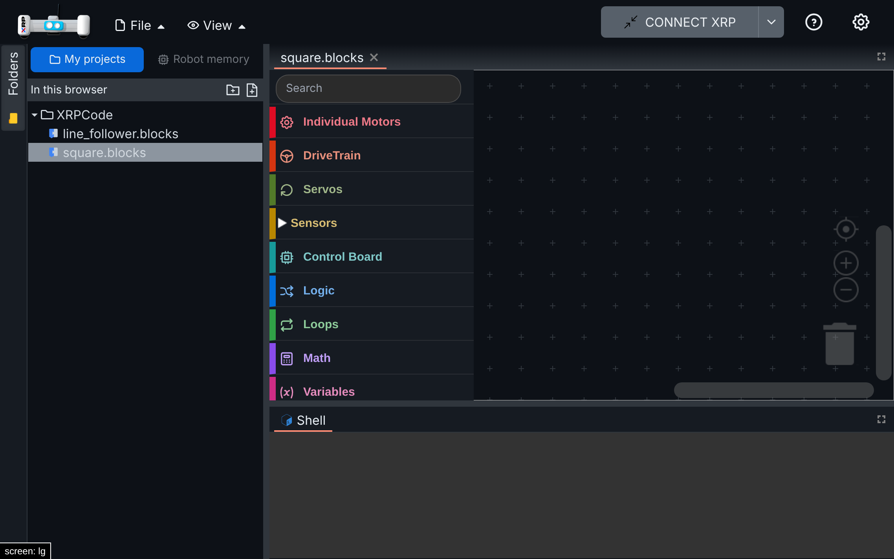

# 012 — Open files with a single tap

## Problem

XRPWeb opens a file from the folder tree with a double click; a single click only selects it (or
switches to its tab if it is already open). On phones and tablets a double tap usually zooms the
page instead, so files could not be opened at all. Children also expect one tap to open things.

## Solution

New flag `openFilesOnSingleClick` (`src/utils/folder-tree-options.ts`, on in XRP Studio). With it,
one click or tap on a file opens it, or switches to its tab when it is already open (a double click
still works and opens it once). Folders keep opening and closing with one click. Clicks on the
rename and delete buttons, or in the rename field, never open the file.

## Files

- New: `src/utils/folder-tree-options.ts`.
- Hook: `src/components/folder-tree.tsx` (`Node` click handler).

## How to test

On desktop (click) and with phone emulation (tap), in My projects with two `.blocks` files:

1. One click/tap on a closed file opens it; a double click opens it once (no duplicate tab).
2. One click/tap on an open file switches to its tab.
3. The rename (pencil) and delete buttons do not open the file.
4. `npx vitest run`: 103 tests pass.

Tablet emulation, after a single tap on `square.blocks`:

| Light | Dark |
| --- | --- |
|  |  |

## Upstream

Possible behind the same flag; it helps XRPWeb on tablets too.
