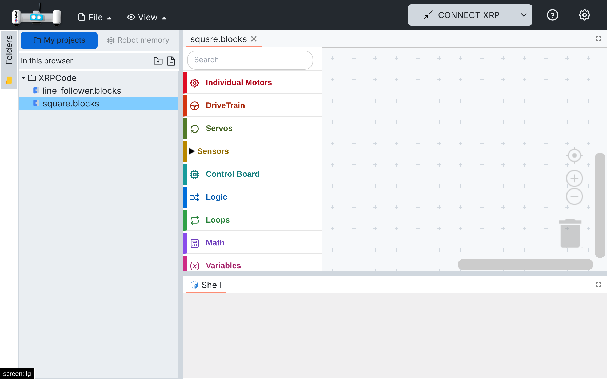
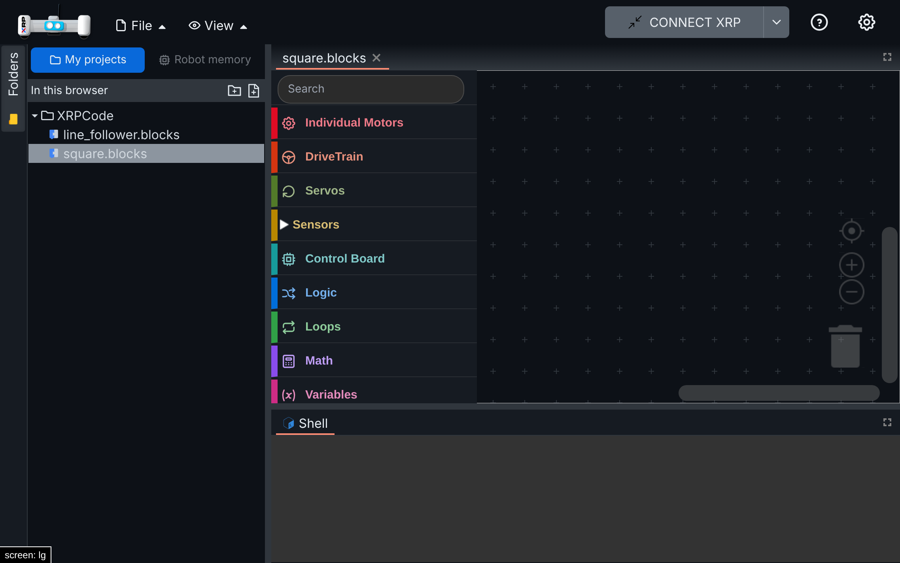
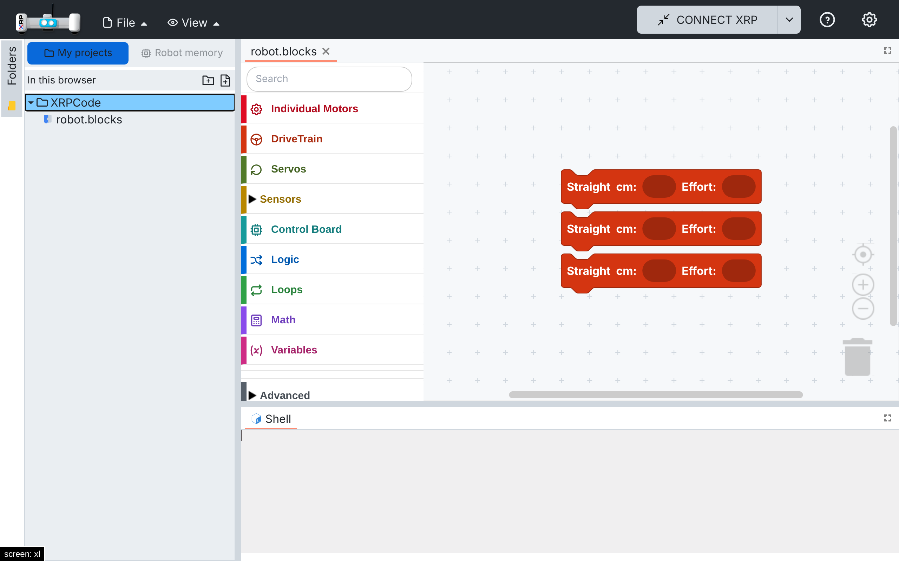
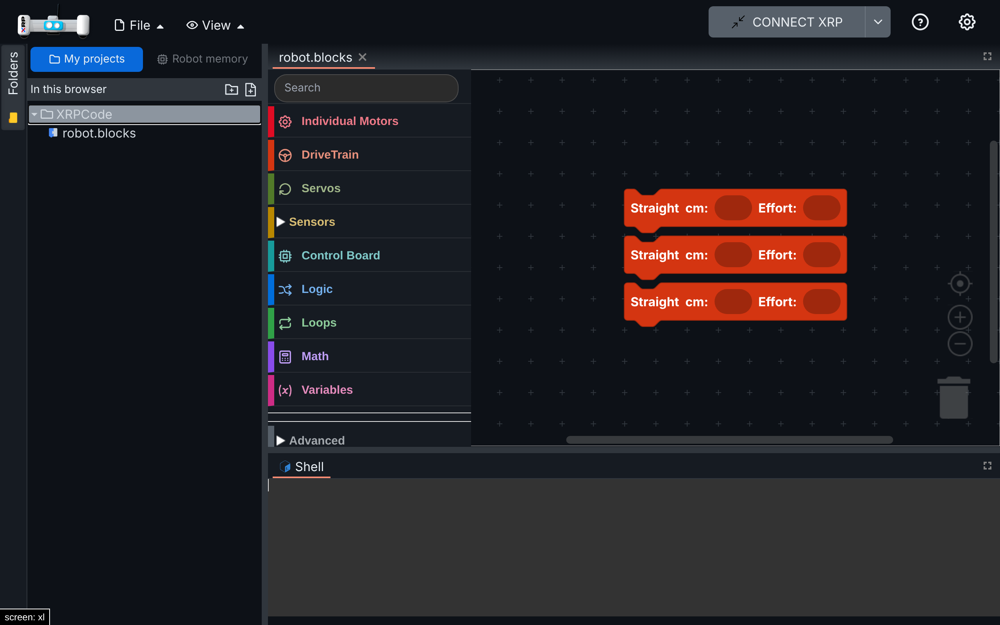

# 012 — Opening projects

Changes that make opening projects easier for kids: open files with a single tap, reopen the last
project on startup, and open blocks projects quickly and without errors.

## Problem

### Single tap

XRPWeb opens a file from the folder tree with a double click; a single click only selects it (or
switches to its tab if it is already open). On phones and tablets a double tap usually zooms the
page instead, so files could not be opened at all. Children also expect one tap to open things.

### Reopen the last project

XRPWeb restores the tabs that were open when the page was closed. If the user had closed them all,
the app starts with an empty editor area, with nothing inviting the child to keep working.

### Faster opening, without errors

- The block search (`@blockly/toolbox-search`) rebuilt its index every time a blocks editor was
  created: it created every toolbox block on a hidden workspace, even if nobody searched. All
  editors have the same toolbox, so the work was repeated for nothing.
- The search also registered its Ctrl+B shortcut once per editor. With two blocks tabs open, the
  console showed `Shortcut named "startSearch" already exists.`, and closing one tab removed the
  shortcut for the others.
- A blocks file that was created but never saved is empty. Opening it again threw
  "Unexpected end of JSON input".
- The search texts ("Search", "Type to search for blocks", "No matching blocks found") were fixed
  in English inside the plugin.

## Solution

### Single tap

New flag `openFilesOnSingleClick` (`src/utils/folder-tree-options.ts`, on in XRP Studio). With it,
one click or tap on a file opens it, or switches to its tab when it is already open (a double click
still works and opens it once). Folders keep opening and closing with one click. Clicks on the
rename and delete buttons, or in the rename field, never open the file.

### Reopen the last project

- `src/utils/last-project.ts` (new): when the last tab is closed, its file path is remembered
  (`LastProject` in local storage). On startup, the first time the user's projects are listed (My
  projects or Google Drive) and no tab is open, that file is opened again. A file that no longer
  exists is skipped, and the robot's own memory is never reopened this way. Closing every tab while
  working leaves the editor area empty until the next start.
- `EditorMgr.RemoveEditor` remembers the file; the folder tree calls `reopenLastProject` when its
  data arrives.
- `navbar.tsx` (`loadGoogleEditor`) also keeps the file content in the editor session. At startup
  the load event can arrive before the new tab has mounted; the editor then loads the session
  content when it mounts (Blockly and Python editors already do this).

### Faster opening, without errors

- **Block search indexed once, when first used.** `src/components/blockly/block-search.ts` (new)
  has the trigram index, adapted from the plugin's `BlockSearcher` (Apache-2.0).
  `sharedSearchIndex` builds it the first time someone types in the search field and keeps one
  index per toolbox and language, shared by every editor. `toolbox-search-category.ts` (new) is the
  search field for the toolbox kind `search`, adapted from the plugin's `ToolboxSearchCategory`; it
  uses the shared index and its texts go through i18n (en and es). The `@blockly/toolbox-search`
  dependency is removed (one less package to move for the Blockly 13 upgrade). `toolbox-ui.ts`
  registers the new field instead of importing the plugin; the field keeps the same id, so the
  existing styles apply.
- **One search shortcut for the whole app.** `registerSearchShortcut` registers Ctrl+B once, at
  startup. It focuses the search field of the current blocks editor (`Blockly.getMainWorkspace()`),
  so it works with any number of tabs and after closing some of them.
- **Empty blocks files open without errors.** `src/components/blockly/blocks-content.ts` (new):
  `parseBlocksJson` returns "no blocks" for empty or blank content instead of failing.
  `blockly.tsx` uses it in its two places that load blocks (`loadBlocksIntoWorkspace` and the
  `EVENT_EDITOR_LOAD` handler). Broken JSON still reports an error.

Measured on a dev build, 4× slower CPU (Chrome DevTools throttling), toolbox with 93 blocks:

| | Before | After |
| --- | --- | --- |
| Search indexing when a blocks editor opens | 40–135 ms, every editor | 0 ms |
| Search indexing when typing the first search | 0 ms (already done) | 35–135 ms, once per language |

## Files

- Single tap: new `src/utils/folder-tree-options.ts`; hook in `src/components/folder-tree.tsx`
  (`Node` click handler).
- Reopen: new `src/utils/last-project.ts`, `src/utils/tests/last-project.spec.ts`; hooks in
  `src/utils/localstorage.ts` (`LAST_PROJECT`), `src/managers/editormgr.ts` (`RemoveEditor`),
  `src/components/folder-tree.tsx` (`EVENT_FILESYS`), `src/components/navbar.tsx`
  (`loadGoogleEditor`).
- Faster opening: new `src/components/blockly/block-search.ts`, `toolbox-search-category.ts`,
  `blocks-content.ts`, and tests in `src/components/blockly/tests/`; changed
  `src/components/blockly/toolbox-ui.ts` (registers the search field), `src/components/blockly.tsx`
  (two calls to `parseBlocksJson`), `src/utils/i18n/locales/{en,es}/blockly.json` (`searchHint`,
  `searchNone`), `package.json` and `package-lock.json` (plugin removed).

## How to test

### Single tap

On desktop (click) and with phone emulation (tap), in My projects with two `.blocks` files:

1. One click/tap on a closed file opens it; a double click opens it once (no duplicate tab).
2. One click/tap on an open file switches to its tab.
3. The rename (pencil) and delete buttons do not open the file.

### Reopen the last project

1. My projects: create `robot.blocks`, add blocks, save, close the tab, reload: `robot.blocks`
   opens with its blocks. Same with a Python file.
2. Opening a file from the folder tree still loads it once (no duplicated blocks).

### Faster opening, without errors

1. Create a blocks project, close its tab without saving, and open it again from the folder tree:
   it opens empty and the console has no "Unexpected end of JSON input".
2. Open a second blocks file: the console has no `startSearch` warning.
3. Type "forward" in the search field: the matching blocks appear. Type "zzzz": "No matching
   blocks found". In Spanish the field says "Buscar" and the hints are in Spanish.
4. Click on the workspace and press Ctrl+B: the search field of that editor gets the focus. Close
   one of the two tabs and try again in the other.

## Screenshots

| | Light | Dark |
| --- | --- | --- |
| Single tap (tablet) |  |  |
| Reopened on startup |  |  |

## Upstream

- Single tap: possible behind the same flag; it helps XRPWeb on tablets too.
- Reopen: fork-specific; the `loadGoogleEditor` change could help XRPWeb on slow devices.
- Faster opening: XRPWeb does not use the block search (it was added by spec 004), so the search
  changes are fork-only. The empty-file fix is an XRPWeb bug too (the same `JSON.parse` of an
  empty file is in its `blockly.tsx`); `parseBlocksJson` could be proposed as a small fix.
