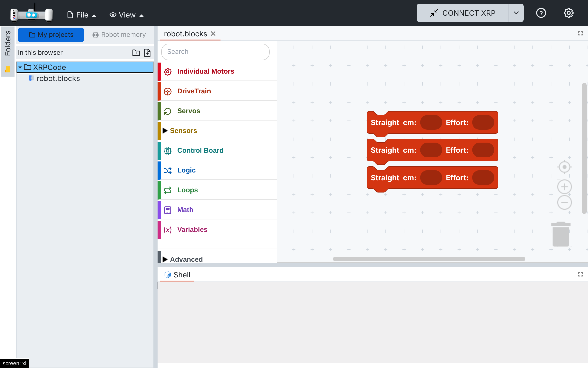
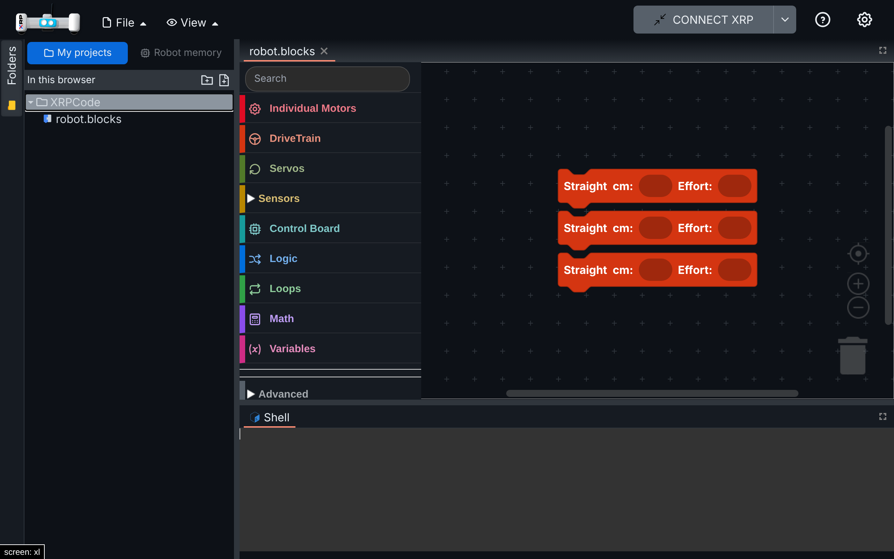

# 013 — Reopen the last project on startup

## Problem

XRPWeb restores the tabs that were open when the page was closed. If the user had closed them all,
the app starts with an empty editor area, with nothing inviting the child to keep working.

## Solution

- `src/utils/last-project.ts` (new): when the last tab is closed, its file path is remembered
  (`LastProject` in local storage). On startup, the first time the user's projects are listed (My
  projects or Google Drive) and no tab is open, that file is opened again. A file that no longer
  exists is skipped, and the robot's own memory is never reopened this way. Closing every tab while
  working leaves the editor area empty until the next start.
- `EditorMgr.RemoveEditor` remembers the file; the folder tree calls `reopenLastProject` when its
  data arrives.
- `navbar.tsx` (`loadGoogleEditor`) also keeps the file content in the editor session. At startup
  the load event can arrive before the new tab has mounted; the editor then loads the session
  content when it mounts (Blockly and Python editors already do this).

## Files

- New: `src/utils/last-project.ts`, `src/utils/tests/last-project.spec.ts`.
- Hooks: `src/utils/localstorage.ts` (`LAST_PROJECT`), `src/managers/editormgr.ts`
  (`RemoveEditor`), `src/components/folder-tree.tsx` (`EVENT_FILESYS`), `src/components/navbar.tsx`
  (`loadGoogleEditor`).

## How to test

1. `npx vitest run src/utils/tests/last-project.spec.ts`: 5 tests (remember, nested lookup, opens
   once, skips open tabs and deleted files, waits for the user's projects).
2. My projects: create `robot.blocks`, add blocks, save, close the tab, reload: `robot.blocks`
   opens with its blocks. Same with a Python file.
3. Opening a file from the folder tree still loads it once (no duplicated blocks).

| Light | Dark |
| --- | --- |
|  |  |

## Upstream

Fork-specific behaviour; the `loadGoogleEditor` change could help XRPWeb on slow devices.
