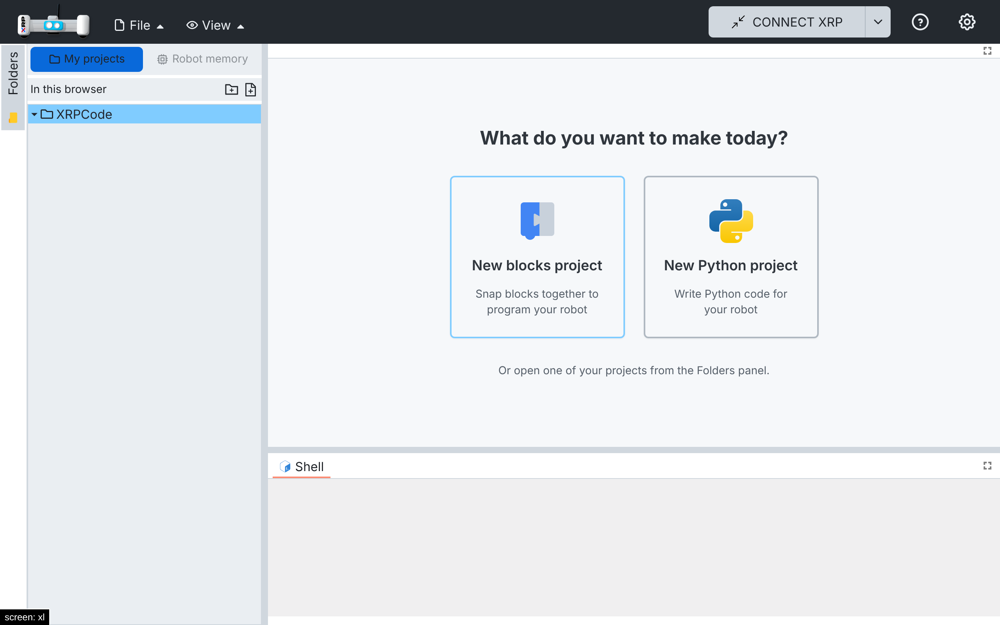
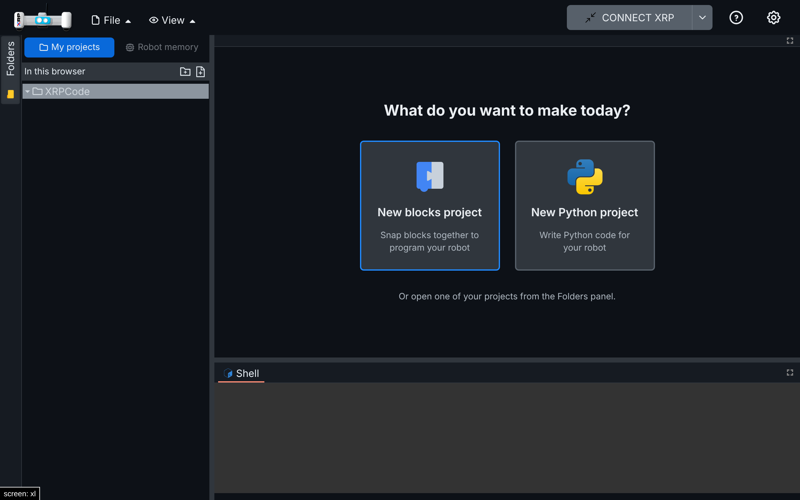
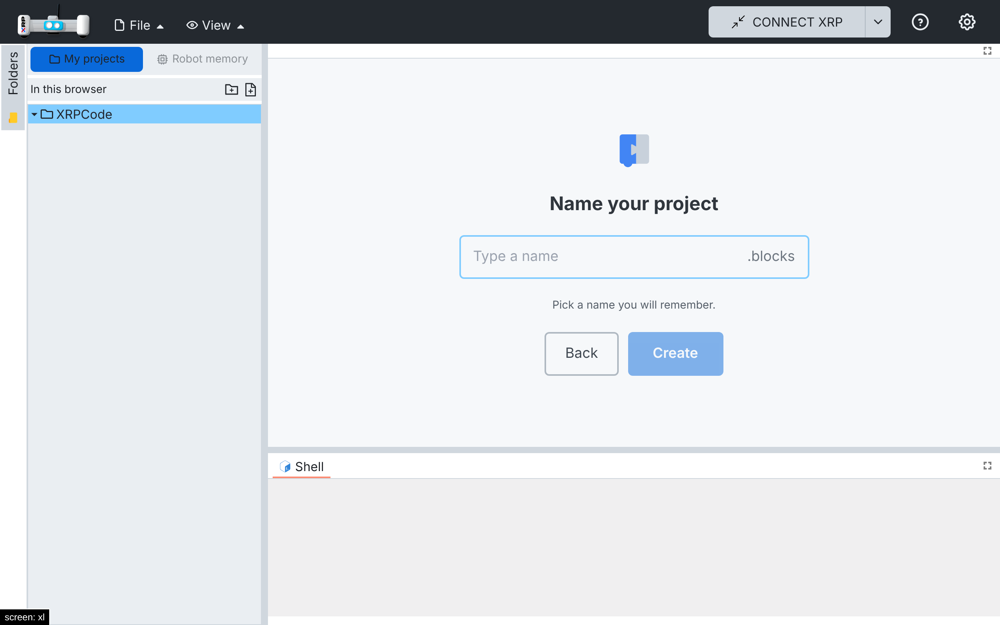
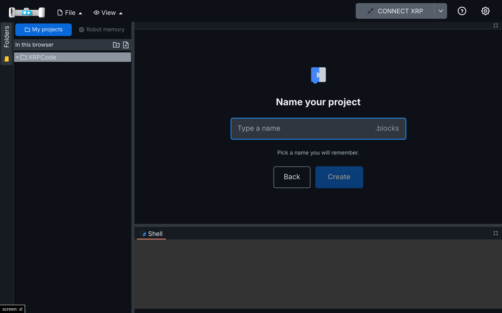
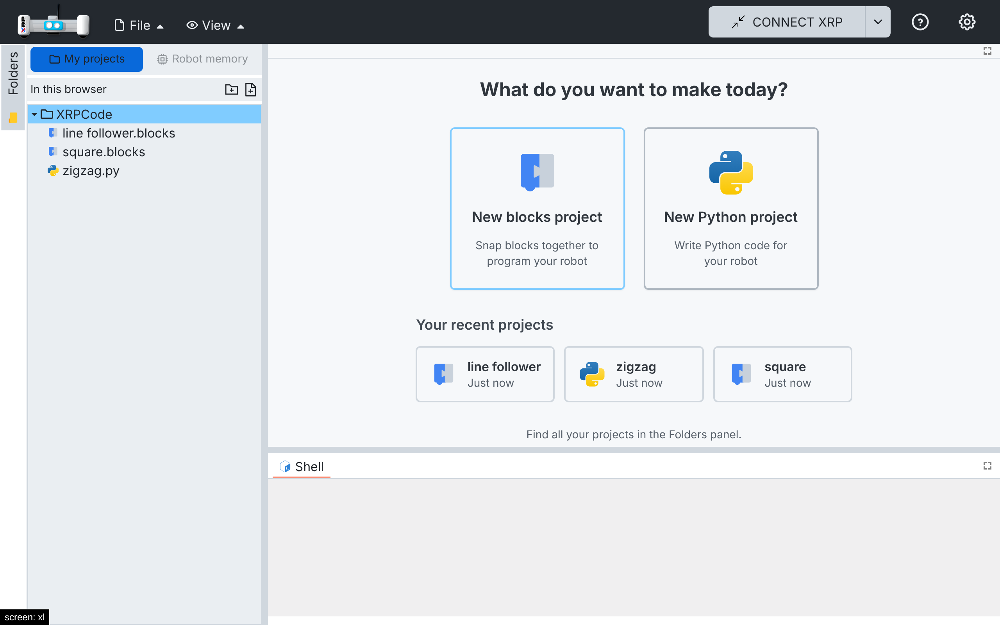
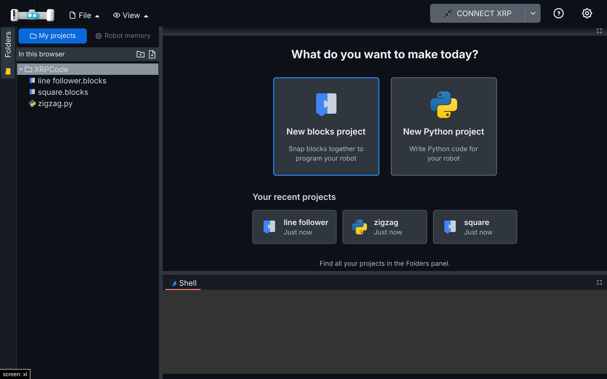

# 013 — Welcome screen

What the editor area shows when no tab is open, in two parts: start a new project, and continue a
recent one.

## Part 1 — New project

### Problem

With no tab open, the editor area was an empty space: nothing invited a child to start. MakeCode,
which children often use alongside other platforms, always offers something to create.

### Solution

- `src/components/welcome/welcome-screen.tsx` (new): shown in the editor area whenever it has no
  tab (flexlayout `onTabSetPlaceHolder` in `xrplayout.tsx`). Two big buttons: **New blocks
  project** and **New Python project**, plus a hint to open a project from the Folders panel.
- Like MakeCode, the child then names the project. No name is suggested, so the child thinks of
  one that is easy to find later; **Create** (or Enter) is enabled once a valid name is typed. Names that already exist or are not valid file names are explained and cannot be
  created; accents are dropped while typing (`línea` becomes `linea`), since robot file names
  allow only plain letters, numbers, spaces, `.`, `-` and `_`. The project is saved right away in
  the top folder of the user's projects (My projects or Google Drive) and opened. No New File
  dialog.
- `src/utils/new-project.ts` (new): accent cleanup, name checks and file data. The folder and the names
  already in it come from the projects service, so it works even while the folder tree shows the
  robot's memory.
- `navbar.tsx`: the New File dialog's create step is shared as `createNewFile`, and the new
  `EVENT_NEW_PROJECT` event (`appmgr.ts`) runs it without the dialog.
- Signed out of Google (no place to save projects), the buttons ask to sign in first.

### Files

- New: `src/components/welcome/welcome-screen.tsx`, `src/utils/new-project.ts`, tests in
  `src/components/welcome/tests/` and `src/utils/tests/new-project.spec.ts`.
- Hooks: `src/components/xrplayout.tsx` (`onTabSetPlaceHolder`), `src/components/navbar.tsx`
  (`createNewFile`, `EVENT_NEW_PROJECT`), `src/managers/appmgr.ts` (`EVENT_NEW_PROJECT`,
  `getFolderData`), `src/utils/i18n/locales/{en,es}/{en,es}.json` (`welcome.*`).

### How to test

1. `npx vitest run src/components/welcome src/utils/tests/new-project.spec.ts`: 5 tests.
2. My projects, no tab open: the welcome screen shows. New blocks project asks for a name (empty,
   Create disabled); type `line follower` and press Enter: `line follower.blocks` opens and
   is in the folder tree. Close it: the welcome screen comes back.
3. Typing the name of an existing project disables Create and says so; Back returns to the two
   buttons.
4. Spanish UI: "¿Qué quieres crear hoy?" and "Ponle nombre a tu proyecto"; typing
   `Seguidor de línea` creates `Seguidor de linea.blocks`.
5. Tablet and phone emulation: the buttons work with a tap and the screen scrolls when it does not
   fit.

| | Light | Dark |
| --- | --- | --- |
| Welcome |  |  |
| Name the project |  |  |

## Part 2 — Recent projects

### Problem

The welcome screen (Part 1) only offered new projects. To continue yesterday's project, a child
had to find it in the Folders panel, among many files and folders.

### Solution

- Below New blocks / New Python, **Your recent projects** shows up to six cards with the newest
  projects (`.blocks` and `.py`, subfolders included, trash left out): the blocks or Python icon,
  the name without its extension and how long ago it was changed ("5 minutes ago", "yesterday",
  "hace 2 días", "Just now"). One tap opens it, like the folder tree (`EVENT_OPEN_FILE`).
- `src/utils/recent-projects.ts` (new): picks the projects from the projects tree
  (`driveService.buildTree`, the same data as the folder tree, for My projects and Google Drive)
  and formats the time with `Intl.RelativeTimeFormat` in the app's language.
- The list loads when the welcome screen shows and again when the user signs in or out. Signed
  out, there is no list. With recent projects, the hint below says that all projects are in the
  Folders panel.
- `src/managers/appmgr.ts`: `removeHandler(event, handler)` removes one handler, so the welcome
  screen unsubscribes when it unmounts without removing other components' handlers (`eventOff`
  removes them all).

### Files

- New: `src/utils/recent-projects.ts`, `src/utils/tests/recent-projects.spec.ts`.
- Changed: `src/components/welcome/welcome-screen.tsx` and its tests, `src/managers/appmgr.ts`
  (`removeHandler`), `src/utils/i18n/locales/{en,es}/{en,es}.json` (`welcome.recentTitle`,
  `welcome.justNow`, `welcome.moreHint`).

### How to test

1. `npx vitest run src/utils/tests/recent-projects.spec.ts src/components/welcome`: 7 tests.
2. My projects: create `square` (blocks), `zigzag` (Python) and `line follower` (blocks) from the
   welcome screen, closing each tab. The welcome screen lists them newest first, "Just now".
3. Tap `zigzag`: `zigzag.py` opens. Close it: the list is back.
4. Spanish UI: "Tus proyectos recientes", "Recién".
5. Phone emulation: the cards stack and open with a tap.

| Light | Dark |
| --- | --- |
|  |  |

## Upstream

Fork-specific (kids UI). `createNewFile` / `EVENT_NEW_PROJECT` and `AppMgr.removeHandler` could
serve XRPWeb too.
