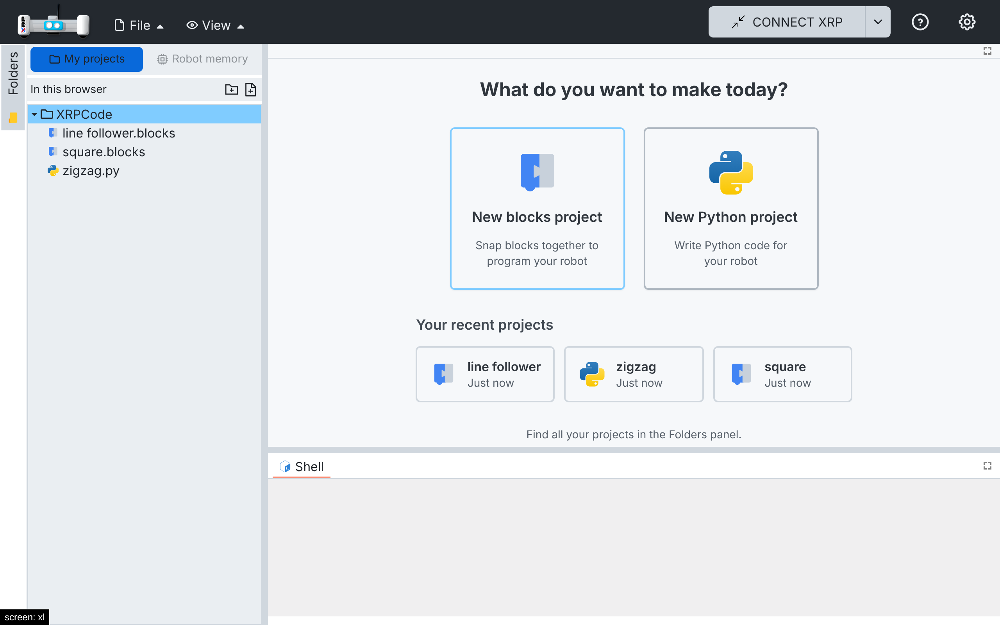
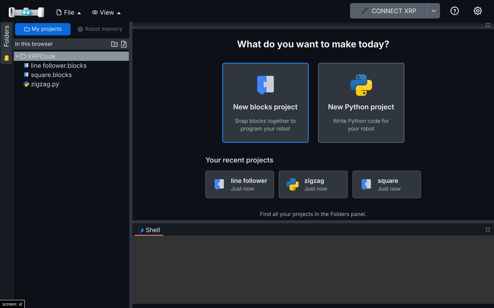

# 015 — Recent projects on the welcome screen

## Problem

The welcome screen (spec 013) only offered new projects. To continue yesterday's project, a child
had to find it in the Folders panel, among many files and folders.

## Solution

- Below New blocks / New Python, **Your recent projects** shows up to six cards with the newest
  projects (`.blocks` and `.py`, subfolders included, trash left out): the blocks or Python icon,
  the name without its extension and how long ago it was changed ("5 minutes ago", "yesterday",
  "hace 2 días", "Just now"). One tap opens it, like the folder tree (`EVENT_OPEN_FILE`).
- `src/utils/recent-projects.ts` (new): picks the projects from the projects tree
  (`driveService.buildTree`, the same data as the folder tree, for My projects and Google Drive)
  and formats the time with `Intl.RelativeTimeFormat` in the app's language.
- The list loads when the welcome screen shows and again when the user signs in or out. Signed
  out, there is no list. With recent projects, the hint below says that all projects are in the
  Folders panel.
- `src/managers/appmgr.ts`: `removeHandler(event, handler)` removes one handler, so the welcome
  screen unsubscribes when it unmounts without removing other components' handlers (`eventOff`
  removes them all).

## Files

- New: `src/utils/recent-projects.ts`, `src/utils/tests/recent-projects.spec.ts`.
- Changed: `src/components/welcome/welcome-screen.tsx` and its tests, `src/managers/appmgr.ts`
  (`removeHandler`), `src/utils/i18n/locales/{en,es}/{en,es}.json` (`welcome.recentTitle`,
  `welcome.justNow`, `welcome.moreHint`).

## How to test

1. `npx vitest run src/utils/tests/recent-projects.spec.ts src/components/welcome`: 7 tests.
2. My projects: create `square` (blocks), `zigzag` (Python) and `line follower` (blocks) from the
   welcome screen, closing each tab. The welcome screen lists them newest first, "Just now".
3. Tap `zigzag`: `zigzag.py` opens. Close it: the list is back.
4. Spanish UI: "Tus proyectos recientes", "Recién".
5. Phone emulation: the cards stack and open with a tap.

| Light | Dark |
| --- | --- |
|  |  |

## Upstream

Fork-specific (kids UI). `removeHandler` could serve XRPWeb too.
