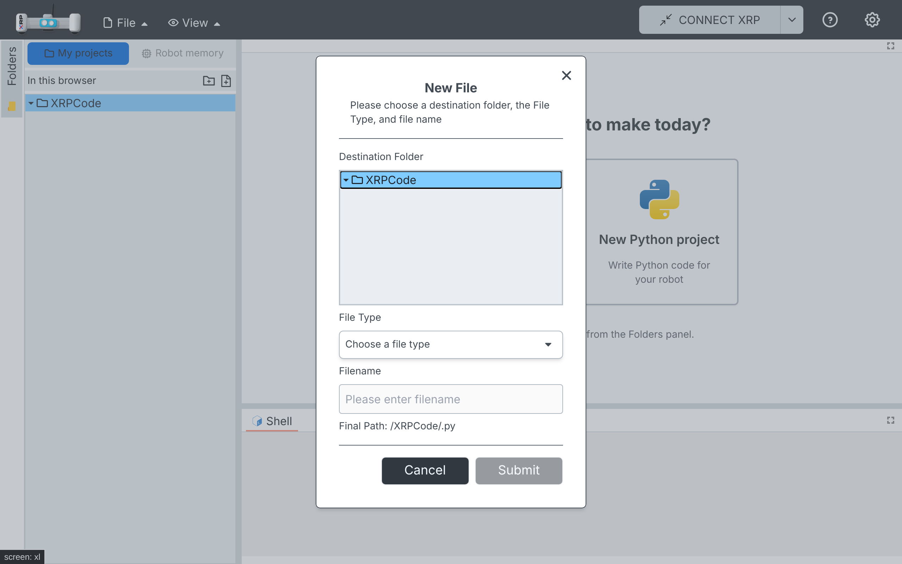
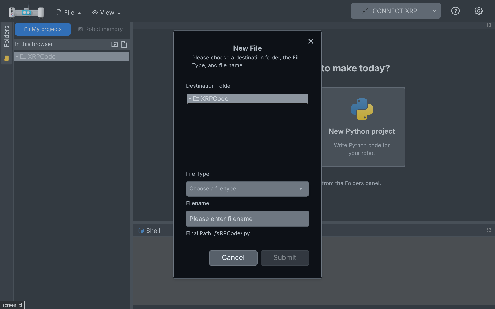

# 017 — Close button on modals

## Problem

Most modals could only be closed with their Cancel button or the Escape key. Children on tablets
expect an X in the corner, and they have no Escape key. Escape also closed the native `<dialog>`
without running the dialog's Cancel action, so state such as "Running" could stay stuck (for
example in the power switch and battery dialogs).

## Solution

- `src/components/dialogs/dialog-close.ts` (new): a context and the `useDialogClose(action)` hook.
  Dialog content registers what closing means for it: a function, `'host'` for the host's plain
  close (`toggleDialog` of `<Dialog>`), or nothing for "cannot be closed".
- `src/components/dialogs/dialog.tsx`: shows an X (40 px, top right, "Close" label through i18n)
  while a close action is registered, and runs the same action on Escape. Busy and progress
  dialogs register nothing, so they have no X and Escape works as before.
- `src/components/dialogs/dialog-footer.tsx`: registers its Cancel action automatically, so the
  16 dialogs that use it get the X with no change. For dialogs without Cancel (alert, login,
  copy files) the X closes them like their only button, and it is hidden while that button is
  disabled (copying files). New optional `closeCallback` prop to override this.
- Dialogs without the footer register their close: backup/restore menu, backup and restore
  (hidden while running), firmware backup prompt, and connections (host close).
  `ble-reconnect-faileddlg.tsx` uses the host close, because its second button is an action
  ("USB connection"), not Cancel.
- Dialogs that already had their own X (language, theme, change log, firmware loader, view
  Python) are unchanged.

## Screenshots

| Light | Dark |
| --- | --- |
|  |  |

## Files

- New: `src/components/dialogs/dialog-close.ts`, `src/components/tests/dialog-close.spec.tsx`.
- Changed: `dialog.tsx`, `dialog-footer.tsx`, `ble-reconnect-faileddlg.tsx`,
  `backup-restoredlg.tsx`, `backupdlg.tsx`, `restoredlg.tsx`, `firmware-backup-promptdlg.tsx`,
  `connectiondlg.tsx` (one line each, plus the import).

## How to test

1. File > New File: the X closes it; open again and press Escape: it closes; it opens again.
2. Connect XRP: the connections dialog has an X that closes it.
4. Language and theme dialogs show a single X (their own).
5. With a robot: Run with the power switch off, close the warning with the X: Run is available
   again (same as Cancel).

## Upstream

Possible: it changes the shared XRPWeb dialog and footer with small hooks, and the behaviour is
the same as each dialog's Cancel.
