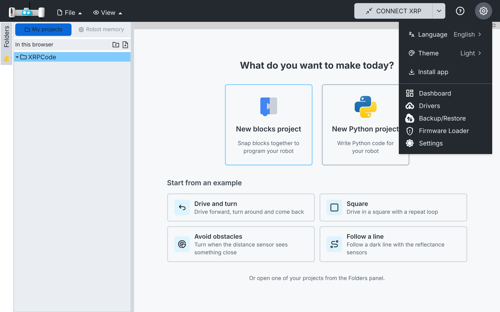
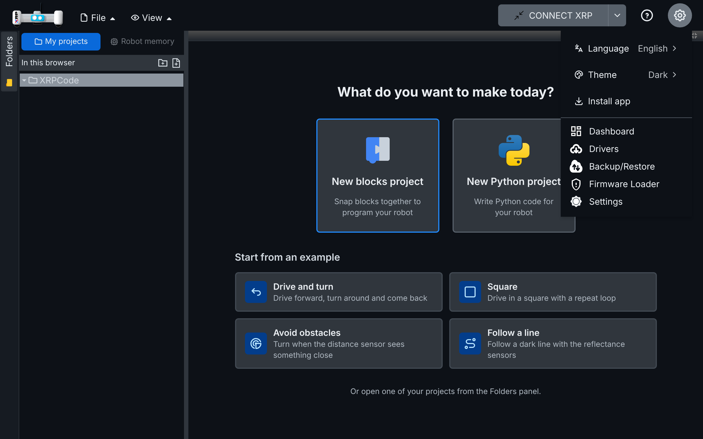
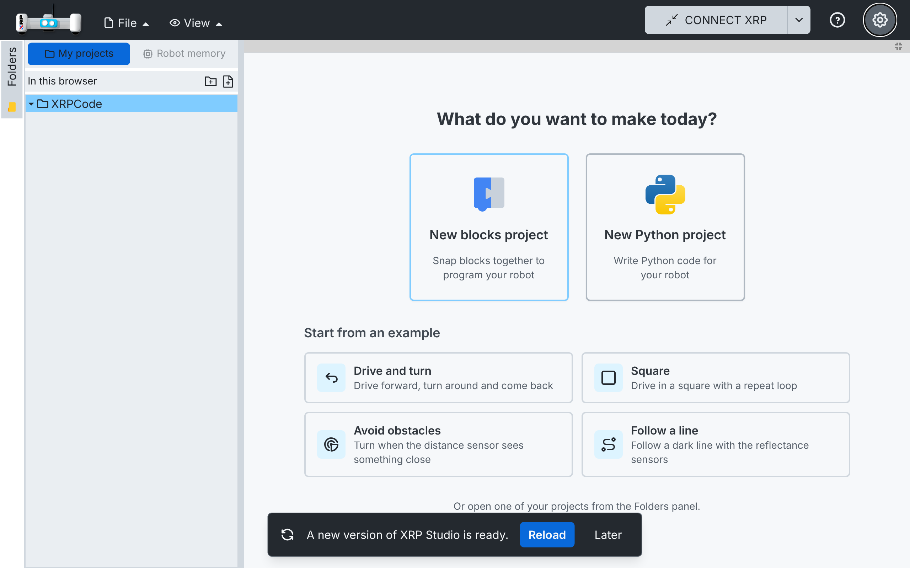
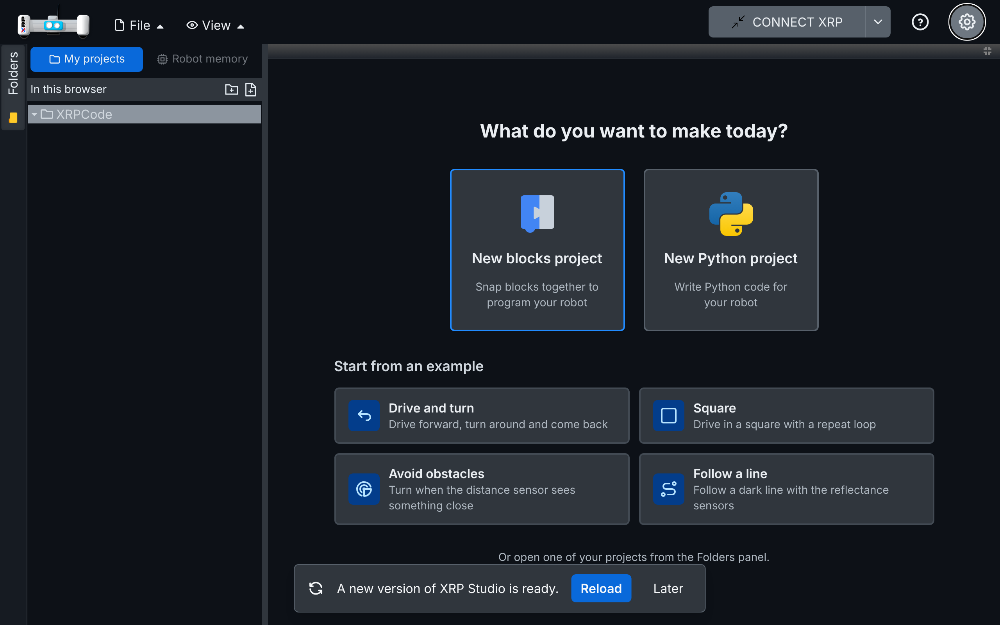

# 018 — Installable app that works offline

## Problem

Schools often lose internet in the middle of a class. The offline build (spec 001) needs someone
to serve it on the local network over `http://`, where Web Serial and Web Bluetooth do not work
(they need a secure context). The hosted app (https://xrp-studio.vercel.app) is HTTPS but did not
open without internet.

## Solution

### Part 1 — Cache the whole app

- `pwa-plugin.ts` (new, repo root) configures `vite-plugin-pwa` (Workbox `generateSW`), added to
  `vite.config.ts` with one line.
- The service worker precaches the whole build in the background on the first visit (about 34 MB:
  the app, Monaco and Pyright, Blockly media, firmware, drivers and the MicroPython libraries).
  Source maps and SCSS are left out. The largest file is under the 20 MB limit.
- Page navigations fall back to `index.html`, except `/api/` (Google sign-in server).
- Old caches are removed after an update.
- The first visit is not controlled by the service worker. After the precache finishes, any later
  visit opens without internet.

### Part 2 — Update notice

- The service worker is registered with `registerType: 'prompt'`: a new version waits and never
  reloads the page on its own, so a child does not lose work.
- `src/utils/pwa.ts` (new) registers it from `main.tsx` (`startPwa()`), checks for an update every
  hour, and keeps a small state (`needRefresh`, `canInstall`) read with `usePwaState()`.
- `src/components/update-notice.tsx` (new), rendered in `App.tsx`, shows "A new version of XRP
  Studio is ready." with **Reload** and **Later**.

### Part 3 — Install the app

- Manifest: name "XRP Studio", standalone, theme colour `#24292f`, icons in `public/icons/`
  (192, 512, maskable 512 and the Apple touch icon). `index.html` links the Apple icon and the
  theme colour.
- **Install app** appears in the ⚙ menu (`src/components/navbar/quick-settings.tsx`) only while
  the browser offers it (`beforeinstallprompt`), and goes away once installed.

### Part 4 — Fix: Reload did nothing

- **Problem:** clicking **Reload** left the old version on screen. The plugin's update function
  asks the waiting version to take over and then waits for a signal that never comes when the app
  was opened before its offline copy was ready (first visit, or an installed app opened right
  away), or when the update was found by the hourly check.
- **Solution:** `applyUpdate()` in `src/utils/pwa.ts` does the update itself. It saves the open
  files first (autosave, spec 019), asks the waiting version to take over, and reloads the page
  once, as soon as the new version controls the page or becomes active. If no version is waiting
  (it is already active), it reloads right away.

## Files

- New: `pwa-plugin.ts`, `src/utils/pwa.ts`, `src/components/update-notice.tsx`,
  `public/icons/*.png`, tests in `src/utils/tests/pwa.spec.ts` with the stub
  `src/utils/tests/stubs/pwa-register.ts`.
- Changed: `vite.config.ts`, `vitest.config.ts` (stub alias), `tsconfig.node.json`,
  `src/vite-env.d.ts`, `src/main.tsx`, `src/App.tsx`, `src/components/navbar/quick-settings.tsx`,
  `index.html`, `src/utils/i18n/locales/{en,es}/{en,es}.json` (`pwa`), `package.json` and
  `package-lock.json` (dev dependency `vite-plugin-pwa`).

## How to test

1. Open a production build in Chrome. DevTools > Application > Service workers: activated; Cache storage holds about 230 entries.
2. DevTools > Network > Offline, reload: the app opens. Open an example (blocks) and a new Python
   project: both work.
3. Install: the ⚙ menu shows **Install app** (Chrome on a computer or Android); installing opens
   the app in its own window and the row goes away.
4. Update: publish a new build and reload the app once; the notice appears. **Later**
   hides it; **Reload** saves the open files and loads the new version.
5. Reload on a first visit: in a new browser profile, open the app once and wait until the
   offline copy is ready, publish a new build, then use DevTools > Application > Service workers
   > Update. The notice appears; **Reload** loads the new version.
6. On a build served over HTTPS, repeat 2 and 3 on an Android tablet.

## Upstream

Possible: the plugin config and the notice are independent of the fork's UI; the install row would
go in XRPWeb's settings dialog instead.
