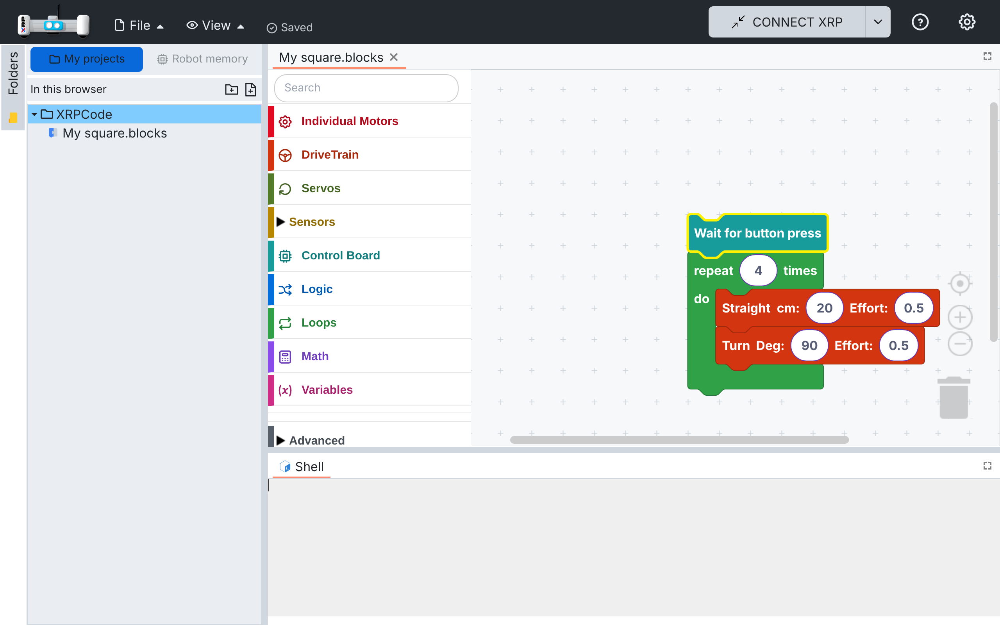
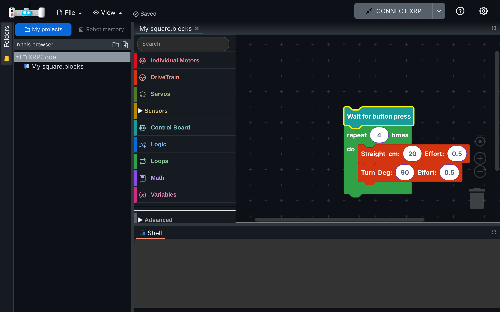

# 019 — Automatic save

## Problem

Saving was manual (File > Save or Ctrl+S). Each save showed a blocking "Saving to XRP" dialog:
with a robot connected it wrote the file to the robot over USB or Bluetooth, which takes a few
seconds, and with Google Drive it also uploaded the file. Children forget to save, and the wait
interrupts them. Apps like MakeCode save on their own.

## Solution

Files in My projects or Google Drive (files with a Drive id, while that session is active) save
themselves. Files opened from Robot memory keep the manual save to the robot.

- **`src/utils/autosave.ts` (new).**
  - Every change in the block or Python editor schedules a save 1.5 s after the last change, so
    quick edits make one write.
  - The write uses the same `driveService.upsertFileToGoogleDrive` call as the Save menu, without
    a dialog.
  - Only one write per file runs at a time. A change made during a write is written right after
    it.
  - A failed write (for example Google Drive without internet) keeps the change. It is tried
    again when the network comes back, on the next change, or after 15 s. The change is also in
    the browser's copy of open tabs, which already survived a reload.
  - Waiting changes are written at once when the page is hidden or closed, on Save, on Run and
    when a tab closes.
- **Save no longer writes to the robot.** Run already copies the program to the robot before
  running it (`saveAllFilesInGoogleDriveToXRP` and the active file). Save and Ctrl+S still work:
  they write at once.
- **Indicator** `src/components/navbar/save-status.tsx` (new), next to the File and View menus:
  "Saving…", "Saved", or "Couldn't save" with a tooltip saying the changes are kept and will be
  saved again. It is hidden until the first change.
- **No unsaved-tab prompt for these files.** Closing a tab writes its last change. The changed
  dot on the tab goes away once the file is saved (`EditorMgr.markSessionSaved`).

Hooks in upstream files:
- `blockly.tsx` and `MonacoEditor.tsx`: one `scheduleAutosave(tabId)` call in their change
  listeners.
- `editormgr.ts`: the autosave branch in `saveEditor`, plus `markSessionSaved`.
- `xrplayout.tsx`: closing a tab.
- `navbar.tsx`: Run and the indicator.
- `main.tsx`: `startAutosave()`.

## Fix: Google Drive saves

- **Problem:** with Google sign-in, two things made autosave unreliable:
  - When Drive refused a write, the indicator still said "Saved", because the Drive upload
    reports a failure by returning nothing instead of an error.
  - The app gets a new Google access token every hour, but the Drive service kept the one from
    sign-in, so every save failed after about an hour.
- **Solution:**
  - Autosave treats an empty answer from the upload as a failure: the change is kept, the
    indicator shows "Couldn't save", and it tries again later.
  - The sign-in service hands each new access token to the Drive service
    (`onAccessToken` in `src/services/google-auth.ts`, set in `src/widgets/login.tsx`).

## Files

- New: `src/utils/autosave.ts`, `src/components/navbar/save-status.tsx`, tests in
  `src/utils/tests/autosave.spec.ts`.
- Changed: `src/managers/editormgr.ts`, `src/components/blockly.tsx`,
  `src/components/MonacoEditor.tsx`, `src/components/xrplayout.tsx`, `src/components/navbar.tsx`,
  `src/main.tsx`, `src/utils/i18n/locales/{en,es}/{en,es}.json` (`autosave`).
- Drive fix: `src/utils/autosave.ts`, `src/services/google-auth.ts`, `src/widgets/login.tsx`, tests
  in `src/utils/tests/autosave.spec.ts` and `src/services/tests/google-auth.spec.ts`.

## How to test

1. In a build with My projects, create a Python project and type: "Saving…" then "Saved" appears
   next to View, with no dialog. Close the tab right after typing: no prompt. Reload and open the
   file: the last change is there.
2. Open the Square example and move a block: same as step 1.
3. In a build with Google sign-in, signed in: edit, wait for "Saved", and check the file in Drive.
   Go offline and edit: "Couldn't save". Back online: "Saved".
4. Same build, signed in: leave the app open for more than an hour, then edit. "Saved" appears and
   the change is in Drive.
5. Same build: remove the app's access in your Google account settings and edit. The indicator
   shows "Couldn't save", not "Saved".
6. With a robot: Run a My projects or Drive file after editing; the robot runs the latest
   version. Files from Robot memory: Save still writes to the robot. **Pending: needs a robot.**

## Upstream

Possible behind a setting. It changes XRPWeb's save model (Save wrote to the robot), so it would
need their agreement.
