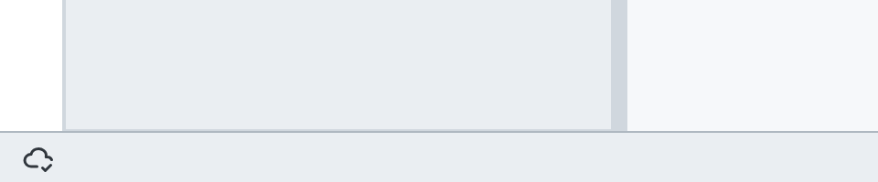
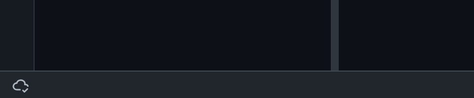
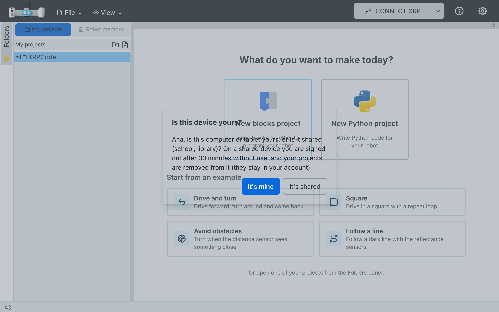
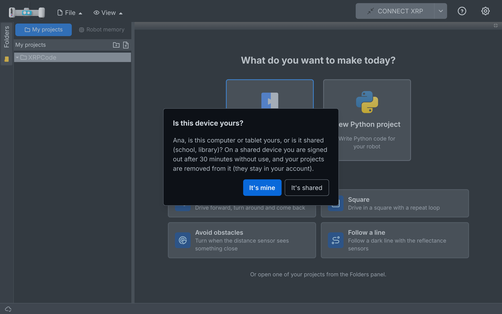

# 020 — Projects in the browser, synced with your account

## Problem

- Builds with Google sign-in behaved like XRPWeb: without signing in there was nowhere to keep
  projects, and once signed in every open, save and list went to Google Drive over the network.
  Without internet, or with a slow one, children could not work.
- The UI talked about "Google Drive file system", which means nothing to a child.
- Shared computers (schools, libraries) need projects to leave the device when the child leaves.

## Solution

Projects always live in the browser (My projects, spec 007). Signing in with Google only adds a
copy in the account: the `XRPCode` folder of its Drive. Drive is the backend; the UI never names
it. Two parts:

- **(a) This change:** every build opens into My projects, accounts on a device, sync on
  sign-in and on every change, status bar.
- **(b) Later:** bring in changes from other devices while signed in, and name the device in
  conflict copies (see the backlog).

### Part (a): accounts on a device

- Every build opens straight into My projects, without signing in. Without an account the user
  sees the device's guest projects.
- Each account has its own space on the device, so two children on one computer do not see each
  other's projects.
- The first time an account signs in on a device the app asks **"Is this device yours?"**:
  - **It's mine:** the session is remembered and the projects stay on the device.
  - **It's shared:** the session is not remembered, the account signs out after 30 minutes
    without use, and its projects are removed from the device when the session ends. If the app
    was closed without signing out, they are removed the next time it opens, before any tab is
    shown.
- If the device has guest projects, the first sign-in offers **"Move them to your account?"**.
- **Signing out** first uploads what is left. If that is not possible (no internet), the app warns
  that those changes would be lost and lets the user stay signed in. Then the account's projects
  are removed from the device; they come back at the next sign-in.
- The account's name and photo show in the bar, as before.

### Part (a): sync

- Every change (new file or folder, edit, rename, move, delete) is uploaded 2 s after the last
  one. Folders go before their files.
- Deleted files go to the account's trash, where they stay 30 days.
- At sign-in, when the network comes back, and when a sync failed (tried again after 30 s), the
  app also brings in what changed in the account: new, changed and deleted files.
- **Same file changed here and in the account:** both are kept. The account's version keeps the
  name; this device's version becomes a copy, for example `square (this device).py`.
- Without internet nothing is lost: changes stay on the device and are uploaded later.

### Part (a): status bar

A thin bar at the bottom of the screen, like MakeCode's. Its first element is a cloud:

| Icon | Meaning (tooltip) |
| --- | --- |
| Cloud with a check | Saved in your account |
| Spinner | Saving to your account… |
| Crossed cloud | No connection: changes are kept on this device |
| Laptop | Saved on this device only (no account signed in) |

### Part (a): wording

- The project header says "My projects" instead of "Google Drive file system".
- Since My projects is always on, the Drive wording elsewhere uses the My projects texts, and
  the Drive logo on the folder tab is not shown.

### Hooks in upstream files

- `offline.ts`: `isLocalProjectsEnabled` is always true; new `isDriveSyncEnabled` (builds with a
  Google auth backend that are not offline builds).
- `appmgr.ts`: a second Drive service used only by sign-in and sync.
- `login.tsx`: with sync, signing in keeps My projects open and starts the account; signing out
  goes through the account (and can be cancelled); idle sign-out on shared devices.
- `session.ts`, `local-projects.ts`: open the account's space on sign-in and the guest space on
  sign-out.
- `google-auth.ts`: an offline restore keeps the remembered session.
- `main.tsx`: clear a shared session left open; `App.tsx`: status bar and question dialog.

## Files

- New: `src/services/drive-api.ts` (Drive requests), `src/services/drive-sync.ts` (push and
  pull), `src/utils/accounts.ts` (accounts on a device), `src/utils/ask.ts` and
  `src/components/ask-dialog.tsx` (questions), `src/components/status-bar.tsx`.
- Changed: `src/services/local-drive.ts` (one store per account, sync fields, deleted files kept
  until uploaded), `src/utils/offline.ts`, `src/managers/appmgr.ts`, `src/widgets/login.tsx`,
  `src/utils/session.ts`, `src/utils/local-projects.ts`, `src/services/google-auth.ts`,
  `src/utils/localstorage.ts`, `src/main.tsx`, `src/App.tsx`,
  `src/utils/i18n/locales/{en,es}/{en,es,local-projects}.json` (`account`, `sync`, `statusBar`).
- Tests: `src/services/tests/drive-sync.spec.ts`, `src/services/tests/drive-api.spec.ts`,
  `src/services/tests/local-drive.spec.ts`, `src/utils/tests/accounts.spec.ts`,
  `src/components/tests/ask-dialog.spec.tsx`, `src/components/tests/status-bar.spec.tsx`.

## How to test

1. Open the app without signing in: My projects opens, the bar shows the laptop. Create a project.
2. Sign in with Google: "Is this device yours?" → It's mine. "Move them to your account?" → Move.
   The cloud spins, then shows a check. The project is in the `XRPCode` folder of the account's
   Drive.
3. Edit, rename, move and delete files: each change reaches Drive a few seconds later; deleted
   files are in the Drive trash.
4. Go offline and edit: crossed cloud. Back online: spinner, then check.
5. Change a file in Drive (another device, or upload a new version), sign out and in again: the new
   version is in the app. Change the same file here while offline and in Drive, then go online:
   both versions are there, this device's one named "… (this device)".
6. Sign out: the account's projects leave the device and the guest projects show. Sign in again:
   they come back without the device question.
7. On another browser profile, sign in and choose It's shared: reload the page; the session is
   gone and so are its projects and tabs. Sign in again as shared and leave it unused for 30
   minutes: it signs out.
8. Offline build: no sign-in, the bar shows the laptop, everything else as in spec 007.

## Upstream

Fork-only for now: it changes XRPWeb's storage model (Drive first). The Drive request layer and
the sync engine could be offered later behind a setting.
