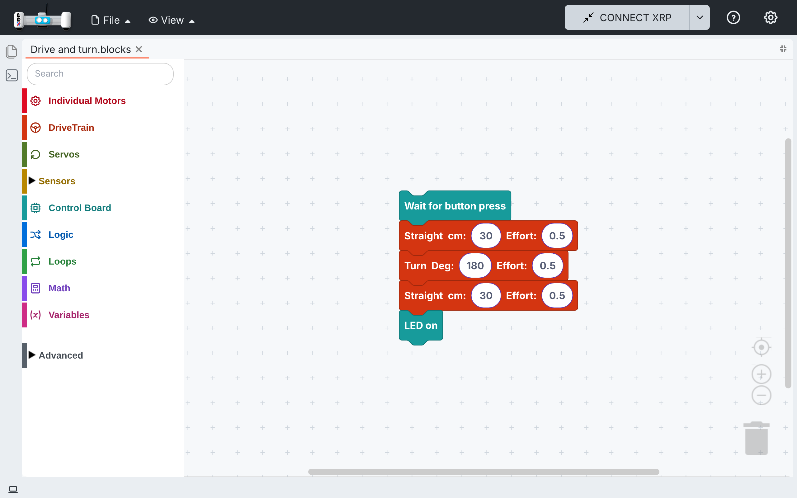
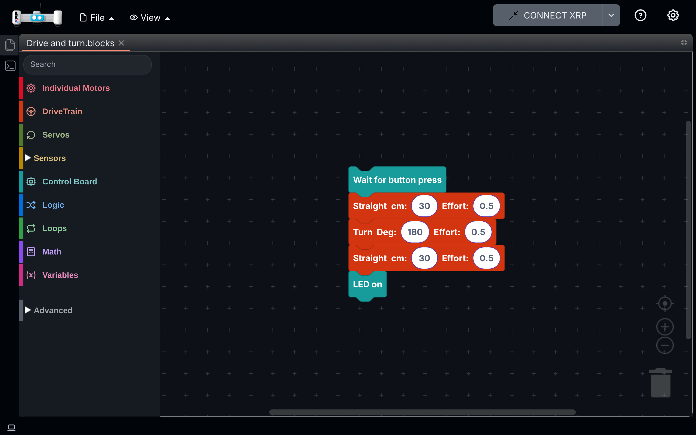
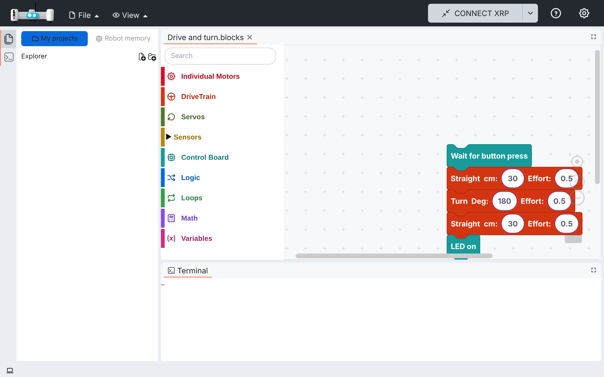
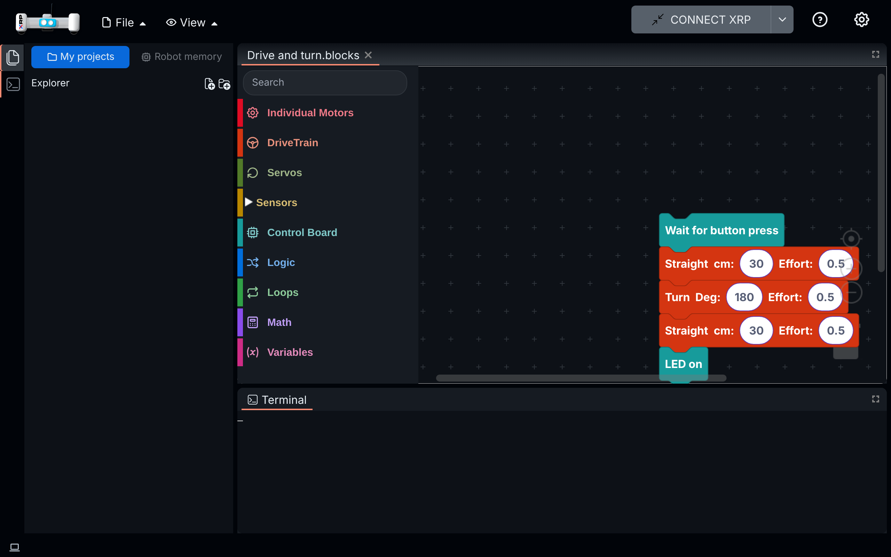

# 021 — Layout

The living spec for the layout of the main screen: the side bar, the editor area and the
terminal. Each layout change adds a part here instead of a spec of its own.

Earlier layout changes, kept in their own specs:

- [006 — Top bar](006-navbar.md): the bar with File, View, Connect and settings.
- [013 — Welcome screen, part 4](013-welcome-screen.md#part-4--shell-only-with-a-project-open): the
  shell only showed while a project was open; Part 2 below replaces that rule.

## Part 1 — Explorer icon in a side bar, collapsed by default

### Problem

The left edge showed a vertical "Folders" text tab, and the folder panel opened expanded at
every start (300 px), taking room from the block canvas even when the child already had a
project open.

### Solution

- The tab is now an icon (two files), like the activity bar of a code editor. Its tooltip and
  accessible name are "Explorer" ("Explorador" in Spanish).
- The panel starts closed. A click on the icon opens it, another click closes it.
- The open panel is marked with the accent line on the icon's outer edge.
- The panel's header reads "Explorer" ("Explorador") instead of "My projects", and its new file
  and new folder buttons use clearer icons (a page and a folder, each with a plus), new file
  first.

## Part 2 — Terminal icon, off by default

### Problem

With a project open, the terminal (Shell) took a third of the editor area. Children only need
it to see what the program prints or to debug.

### Solution

- A Terminal icon sits below the Explorer icon. A click shows the terminal under the editor,
  another click hides it. It is highlighted while the terminal shows.
- The terminal is off the first time. The choice is remembered on the device.
- The Terminal icon works the same on the welcome screen, with no project open.
- Hiding the terminal does not close it: what the program printed is still there when it is
  shown again.
- Its tab is named "Terminal" instead of "Shell", the more common word, and shows the same icon
  as the side bar so the two are associated.

## Part 3 — Rounded panels, one colour each

### Problem

The panels were squares pressed against each other, split by grey lines, and each one mixed
several background colours: the tab bar, the folder rows, the terminal and the toolbox lines
all differed. The screen looked busy.

### Solution

- The side panel, the editor and the terminal are rounded cards on a frame colour, with a small
  gap between them, like a modern code editor.
- The frame colour is shared by the side bar, the status bar and, in dark mode, the top bar.
- Each card has one colour, and the tab bar is a slightly different tone so tabs stand out from
  the content. The panel corners are rounded all around, also at the bottom. The folder rows and
  the terminal match the card. There
  are no lines between the tab bar and the content, under the status bar, between toolbox rows
  or around the side panel's rows.

## Files

- `src/components/xrplayout.tsx`: the side bar starts collapsed; the folder tab renders the
  Explorer icon; the Terminal toggle is added to the side bar.
- `src/components/side-bar-icon.tsx` (new): a side bar icon, as a tab or as a toggle button.
- `src/utils/shell-visibility.ts`: the shell shows with a project open and the terminal on;
  `toggleTerminal` and the remembered choice.
- `src/utils/localstorage.ts`: `Terminal` key.
- `src/theme/github/app.css`: side bar icon buttons; the frame colour, gaps, rounded cards and
  one colour per card.
- `src/components/folder-header.tsx`: new file and new folder icons.
- `src/components/xrpshell.tsx`: the terminal uses the card colour.
- `src/components/status-bar.tsx`, `src/App.tsx`: the status bar (and the dark top bar) use the
  frame colour; no line above the status bar.
- `src/components/blockly/toolbox-ui.css`: no lines between toolbox rows or at separators.
- `src/utils/i18n/locales/{en,es}/*.json`: `explorer`, `terminal`; the Shell tab is "Terminal";
  the panel header is "Explorer" ("Explorador").
- Tests: `src/utils/tests/shell-visibility.spec.ts`,
  `src/components/tests/side-bar-icon.spec.tsx`.

## How to test

1. Open the app: the side bar shows two icons and no "Folders" text; the folder panel and the
   terminal are hidden.
2. Hover each icon: "Explorer" and "Terminal". In Spanish: "Explorador" and "Terminal".
3. Click Explorer: the projects panel opens. Click again: it closes.
4. On the welcome screen and with a project open, click Terminal: it shows under the editor.
   Click again: it hides. The tab shows the same icon as the side bar.
5. Turn the terminal on and reload: it is still on.
6. In light and dark: the side panel, editor and terminal are rounded cards with a gap between
   them; no grey lines between panels, under the tab bar, between toolbox rows or above the
   status bar; the terminal and the folder rows have the same colour as their card.

### Screenshots

Collapsed side bar with a project open (the editor fills the frame):

Explorer and terminal open:

## Upstream

Fork-specific (kids UI). XRPWeb could take the Explorer icon on its own; hiding the terminal by
default suits a kids' editor more than XRPWeb's.

- The toolbox search box can be clicked and typed in, has a flat focus outline and no gradient in
  dark mode. Dialogs opened from the side panel keep their own colours.
